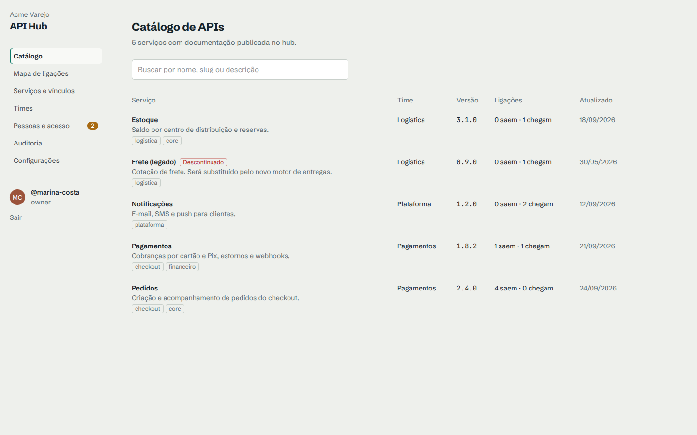

<p align="center">
  
</p>

<h1 align="center">Rizoma</h1>

<p align="center">
  <strong>O catálogo fechado das APIs da sua empresa.</strong><br>
  A documentação OpenAPI de todos os serviços num lugar só, por ambiente, com login da empresa,<br>
  times, integrações, segredos e o mapa de quem depende de quem. Código aberto, gratuito e auto-hospedado.
</p>

<p align="center">
  <a href="https://github.com/wendersonbelko/rizoma/actions/workflows/ci.yml"></a>
  <a href="https://wendersonbelko.github.io/rizoma/"></a>
  <a href="https://wendersonbelko.github.io/rizoma/contribuindo/"></a>
</p>

<p align="center">
  <a href="https://wendersonbelko.github.io/rizoma/"><b>Documentação</b></a> ·
  <a href="https://wendersonbelko.github.io/rizoma/guia/inicio-rapido">Início rápido</a> ·
  <a href="https://wendersonbelko.github.io/rizoma/receitas/">Passo a passo</a> ·
  <a href="https://wendersonbelko.github.io/rizoma/arquitetura/visao-geral">Como foi pensado</a> ·
  <a href="https://wendersonbelko.github.io/rizoma/contribuindo/">Contribuir</a>
</p>



## Por que existe

Muitos times expõem o Swagger de cada serviço em `/docs`. Isso tem dois custos: alguém precisa apresentar serviço por serviço a cada pessoa nova, e contratos internos ficam públicos na internet. O Rizoma junta tudo num único lugar **fechado**, onde quem é da empresa encontra todas as APIs, entende quem é dono de cada uma e como elas se ligam.

## O que ele faz

- **Catálogo de APIs**: Swagger 2.0, OpenAPI 3.0 e 3.1 renderizados, com busca, tags, time responsável e histórico de versões.
- **Um contrato por ambiente**: dev, homologação, produção (ou os nomes que fizerem sentido), resolvidos pela branch.
- **Publicação automática**: um passo no CI (`POST /api/v1/specs`). A spec também pode vir de um arquivo no repositório (GitHub, GitLab, Bitbucket), de uma URL interna ou de importação manual.
- **Login da empresa**: GitHub, Google, Microsoft, GitLab, Facebook, OIDC (Keycloak, Okta, Auth0…) e e-mail e senha. Quem comprova vínculo entra direto; o resto pede acesso, com aprovação e prazo opcional.
- **Mapa de ligações**: serviços, integrações externas, repositórios e times num grafo interativo, e também em tabela navegável por teclado.
- **Integrações externas**: APIs de terceiros, filas, tópicos, webhooks e bancos, cada um com endereço por ambiente.
- **Variáveis de ambiente**: por serviço e ambiente, com segredos cifrados (AES-256-GCM), download de `.env` e cópia entre ambientes.
- **Regras de negócio**: páginas em Markdown por serviço, escritas pelo time.
- **Papéis e permissões**: OWNER, ADMIN, MAINTAINER e VIEWER, com matriz de permissões editável.
- **Auditoria**: toda ação administrativa registrada, com filtros e exportação em CSV.
- **Instalação guiada**: um assistente de 9 etapas configura tudo pela tela, sem editar o banco. Um tour guiado apresenta o sistema a cada pessoa no primeiro acesso.

Veja a lista completa em [Tudo o que o sistema faz](https://wendersonbelko.github.io/rizoma/guia/funcionalidades).

## Início rápido

**Avaliar com Docker** (Docker e Node 22+):

```bash
git clone https://github.com/wendersonbelko/rizoma.git && cd rizoma
cp .env.example .env
node scripts/generate-keys.mjs      # cole ENCRYPTION_KEY e AUTH_SECRET no .env
docker compose --profile app up -d --build
```

Abra http://localhost:3000 e siga o assistente de instalação.

**Desenvolver** (Node 22+, pnpm 10, Docker):

```bash
pnpm install
cp .env.example .env && pnpm setup:keys   # cole as chaves no .env
cp .env apps/web/.env && cp .env packages/db/.env
pnpm db:up && pnpm db:deploy
pnpm dev
```

Quer ver o hub populado? Depois de concluir a instalação: `pnpm demo:seed --me seu-usuario-ou-email`.

Guias completos: [instalação](https://wendersonbelko.github.io/rizoma/instalacao/), [produção com Docker](https://wendersonbelko.github.io/rizoma/instalacao/docker), [HTTPS com proxy reverso](https://wendersonbelko.github.io/rizoma/instalacao/proxy-https) e [provedores de login](https://wendersonbelko.github.io/rizoma/instalacao/provedores-de-login).

## Publicar a spec pelo CI

```yaml
- name: Publicar spec no Rizoma
  run: |
    curl --fail-with-body -sS -X POST \
      "https://apihub.suaempresa.com/api/v1/specs?commitSha=${GITHUB_SHA}&branch=${GITHUB_REF_NAME}" \
      -H "Authorization: Bearer ${{ secrets.API_HUB_TOKEN }}" \
      -H "Content-Type: application/yaml" \
      --data-binary @openapi.yaml
```

Mais exemplos (GitLab CI, Bitbucket, Azure DevOps, Jenkins) em [Passo a passo](https://wendersonbelko.github.io/rizoma/receitas/).

## Tecnologias

Next.js 16 (App Router) · React 19 · TypeScript · Auth.js v5 · Prisma 6 + PostgreSQL 16 · Tailwind CSS 4 · Zod 4 · Scalar · React Flow + dagre · driver.js · Vitest · Turborepo + pnpm · VitePress (documentação).

| Pasta | Conteúdo |
|---|---|
| `apps/web` | Next.js: telas, rotas de API, assistente de instalação e backoffice |
| `packages/core` | Regras de negócio puras e testadas (permissões, acesso, specs, ambientes, paginação…) |
| `packages/db` | Schema Prisma, migrações, client e scripts administrativos |
| `docs` | Este site de documentação (VitePress, publicado no GitHub Pages) |

Detalhes em [Arquitetura](https://wendersonbelko.github.io/rizoma/arquitetura/visao-geral).

## Comandos

| Comando | O que faz |
|---|---|
| `pnpm dev` | Sobe o app em modo desenvolvimento |
| `pnpm test` | Testes unitários (regras de negócio e guardas da interface) |
| `pnpm test:integration` | Testes de integração contra PostgreSQL (`TEST_DATABASE_URL`; o banco é truncado) |
| `pnpm typecheck` | Checagem de tipos em todo o monorepo |
| `pnpm db:migrate` / `pnpm db:deploy` | Cria/aplica migrações (desenvolvimento / produção) |
| `pnpm admin:recover --login x` | Recupera o acesso de OWNER (roda no servidor, pede confirmação) |
| `pnpm demo:seed --me x` | Popula um hub de teste com dados de demonstração |
| `pnpm docs:dev` | Sobe esta documentação localmente |

Referência completa em [Comandos (CLI)](https://wendersonbelko.github.io/rizoma/referencia/cli).

## Contribuindo

Contribuições são muito bem-vindas: correções, funcionalidades, documentação e revisão. Comece por [Como contribuir](https://wendersonbelko.github.io/rizoma/contribuindo/) e pelo [CONTRIBUTING.md](CONTRIBUTING.md). Ao participar, siga o [código de conduta](CODE_OF_CONDUCT.md).

Encontrou uma vulnerabilidade? Não abra issue pública: veja [SECURITY.md](SECURITY.md).

## Licença

Projeto de código aberto e gratuito. Veja o arquivo [LICENSE](LICENSE).

Desenvolvido por [Belko](https://belko.com.br) e colaboradores.
