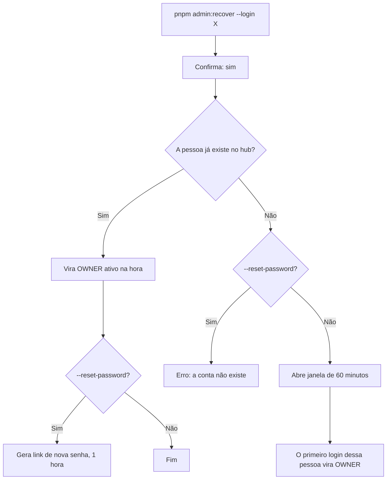

# Recuperação de OWNER

Se todos os OWNERs do Rizoma perderem o acesso, quem administra o servidor pode devolver o papel de OWNER a uma pessoa com um único comando, rodado no próprio servidor. Esta página explica quando usar, os comandos, o que cada um faz, como cancelar e por que o hub não tem um token central de recuperação. É para quem administra a infraestrutura onde o hub roda.

## Para que serve

O OWNER (**Proprietário**, nos textos da interface) é o único papel que sempre tem todas as permissões, e a instalação nunca deve ficar sem um. O código `OWNER` continua aparecendo nos comandos e no banco, por isso esta página o usa. Mas contas se perdem: alguém sai da empresa, muda a organização do GitHub, esquece a senha, ou o provedor de login deixa de reconhecer o e-mail. Sem OWNER, ninguém acessa **Configurações** nem **Permissões**, e o hub fica sem quem o administre.

A recuperação resolve isso sem mexer no banco à mão.

## Quando usar

Use quando **não há mais nenhum OWNER ativo** que consiga entrar. Se ainda existe um OWNER com acesso, não precisa do comando: ele muda o papel de outra pessoa em [Pessoas e acesso](/admin/pessoas-e-acesso). Se o problema é só uma senha esquecida, um administrador gera um link de nova senha na ficha da pessoa, no bloco **Segurança**.

::: tip Evite chegar aqui
Mantenha pelo menos dois OWNERs ativos. O cabeçalho de [Configurações](/admin/configuracoes) recomenda isso ("Recomendado ter pelo menos dois Proprietários ativos.") quando há menos de dois.
:::

## Quem pode

O comando roda com **acesso de linha de comando ao servidor** onde o hub está instalado. Esse acesso é, em si, a prova de autorização (RN-70): não há senha, token nem "código de emergência". Quem já controla o servidor controla o banco e a chave `ENCRYPTION_KEY`, então exigir um segredo a mais não traria segurança de verdade.

## Os comandos

O argumento `--login` recebe o usuário do GitHub ou o e-mail da pessoa que vai virar OWNER.

::: code-group

```bash [Servidor com o código]
# usuário do GitHub
pnpm admin:recover --login fulano

# e-mail
pnpm admin:recover --login fulano@suaempresa.com

# e-mail, com um link para criar uma senha nova
pnpm admin:recover --login fulano@suaempresa.com --reset-password
```

```bash [Docker]
docker compose --profile app run --rm migrate \
  pnpm admin:recover --login fulano@suaempresa.com

# com link de nova senha
docker compose --profile app run --rm migrate \
  pnpm admin:recover --login fulano@suaempresa.com --reset-password
```

:::

No Docker, o serviço `migrate` usa a mesma imagem das migrações, que já traz o comando administrativo, e o `run` abre um terminal interativo, necessário para responder à pergunta de confirmação.

| Argumento | O que faz |
|---|---|
| `--login <valor>` | Obrigatório. Usuário do GitHub (letras, números e hífen) ou e-mail. O `@` inicial é ignorado. |
| `--reset-password` | Opcional. Gera também um link de nova senha. Só funciona com e-mail e para uma conta que já existe. |

### A confirmação

O comando sempre pergunta antes de agir:

```text
Tornar fulano@suaempresa.com OWNER da instalação "Acme Varejo"? (sim/não)
```

Só a resposta `sim` continua. Qualquer outra coisa mostra "Cancelado." e não muda nada. O comando também recusa rodar se o hub ainda não estiver instalado ("O hub ainda não foi instalado. Use o assistente em /setup.").

## O que acontece

O comportamento depende de a pessoa já ter entrado no hub alguma vez.



### A pessoa já existe

Ela é encontrada pelo usuário do GitHub ou pelo e-mail e vira OWNER **na hora**:

- o papel passa a OWNER e o status a ativo, mesmo que a conta estivesse suspensa ou recusada;
- qualquer prazo de acesso é removido, e o bloqueio por senhas erradas é limpo;
- o comando escreve "fulano agora é OWNER e está ativo."

Com `--reset-password`, o comando também gera um link de nova senha, no formato `/reset-password/<token>`, e o imprime na tela ("Link de nova senha (1 hora, uso único): …"). O link vale por 1 hora e só funciona uma vez, e os links de redefinição anteriores dessa pessoa deixam de valer. Para gerar o endereço completo, o comando usa a variável `AUTH_URL` do hub. Sem `--reset-password`, a pessoa entra do jeito de sempre.

### A pessoa nunca entrou

O comando não cria contas. Em vez disso, abre uma **janela de 60 minutos**: "fulano nunca entrou no hub. O primeiro login até 15:42 vira OWNER."

1. Avise a pessoa para entrar no hub agora, por um provedor de login com o mesmo usuário do GitHub ou o mesmo e-mail informados no comando.
2. No primeiro login dentro da janela, ela vira OWNER ativo, **mesmo sem vínculo comprovado com a empresa** e mesmo com a política "não pode entrar" ligada.
3. A janela é de **uso único**: ela se fecha assim que alguém a usa.

Se ninguém entrar em 60 minutos, a janela expira sozinha, e você roda o comando de novo. Com `--reset-password` para uma conta que não existe, o comando recusa: "fulano não tem conta. Sem --reset-password, o comando abre a janela de primeiro login."

::: warning A janela não pede senha
Durante os 60 minutos, quem entrar com aquele usuário ou e-mail, por um provedor ativo, vira OWNER. Combine o horário com a pessoa e confirme depois, no cabeçalho de **Configurações** ou em **Pessoas e acesso**, quem ficou como Proprietário.
:::

## O alerta em Configurações

Enquanto uma janela está aberta, a tela [Configurações](/admin/configuracoes), na aba **Ambientes e sessões** (`?s=environments`), seção **Sessões e recuperação**, mostra o aviso **Recuperação de Proprietário em aberto** (RN-72). Ele diz de quem é a janela e até quando vale:

> O primeiro login de **fulano** até 29/09/2026 15:42 vira Proprietário. Se você não abriu essa janela pelo servidor, cancele e revise quem tem acesso de linha de comando ao servidor.

### Cancelar a janela

No mesmo aviso, o bloco **Cancelar a janela de recuperação** tem o botão **Cancelar janela**. Um Proprietário (ou quem tem a permissão de configurações) clica nele, e um modal confirma ("O primeiro login desse identificador deixa de virar Proprietário. Se precisar, abra outra janela pelo servidor."): clique de novo em **Cancelar janela**. O aviso desaparece e o identificador é apagado. Cancele sempre que a janela tiver sido aberta por engano, ou por alguém que não deveria ter acesso ao servidor. Uma janela cancelada não pode mais ser usada.

## O que fica na auditoria

Todo passo da recuperação é registrado (RN-73), e você o filtra na [Auditoria](/admin/auditoria) pelo tipo de evento **Recuperação de proprietário** (o link de nova senha aparece em **Pessoas**). A linha mostra a frase; o código fica em **Detalhes**:

| Momento | Código e frase |
|---|---|
| Janela aberta pelo comando | `owner.recovery_opened`, com o login e a hora de expiração. Ainda não tem frase própria: a linha diz `Sistema registrou a ação "owner.recovery_opened"`. |
| Pessoa existente promovida pelo comando | `owner.recovered`: "Sistema recuperou o acesso de proprietário", com o papel e o status anteriores nos dados do evento |
| Janela usada por um login | `owner.recovered`: "Fulano recuperou o acesso de proprietário", em nome da pessoa que entrou |
| Janela cancelada | `owner.recovery_cancelled`: "Marina Costa cancelou a recuperação de proprietário", em nome de quem cancelou |
| Link de nova senha gerado pelo comando | `user.password_reset_link`: "Sistema gerou um link de nova senha", com a origem `cli` nos dados do evento |

Os registros feitos pelo comando aparecem com **Sistema** no lugar do autor, porque quem executou foi o servidor, não uma conta do hub.

## Por que não existe um token central

O Rizoma é um projeto de código aberto e auto-hospedado. Um token de recuperação embutido no código ou distribuído pelo projeto seria uma chave-mestra de todas as instalações do mundo. E um token gerado na instalação teria de ficar guardado em algum lugar, e a pessoa que precisa dele é justamente a que perdeu o acesso.

Por isso a autorização vem do que só o administrador do servidor tem: o acesso ao shell (RN-70). A mesma lógica vale para a instalação, que também não tem token (RN-61), e por isso o assistente pede que você mantenha a URL do hub fora de redes públicas até concluir. Como consequência:

- **Restrinja o acesso ao servidor.** Quem tem shell no servidor pode se tornar OWNER.
- **Confirme e audite.** O comando pede confirmação interativa, e tudo fica registrado.
- **Janela curta e de uso único.** Reduz o tempo em que um login inesperado poderia virar OWNER.

## Regras importantes

| Regra | Resumo |
|---|---|
| RN-61 | Não existe token central de instalação: o acesso ao servidor é a autorização. |
| RN-70 | Se todos os OWNERs perderem o acesso, `pnpm admin:recover` roda no servidor e pede confirmação "sim/não". |
| RN-71 | Quem já entrou vira OWNER ativo na hora (e, com `--reset-password`, ganha um link de nova senha). Quem nunca entrou abre uma janela de 60 minutos. |
| RN-72 | A janela é de uso único e pode ser cancelada em Configurações, que mostra um alerta enquanto ela está aberta. |
| RN-73 | Abertura, uso e cancelamento ficam na auditoria. |

Veja os códigos completos em [Regras de negócio](/referencia/regras-de-negocio) e os comandos administrativos em [Comandos (CLI)](/referencia/cli).

## Problemas comuns

| Sintoma | O que fazer |
|---|---|
| "Uso: pnpm admin:recover --login …" | Faltou o `--login`, ou o valor não é um usuário do GitHub nem um e-mail válido. |
| "--reset-password só funciona com e-mail." | Use `--login` com o e-mail da pessoa. |
| "O hub ainda não foi instalado." | Conclua o [assistente de instalação](/instalacao/assistente). |
| A pessoa entrou, mas não virou OWNER | O login usado não bate com o `--login`, ou a janela de 60 minutos já expirou. Confira o usuário ou e-mail, e rode o comando de novo. |
| O comando não encontra o banco | Ele precisa enxergar o mesmo `DATABASE_URL` do hub. No Docker, use o serviço `migrate`, que já vem configurado. |

## Próximos passos

- [Configurações](/admin/configuracoes): cancele uma janela de recuperação e revise as regras de acesso.
- [Pessoas e acesso](/admin/pessoas-e-acesso): depois de recuperar, revise quem tem acesso e o papel de cada um.
- [Comandos (CLI)](/referencia/cli): os demais comandos administrativos.
