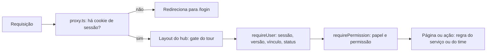
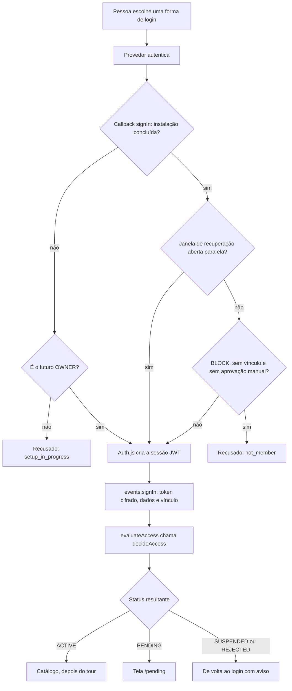
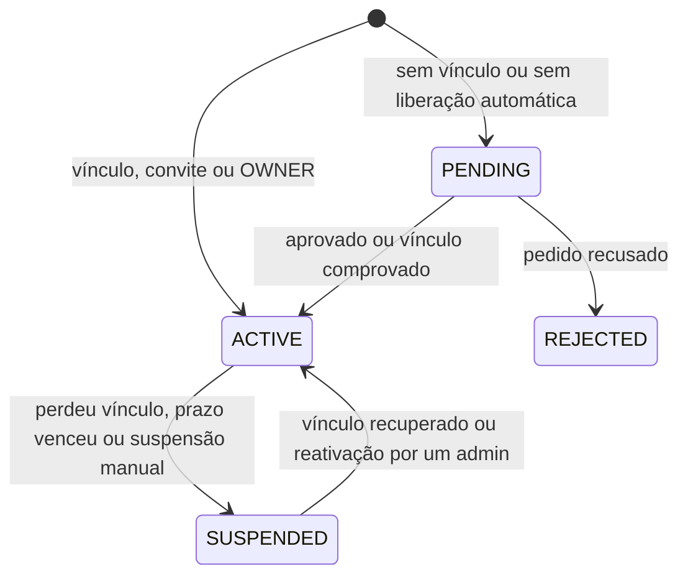

# Autenticação e acesso

Esta página explica, para quem contribui ou audita o código, como uma pessoa passa de "abriu o endereço do hub" a "está dentro com um papel": quem autentica, quem decide o acesso, como o vínculo com a empresa é conferido de novo com o tempo e como uma sessão é derrubada. Ela descreve o que o código faz hoje; as regras de negócio correspondentes estão em [Regras de negócio](/referencia/regras-de-negocio) (RN-01 a RN-17 e RN-70 a RN-78).

## Visão geral

A separação é deliberada: **autenticar** (provar quem a pessoa é) é trabalho do Auth.js; **decidir o acesso** (a pessoa pode entrar? com qual papel?) é uma função pura em `packages/core`; **autorizar** cada página e ação é feito no servidor, sempre, por `requireUser()` e `requirePermission()`.



| Peça | Onde | Responsabilidade |
|---|---|---|
| Configuração do Auth.js | `apps/web/src/auth.ts` | Provedores, sessão JWT, callbacks e eventos |
| Provedores | `apps/web/src/lib/auth-providers.ts`, `packages/core/src/auth-providers.ts` | Monta cada provedor a partir do banco; metadados e validação |
| Vínculo com a empresa | `packages/core/src/affiliation.ts`, `github.ts` | Domínio de e-mail, tenant e organização do GitHub |
| Decisão de acesso | `packages/core/src/access-policy.ts` | `decideAccess()`: função pura, coberta por testes |
| Aplicação da decisão | `apps/web/src/lib/access.ts` | `evaluateAccess()`: grava status, pedidos e auditoria |
| Guards | `apps/web/src/lib/guards.ts` | `requireUser()` e `requirePermission()` |
| Barreira barata | `apps/web/src/proxy.ts` | Exige cookie de sessão e repassa `x-pathname` |
| E-mail e senha | `apps/web/src/lib/local-auth.ts`, `packages/core/src/password.ts` | Convites, redefinição, cadastro e hash de senha |

## Auth.js configurado a partir do banco

Em `auth.ts`, o Auth.js v5 recebe uma **função assíncrona** em vez de um objeto fixo:

```ts
export const { handlers, auth, signIn, signOut } = NextAuth(async () => {
  const inst = await getInstallation();
  const rows = await prisma.authProvider.findMany({ where: { enabled: true } });
  return { providers: buildProviders(rows), session: { strategy: "jwt", maxAge: inst.sessionMaxAgeHours * 3600 }, /* … */ };
});
```

Por isso os provedores vivem na tabela `AuthProvider` (credenciais cifradas com AES-256-GCM) e não em variáveis de ambiente. O administrador liga, troca ou desliga uma forma de login em **Configurações → Formas de login**, e ela vale a partir do próximo login, sem novo deploy. `buildProviders()` mapeia cada linha para um provedor do Auth.js:

| Tipo | Id do Auth.js | Observações |
|---|---|---|
| `GITHUB` | `github` | Escopos `read:user user:email read:org`; guarda `githubId` e `githubLogin` |
| `GOOGLE` | `google` | |
| `MICROSOFT` | `microsoft-entra-id` | Emissor `login.microsoftonline.com/<tenant ou common>/v2.0` |
| `GITLAB` | `gitlab` | URL base configurável (instalação própria); escopo `read_user` |
| `FACEBOOK` | `facebook` | Nunca comprova vínculo |
| `OIDC` | `oidc` | Emissor e nome do botão configuráveis; escopos `openid email profile` |
| `CREDENTIALS` | `credentials` | E-mail e senha, com `authorize` próprio |

Outras escolhas de configuração:

- **Sessão em JWT** (`strategy: "jwt"`), com `maxAge` igual a **Sessão (horas)** da instalação (padrão 8). É a única estratégia que serve ao mesmo tempo aos provedores externos e ao login por senha. Mudar a duração vale para os próximos logins (RN-78).
- **Adaptador Prisma**, envolvido por `withSealedTokens()`: guarda `User` e `Account`, mas os tokens OAuth (o do GitHub, principalmente) são gravados **cifrados**, com prefixo `v1.`. Se a `ENCRYPTION_KEY` mudar, `getGithubToken()` devolve `null` e a pessoa é levada a entrar de novo.
- `pages.signIn` e `pages.error` apontam para `/login`, que traduz os códigos de erro em mensagens.

## Callbacks e eventos

| Gancho | O que faz |
|---|---|
| `callbacks.signIn` | Porteiro **antes** da sessão existir. Durante a instalação, só o futuro OWNER passa; com a janela de recuperação aberta, quem foi autorizado passa; com a política **BLOCK**, recusa quem não comprova vínculo (exceto quem já tem aprovação manual). |
| `callbacks.jwt` | No login, grava no token o `uid` da pessoa e o `tv` (a `tokenVersion` atual). |
| `callbacks.session` | Expõe `session.user.id` e `session.user.tv`. |
| `events.signIn` | **Depois** do login aceito: cifra e guarda o token do provedor, atualiza `githubLogin`, e-mail, nome e `lastSeenAt`, calcula o vínculo, chama `evaluateAccess()` e registra `auth.sign_in`. |
| `events.signOut` | Registra `auth.sign_out`. |

O fluxo completo de um login:



## Vínculo com a empresa

"Vínculo" é a resposta a uma pergunta: esta pessoa é da empresa? `affiliationFor()` em `auth.ts` devolve `member`, `not_member` ou `token_invalid`:

| Provedor | Como o vínculo é calculado |
|---|---|
| GitHub | `checkMembership()` consulta `GET /user/memberships/orgs/{org}` com o token da pessoa, para cada organização aceita. `state: "active"` em qualquer uma vale. Resposta 401 vira `token_invalid`. |
| Google | `email_verified` verdadeiro **e** domínio do e-mail na lista aceita. |
| Microsoft | `tid` do token igual ao tenant configurado, **ou** domínio do e-mail (ou `preferred_username`) na lista. |
| GitLab | Domínio do e-mail na lista. |
| OIDC | `email_verified` verdadeiro **e** domínio na lista. |
| Facebook, e-mail e senha | Sempre `not_member`. |

`emailDomainAllowed()` aceita subdomínios (`time.acme.com` casa com `acme.com`). O GitHub é o único caso que passa pela API do provedor a cada conferência; os outros usam o perfil devolvido no login.

## Decisão de acesso

`decideAccess()` recebe o estado atual da pessoa (status, origem do acesso, prazo), se ela comprova vínculo, se é uma reivindicação de OWNER e a política (`autoApproveOrgMembers`, `outsiderPolicy`). Devolve `deny` ou um novo estado. Não toca no banco: por isso é fácil de testar (`packages/core/test/access-policy.test.ts`). As regras são avaliadas **nesta ordem**:

| # | Situação | Resultado |
|---|---|---|
| 1 | Reivindicação de OWNER (assistente ou janela de recuperação) | ACTIVE, OWNER, origem `OWNER_SETUP` |
| 2 | Sem vínculo, política BLOCK e origem diferente de `MANUAL_APPROVAL` | `deny` |
| 3 | Sem registro, ou PENDING, com vínculo e liberação automática | ACTIVE, VIEWER, origem `ORG_MEMBERSHIP` |
| 4 | Sem registro, ou PENDING, nos outros casos | PENDING, cria pedido |
| 5 | REJECTED | Continua REJECTED |
| 6 | SUSPENDED por `ORG_MEMBERSHIP_LOST`, voltou a comprovar vínculo e liberação ligada | ACTIVE de novo, sem mudar o papel |
| 7 | Outro SUSPENDED | Continua SUSPENDED |
| 8 | ACTIVE por `MANUAL_APPROVAL` com prazo vencido | SUSPENDED, motivo `ACCESS_EXPIRED` |
| 9 | ACTIVE por `ORG_MEMBERSHIP` sem vínculo | SUSPENDED, motivo `ORG_MEMBERSHIP_LOST` |
| 10 | Qualquer outro ACTIVE | Continua ACTIVE |

`evaluateAccess()` em `lib/access.ts` aplica o resultado: grava status, papel, origem e motivo, atualiza `isOrgMember` e `lastMembershipCheckAt`, registra `access.status_changed` (autor "sistema") quando o estado muda, cria o `AccessRequest` (com validade de `accessRequestTtlDays`) quando a decisão pede e **aprova automaticamente** um pedido aberto se a pessoa virou ACTIVE. No caso `deny`, incrementa `tokenVersion` e registra `access.denied`. Se o resultado for SUSPENDED ou REJECTED, devolve `ok: false`, e o chamador encerra a sessão.

Duas consequências vêm da ordem das regras. A regra 2 vem antes das regras de suspensão, então, com a política BLOCK, quem perde o vínculo é **recusado** (`deny`), e não marcado como SUSPENDED. E a exceção da regra 2 olha só a **origem** do acesso (`MANUAL_APPROVAL`, que é o que aprovações e convites gravam), e não o papel.

### Status da pessoa



Só a suspensão **por perda de vínculo** é desfeita sozinha (RN-08). O prazo vencido e a suspensão manual exigem um administrador, e um pedido recusado só sai de REJECTED pela ação de um administrador (RN-09).

## Revalidação do vínculo

O vínculo não é conferido só no login. `requireUser()` refaz a decisão quando a pessoa está ACTIVE e **o prazo do acesso venceu** ou a **última conferência está velha** (`membershipCheckIsStale()`, com `membershipRecheckHours`, padrão 12):

1. Se a pessoa tem conta GitHub e a instalação tem organizações aceitas, o hub decifra o token guardado e chama `checkMembership()` de novo. Token ausente ou recusado vira `token_invalid`: a sessão cai com o aviso "reauth" e a pessoa entra de novo.
2. Nos demais provedores, vale o último `isOrgMember` gravado. A conferência real acontece no **próximo login**, e o limite prático é a duração da sessão.
3. O resultado passa por `evaluateAccess()`. Se não estiver `ok`, `tokenVersion` é incrementado e a pessoa é enviada a `/login`.

Mudar organizações ou domínios em **Configurações** zera `lastMembershipCheckAt` de todos os ativos (RN-75), e o botão **Conferir vínculos de todos** faz o mesmo. Reativar alguém manualmente também zera o campo dessa pessoa.

## Sessão e revogação

O JWT não pode ser revogado no servidor por si só. O hub resolve isso com um **contador de versão**: cada `User` tem `tokenVersion`, o JWT leva o valor no claim `tv`, e `requireUser()` compara os dois a cada requisição. Se forem diferentes, a sessão é tratada como revogada (`/login?error=session_revoked`). O custo é uma consulta ao banco por requisição, o preço de poder derrubar uma sessão na hora.

`tokenVersion` sobe quando:

- um administrador **suspende** a pessoa ou **muda o papel** dela;
- a pessoa **aceita um convite** ou **usa um link de nova senha**;
- **Encerrar todas as sessões** é executado (todos, menos quem clicou);
- `evaluateAccess()` devolve `deny` ou `requireUser()` recebe `ok: false`.

## Guards

`requireUser()` é o ponto único de entrada de páginas e ações (RN-20). Nesta ordem:

1. Instalação não concluída: redireciona para `/setup`.
2. Sem sessão: redireciona para `/login`.
3. Carrega a pessoa, seus times, contas e as **permissões do papel** (a matriz vem do banco, com cache só dentro da requisição, então uma mudança em **Permissões** vale na próxima página).
4. `tv` diferente de `tokenVersion`: sessão revogada.
5. Revalidação do vínculo, quando devida.
6. `PENDING` vai para `/pending`; qualquer status diferente de `ACTIVE` volta ao login com o motivo.

`requirePermission(permission)` chama `requireUser()` e, se a pessoa não tem a permissão, responde `notFound()`. Rotas administrativas **fingem não existir** (RN-23). Regras que dependem do serviço (time responsável, visibilidade) ficam em `canManageService()` e `canSeeService()`, em `packages/core/src/rbac.ts`. As rotas de API que usam a sessão (`/api/services/<slug>/dotenv` e `/api/admin/audit`) repetem à mão a checagem de status e de `tokenVersion`, mas não rodam a revalidação de vínculo.

## `proxy.ts`: a barreira barata

`apps/web/src/proxy.ts` (o "middleware" do Next 16) roda antes de qualquer renderização e só faz duas coisas:

- **Exige um cookie de sessão** (`authjs.session-token` ou `__Secure-authjs.session-token`). Sem ele, redireciona para `/login`. É uma barreira barata e **não é** controle de acesso: não valida a assinatura, nem o status, nem a versão. Toda a checagem real está em `requireUser()`.
- **Repassa o caminho** no header `x-pathname` (o `set` sobrescreve o que o cliente enviar). É a única forma de o layout compartilhado saber a rota atual.

São públicas: `/login`, `/setup`, `/pending`, `/invite`, `/reset-password`, `/signup`, `/api/auth`, `/api/setup`, `/api/v1` (a publicação de specs usa token de serviço, não cookie) e `/api/health`. Endereços antigos (`/convite`, `/redefinir`, `/cadastro`, `/login/esqueci`) redirecionam para os novos.

## Gate do tour obrigatório

O tour do primeiro acesso é imposto pelo layout do hub, `apps/web/src/app/(hub)/layout.tsx`, e não por `requireUser()`: essa função roda em **toda** server action, e o gate redirecionaria ações no meio do tour. O layout calcula `mandatoryTourTarget()` a partir de `getMandatoryTourRoutes()`, que devolve só o Catálogo, e de `tourStep` e `tourCompletedAt` do usuário. Se o panorama ainda não foi concluído e o `x-pathname` é outro, redireciona para o Catálogo. Como a navegação no cliente não reexecuta o layout, o `TourProvider` tem uma guarda equivalente. A action `advanceMandatoryTour()` avança um passo por vez, com `updateMany` condicionado ao `tourStep` atual (resistente a clique duplo) e registra `user.tour_completed` no fim.

## E-mail e senha

O provedor `credentials` chama `authorizeCredentials()` (`lib/auth-providers.ts`), que valida a entrada e aplica, em ordem: limite em memória de 20 tentativas por e-mail em 15 minutos; bloqueio da conta (`lockedUntil`); verificação da senha; contagem de falhas; e recusa de contas suspensas ou recusadas.

| Aspecto | Como é |
|---|---|
| Hash | `scrypt` (`N=2^15`, `r=8`, `p=1`, 64 bytes), sal aleatório de 16 bytes por pessoa, senha normalizada em NFKC. Formato `scrypt$N$r$p$sal$hash`. |
| Comparação | `timingSafeEqual`. Para e-mail inexistente, o hub roda um scrypt de mentira, para o tempo de resposta não revelar quem tem conta. |
| Regras de senha | De 12 a 128 caracteres, pelo menos 3 de 4 tipos, sem sequências comuns e sem a parte local do e-mail. |
| Bloqueio | 5 erros seguidos zeram o contador e bloqueiam por 15 minutos (`LOGIN_MAX_FAILURES`, `LOGIN_LOCK_MINUTES`), com `auth.locked` na auditoria. |
| Convite e redefinição | Token de 32 bytes aleatórios (base64url). Só o SHA-256 vai para `UserInvite`. Convite vale 7 dias; redefinição, 60 minutos. Um link novo expira os anteriores do mesmo tipo e e-mail. |
| Uso único | Consumo em transação com `updateMany({ id, usedAt: null })`. |
| Efeito do convite | Cria ou atualiza a pessoa como ACTIVE, com origem `MANUAL_APPROVAL` e o papel do convite. Um OWNER continua OWNER. |
| Efeito da redefinição | Troca a senha, zera bloqueio e falhas, incrementa `tokenVersion`. |
| Cadastro aberto | `signup()` cria a pessoa como PENDING com um pedido e a justificativa. Responde igual quando o e-mail já existe. Fica fechado com a política BLOCK. |

## Janela de recuperação de OWNER

Se todos os OWNERs perderem o acesso, quem administra o servidor roda `pnpm admin:recover --login <x>` (o acesso ao servidor é a prova de autorização). O script (`packages/db/scripts/recover-owner.ts`) pede confirmação e escolhe entre dois caminhos:

- **A pessoa já existe:** vira OWNER ativo na hora, com `owner.recovered` na auditoria. Com `--reset-password`, também sai um link de nova senha.
- **A pessoa nunca entrou:** o script grava `recoveryIdentifier` e `recoveryExpiresAt` (60 minutos) em `Installation`. Enquanto a janela está aberta, `isRecoveryLogin()` faz o `callbacks.signIn` ignorar a política BLOCK, e `evaluateAccess()` trata o login como reivindicação de OWNER. **Uso único**: ao usar, a janela fecha e `owner.recovered` é registrado. **Configurações → Sessões e recuperação** mostra um alerta enquanto ela está aberta e permite cancelar.

O assistente de instalação usa o mesmo mecanismo de reivindicação (`isSetupClaim`) para o primeiro OWNER: com `ownerIdentifier` gravado, só essa pessoa entra até a instalação terminar. Veja [Recuperação de OWNER](/admin/recuperacao-de-owner) para o uso no dia a dia.

## Limites conhecidos

- O limite de tentativas (`rate-limit.ts`) é **em memória**, por processo. Com mais de uma instância do hub, o contador não é compartilhado. Redis está no [Roadmap](/arquitetura/roadmap).
- Só o GitHub reconsulta o vínculo sem novo login. Nos demais provedores, uma saída da empresa só é notada no próximo login.
- O hub não junta contas: um e-mail que já entrou por um provedor não entra por outro, e a pessoa vê "Esse e-mail já entra por outra forma de login".

## Veja também

- [Segurança](/referencia/seguranca): o modelo de ameaças e as defesas em camadas.
- [Modelo de dados](/arquitetura/modelo-de-dados): as tabelas `User`, `AccessRequest`, `UserInvite` e `Installation`.
- [Acesso automático para a empresa](/receitas/acesso-automatico-pela-organizacao): a configuração pelo lado de quem administra.
- [Adicionar um provedor de login](/contribuindo/guias/novo-provedor-de-login): como estender esta camada.
