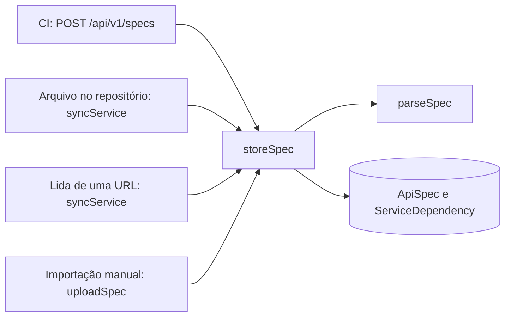
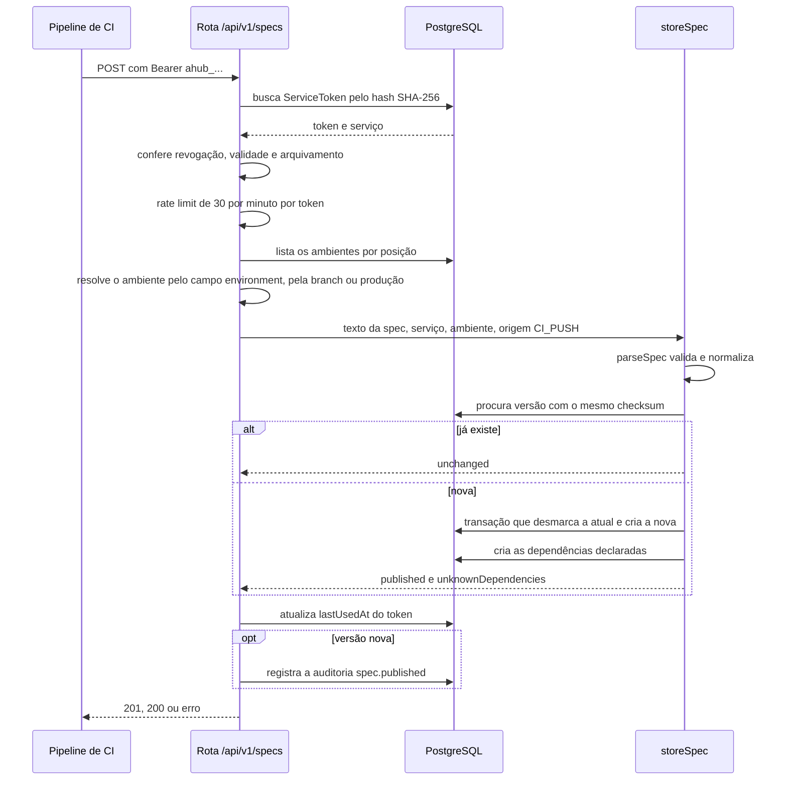
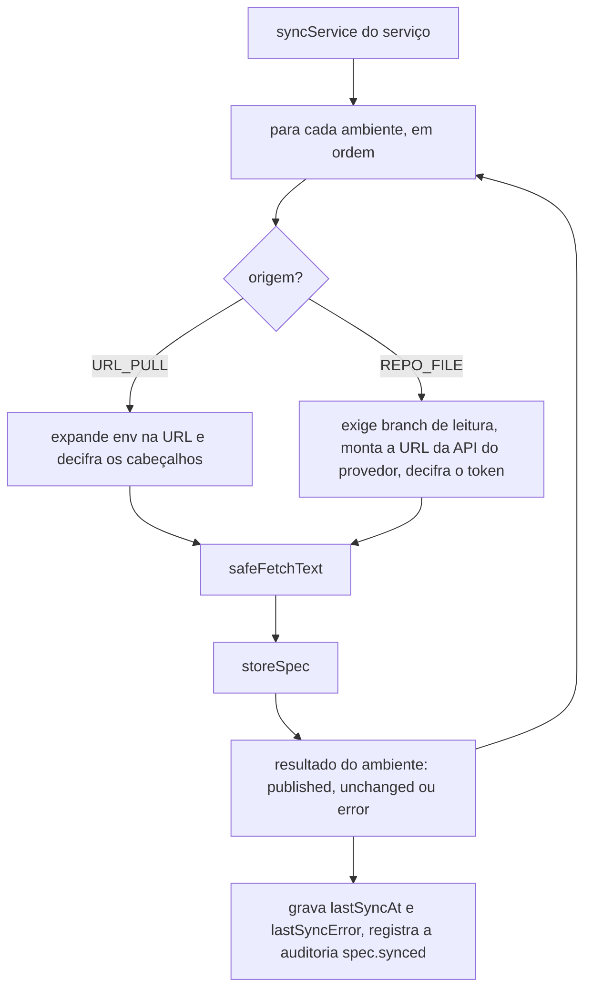

# Ingestão de specs

Esta página explica, por dentro, o caminho de uma spec até a tela: a rota de publicação do CI, a validação e a normalização, o armazenamento versionado por ambiente, a leitura de repositório e de URL, a proteção contra SSRF e a renderização com o Scalar. É para quem quer contribuir com o código ou entender por que o hub responde como responde. Para usar a publicação, veja as [receitas](/receitas/publicar-pelo-github-actions) e a [referência da API](/referencia/api).

## Visão geral

Existem quatro origens de spec, escolhidas por serviço (`Service.specSource`). Todas terminam na mesma função, `storeSpec`, que valida, deduplica e grava.

| Origem | Enum `SpecSource` | Quem chama `storeSpec` | Arquivo |
|---|---|---|---|
| Enviada pelo CI | `CI_PUSH` | rota `POST /api/v1/specs` | `apps/web/src/app/api/v1/specs/route.ts` |
| Arquivo no repositório | `REPO_FILE` | `syncService` | `apps/web/src/lib/sources.ts` |
| Lida de uma URL | `URL_PULL` | `syncService` | `apps/web/src/lib/sources.ts` |
| Importação manual | `MANUAL_UPLOAD` | server action `uploadSpec` | `apps/web/src/app/(hub)/services/[slug]/actions.ts` |

A regra de negócio pura (validar e normalizar) mora em `packages/core/src/spec.ts`. O que depende do banco (gravar, deduplicar, criar vínculos) mora em `apps/web/src/lib/specs-store.ts`. A busca por rede mora em `apps/web/src/lib/sources.ts`, com as regras puras de URL em `packages/core/src/sources.ts`.

## A publicação pelo CI

A ordem das checagens em `route.ts` é deliberada:

1. **Autenticação.** O cabeçalho `Authorization: Bearer ahub_...` precisa existir. O token é procurado pelo hash SHA-256 (`ServiceToken.hash`); no banco nunca há o token em texto. Token revogado, vencido ou de serviço arquivado responde 401. A rota fica fora do gate de sessão do `proxy.ts` (`/api/v1` é público), porque quem chama é uma máquina.
2. **Rate limit.** 30 publicações por minuto por token, em `apps/web/src/lib/rate-limit.ts`. Excedeu, 429. O contador é um `Map` em memória do processo: com mais de uma instância do hub, cada uma conta separado, e reiniciar zera. Redis está no [roadmap](/arquitetura/roadmap).
3. **Tamanho.** Se o `Content-Length` passa de 5 MB mais 64 000 bytes de folga para o envelope, 413. A checagem exata dos 5 MB é do `parseSpec`, que responde 422.
4. **Corpo.** Com `Content-Type: application/json`, o corpo é um envelope `{ spec, commitSha, branch, environment }` validado pelo `ingestSpecSchema` (Zod); `spec` pode ser objeto ou texto, e `commitSha` precisa ser hexadecimal de 7 a 40 caracteres. Com qualquer outro tipo, o corpo inteiro é a spec e os metadados vêm da query string.
5. **Ambiente.** `environment` explícito vence; senão vale a branch, pela função pura `resolveEnvironment` (`packages/core/src/environments.ts`), que percorre os ambientes por `position` e devolve o primeiro cujo padrão glob casa; sem branch, o ambiente de produção. Sem resultado, 422 com a lista `environments` (`slug` e `branches`).
6. **Gravação.** `storeSpec`. Um `SpecError` vira 422 com a mensagem.
7. **Efeitos.** `lastUsedAt` do token é atualizado; a auditoria `spec.published` só é registrada quando nasce uma versão (respostas `unchanged` não geram evento).

Os códigos de resposta e os corpos estão em [API HTTP](/referencia/api).

## parseSpec: validar e normalizar

`parseSpec(raw)` (em `packages/core/src/spec.ts`) é uma função pura: recebe texto, devolve um `ParsedSpec` ou lança `SpecError`. Ela não é um linter de OpenAPI; garante só o mínimo para o hub renderizar e versionar.

| Etapa | Regra | Erro |
|---|---|---|
| Tamanho | Não pode ser vazia nem passar de 5 MB (`MAX_SPEC_BYTES`, medido em bytes UTF-8). | `A spec está vazia.` ou `A spec passa de 5 MB.` |
| Formato do texto | Se, sem espaços iniciais, começa com `{`, é lida como JSON; senão, como YAML, com `maxAliasCount: 100` (limite contra expansão maliciosa de aliases). | `Não foi possível ler a spec: ...` |
| Tipo | O resultado precisa ser um objeto. | `A spec precisa ser um objeto JSON/YAML.` |
| Versão | `openapi` começando em `3.1` vira `openapi-3.1`; em `3.0`, `openapi-3.0`; `swagger` igual a `2.0`, `swagger-2.0`. | Campo `openapi` ou `swagger` não encontrado. |
| Estrutura | Precisa de `info` (objeto) e de pelo menos um entre `paths`, `webhooks` e `components`. | `Campo info ausente.` ou `A spec não tem paths, webhooks nem components.` |
| Normalização | `JSON.stringify` do objeto lido. YAML e JSON viram o mesmo formato; comentários e âncoras desaparecem; a ordem das chaves é preservada. É o que vai para `ApiSpec.content`. | |
| Checksum | `sha256` do texto normalizado. | |
| Metadados | `title` de `info.title` e `version` de `info.version`, só se forem texto (senão a versão vira `0.0.0`). `sizeBytes` é o tamanho do texto original. | |
| Dependências | `x-api-hub.dependsOn`, se for lista, filtrada para textos. | |

Como o checksum vem do texto normalizado, a mesma spec em YAML e em JSON, com as chaves na mesma ordem, gera o mesmo checksum. Reordenar chaves muda o checksum e cria uma versão nova.

::: warning
`info.version` precisa ser texto. Em YAML, `version: 1.0` sem aspas é um número e a versão exibida vira `0.0.0`. Escreva `version: "1.0"`.
:::

## storeSpec: versões por serviço e ambiente

`storeSpec` (em `apps/web/src/lib/specs-store.ts`) grava uma linha em `ApiSpec` por combinação de serviço, ambiente e conteúdo. A restrição `@@unique([serviceId, environmentId, checksum])` é a base da idempotência; o índice `[serviceId, environmentId, isLatest]` acelera a busca da versão atual.

1. Chama `parseSpec`.
2. Procura uma linha com o mesmo serviço, ambiente e checksum.
3. **Se existe** e é a atual, devolve `unchanged`. Se existe mas não é a atual (a equipe voltou a uma spec antiga), a transação a marca como atual e desmarca a que era, e também devolve `unchanged`. É assim que "voltar a uma versão" funciona: republicar o conteúdo antigo.
4. **Se não existe**, uma transação desmarca a atual do ambiente (`isLatest = false`) e cria a nova com `isLatest = true`, junto com `commitSha`, `branch` e `source`.
5. Para cada slug em `declaredDependencies`, procura o serviço. Slug desconhecido ou o do próprio serviço vai para `unknownDependencies`. Os demais viram `ServiceDependency` do tipo `CONSUMES` com `detected = true`, por `upsert` com `update` vazio: uma ligação manual que já exista com o mesmo trio (origem, destino, tipo) não é alterada.

Consequências que valem conhecer:

- **A versão atual é por ambiente.** Publicar em `hml` não mexe na atual de `prod`.
- **As dependências só são processadas quando nasce uma versão.** Uma publicação `unchanged` não recria um vínculo detectado que alguém tenha removido. Por isso, a regra RN-54 ("voltam na próxima publicação") vale para a próxima publicação com conteúdo novo.
- **Nada é apagado.** Tirar um slug de `dependsOn` não remove a ligação já criada, e versões antigas ficam no banco. A interface lista as 20 mais recentes de cada ambiente.
- **Ambiente com spec não pode ser removido** (`onDelete: Restrict` em `ApiSpec.environment`).

## Origens lidas pelo hub: syncService

Quando a origem é `REPO_FILE` ou `URL_PULL`, quem busca é o hub. Há dois pontos de entrada: o botão **Sincronizar agora** (server action `syncNow`, exige `spec:publish` e ser do time) e o endpoint `POST /api/v1/sync` para cron.

Pontos de projeto:

- **Todos os ambientes, sempre.** `syncService` percorre todos os ambientes; um erro em um (por exemplo, sem branch de leitura) não impede os outros. Os erros são juntados em `Service.lastSyncError` no formato `ambiente: mensagem`, separados por ` · `, e aparecem no cabeçalho do serviço.
- **`URL_PULL`.** `expandEnvTemplate` troca `{env}` pelo identificador do ambiente (com `encodeURIComponent`). Os cabeçalhos vêm de `Service.pullHeadersEnc`, um JSON cifrado com AES-256-GCM (`encryptSecret`/`decryptSecret`, em `packages/core/src/crypto.ts`).
- **`REPO_FILE`.** Usa o repositório e o caminho do serviço, a `Environment.syncBranch` e o token de `SourceIntegration.tokenEnc`. `repoFileApiUrl` monta a URL da API de cada provedor:

| Provedor | URL lida | Autenticação |
|---|---|---|
| GitHub | `<base>/repos/<dono/repo>/contents/<caminho>?ref=<branch>`, com `Accept: application/vnd.github.raw+json` | `Authorization: Bearer` |
| GitLab | `<base>/api/v4/projects/<projeto codificado>/repository/files/<caminho codificado>/raw?ref=<branch>` | `PRIVATE-TOKEN` |
| Bitbucket | `<base>/2.0/repositories/<dono/repo>/src/<branch>/<caminho>` | `Authorization: Bearer` |
| Outro (`GENERIC`) | não há leitura direta | erro orientando a usar URL, CI ou importação |

- **Sem commit.** A versão lida do repositório guarda a `branch`, mas não o `commitSha`.
- **Cron.** A rota `apps/web/src/app/api/v1/sync/route.ts` compara o hash do cabeçalho com o token gerado em **Configurações → Repositórios**, por `safeEqual`. O push do Git chama `POST /api/v1/hooks` com o segredo gerado na mesma aba. As duas rotas sincronizam serviços não arquivados com origem `URL_PULL` ou `REPO_FILE` (o webhook, só o repositório do evento) e respondem 200 com um relatório mesmo quando há erros. Cada execução registra um evento `spec.synced` por serviço.

## Proteção contra SSRF

Ler uma URL informada por uma pessoa faz do servidor do hub um cliente HTTP a serviço de quem cadastra a URL. `safeFetchText` (em `apps/web/src/lib/sources.ts`) limita esse risco (RN-S17):

1. Só `http:` e `https:`.
2. `unsafeHostReason(hostname)` (em `packages/core/src/sources.ts`) recusa `localhost` e `*.localhost`, loopback (`127.x.x.x`, `::1`, `0.0.0.0`), link-local (`169.254.x.x` e `fe80:`, que cobre o serviço de metadados de nuvem em `169.254.169.254`) e os nomes `metadata.google.internal` e `metadata`.
3. O nome é resolvido por DNS e o endereço obtido passa pela mesma checagem.
4. `fetch` com `redirect: "error"`: nenhum redirecionamento é seguido, para que um servidor permitido não redirecione o hub para um destino bloqueado.
5. Tempo limite de 15 segundos (`AbortSignal.timeout`), `cache: "no-store"`.
6. Resposta precisa ser 2xx. O `Content-Length` acima de 5 MB é recusado antes de ler o corpo, e o tamanho do texto lido é conferido de novo.

**Redes privadas são permitidas de propósito**: ler serviços internos (`10.x`, `172.16.x`, `192.168.x`, nomes internos) é o caso de uso principal da leitura por URL. Por isso a proteção é uma lista de bloqueio, não um isolamento de rede. Em ambientes sensíveis, restrinja também a saída de rede do servidor do hub (firewall ou regras de egress) para só alcançar o que precisa.

O código que valida a URL e o que busca ficam separados de propósito: as regras de bloqueio são funções puras, fáceis de testar; a busca depende de rede e de DNS.

## Renderização com o Scalar

A documentação da aba **Documentação da API** é desenhada pelo Scalar (`@scalar/api-reference-react`), no componente cliente `apps/web/src/app/(hub)/services/[slug]/api-reference.tsx`. Ele recebe o texto normalizado de `ApiSpec.content` e o tema claro ou escuro do hub.

O hub é fechado e as specs são contratos internos, então o renderizador roda com tudo o que envia dados para fora desligado (RN-S15):

| Opção | Valor | Por que |
|---|---|---|
| `telemetry` | `false` | Nenhuma métrica de uso sai do hub. |
| `mcp` e `agent` | `disabled: true` | Sem assistente de IA nem servidor MCP: a spec não vai para serviços externos. |
| `hideTestRequestButton` | `true` | Sem "testar requisição": as chamadas sairiam do navegador de quem lê, direto para os servidores da spec. |
| `hideClientButton` | `true` | Esconde o botão que abre o cliente de API do Scalar, que serve para enviar requisições. |
| `showToolbar` e `showDeveloperTools` | `"never"` | Sem a barra de ferramentas nem as ferramentas de desenvolvedor do Scalar, para não sobrar caminho de compartilhamento ou de deploy da spec. |
| `withDefaultFonts` | `false` | As fontes são servidas pelo próprio hub (`@fontsource`), sem consulta a CDNs de fontes. |
| `hideDarkModeToggle` e `forceDarkModeState` | `true` e `"light"` ou `"dark"` | O modo claro ou escuro segue o tema escolhido em **Aparência**. |
| `documentDownloadType` | `"both"` | Baixar a spec em JSON e em YAML. |

A defesa tem uma segunda camada: a Content-Security-Policy de `apps/web/next.config.ts` restringe `connect-src` a `'self'`, então mesmo um recurso do Scalar que tentasse chamar outro domínio seria bloqueado pelo navegador.

::: warning
As opções do Scalar são passadas com um cast (`as unknown as Config`), que silencia o TypeScript quando uma opção deixa de existir. Ao atualizar `@scalar/api-reference-react`, confira nas notas de versão que cada opção acima continua valendo, e que nenhum recurso novo que envie dados para fora vem ligado por padrão.
:::

## Testes

| Arquivo | O que cobre |
|---|---|
| `packages/core/test/spec.test.ts` | `parseSpec`: YAML 3.1 com dependências declaradas e recusa de documento sem versão de OpenAPI. |
| `packages/core/test/features.test.ts` | Ambientes por branch (`*` e `**`) e as regras de origem: `{env}` na URL, URL do arquivo por provedor e bloqueio de metadados de nuvem e loopback. |
| `apps/web/test/integration/ingest.test.ts` | A rota contra um PostgreSQL real: publica e ignora repetição, aceita o envelope JSON e cria dependências, recusa token inválido, revogado ou de serviço arquivado, explica spec inválida, escolhe o ambiente pela branch e recusa branch sem ambiente com a lista de regras. |

Os testes de integração truncam o banco de `TEST_DATABASE_URL`. Veja [Testes](/contribuindo/testes).

## Veja também

- [API HTTP](/referencia/api): endpoints, cabeçalhos e respostas.
- [Extensão x-api-hub](/referencia/extensao-x-api-hub)
- [Modelo de dados](/arquitetura/modelo-de-dados): as tabelas `ApiSpec`, `ServiceToken` e `ServiceDependency`.
- [Segurança](/referencia/seguranca)
