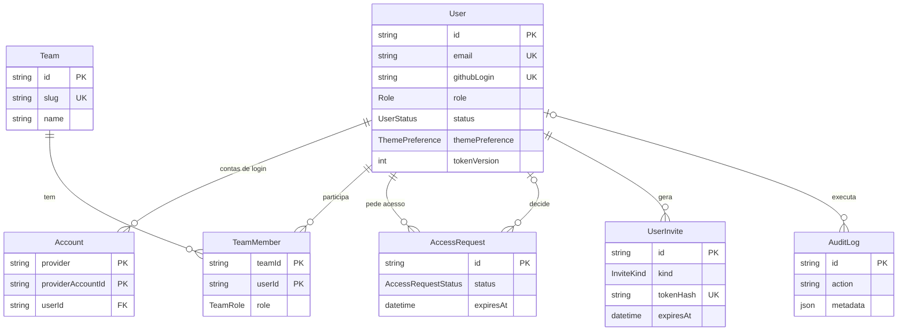
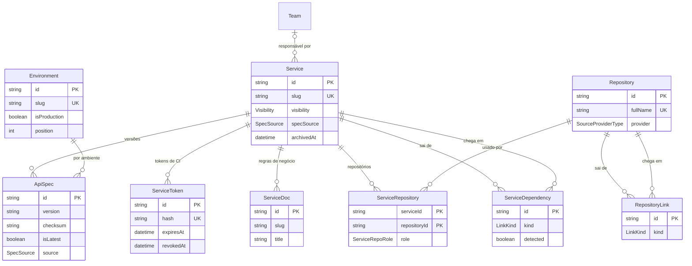
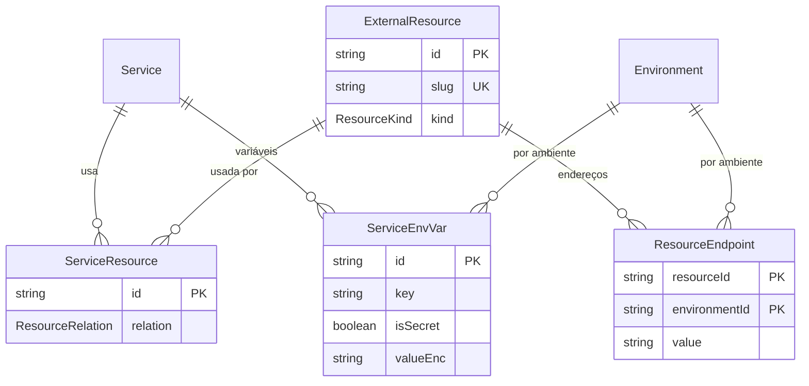

# Modelo de dados

Esta página descreve o banco do Rizoma: os modelos do Prisma, como eles se relacionam, o que cada enum significa e como o esquema evolui por migrações. É para quem vai contribuir com o código, escrever uma migração ou consultar o banco diretamente. A fonte da verdade é `packages/db/prisma/schema.prisma`.

## Visão geral

- **Banco:** PostgreSQL 16. O esquema usa listas (`String[]`) e `Json` nativos do Postgres, por isso outros bancos ainda não são suportados (veja o [roadmap](/arquitetura/roadmap)).
- **Acesso:** Prisma 6 com o cliente sem engine nativa (`engineType = "client"`): as consultas são compiladas em WASM e executadas pelo driver `pg` (`@prisma/adapter-pg`). O cliente único está em `packages/db/src/index.ts`, reexportado como `prisma` por `@api-hub/db`.
- **Chaves:** ids `String` gerados com `cuid()`, e `createdAt`/`updatedAt` nos modelos que mudam.
- **Enums espelhados:** o `packages/core` não depende do banco para poder ser testado sem ele. Por isso `packages/core/src/types.ts` repete os enums do Prisma como tipos TypeScript. Ao criar ou renomear um valor de enum, atualize os dois lugares.

## Pessoas, times e acesso

| Modelo | Para que serve | Pontos importantes |
|---|---|---|
| `User` | Uma pessoa com acesso (ou pedindo acesso) ao hub. | `role` (OWNER, ADMIN, MAINTAINER, VIEWER) e `status` (PENDING, ACTIVE, SUSPENDED, REJECTED). `accessGrant` diz como o acesso foi concedido; `accessExpiresAt` é o prazo do acesso temporário. `isOrgMember` e `lastMembershipCheckAt` guardam o último resultado da checagem de vínculo. `tokenVersion` invalida todas as sessões JWT quando incrementado. `passwordHash` (scrypt), `failedLogins` e `lockedUntil` são do login por e-mail e senha. `tourStep` e `tourCompletedAt` guardam o progresso do tour obrigatório. `themePreference` (`ThemePreference`) é o tema da própria pessoa: Claro, Escuro ou Sistema (o padrão). |
| `Account` | Conta de um provedor externo ligada à pessoa (tabela do Auth.js). | Chave `[provider, providerAccountId]`. Os tokens (`access_token`, `refresh_token`, `id_token`) ficam cifrados. Apagar a pessoa apaga as contas (`Cascade`). |
| `VerificationToken` | Tabela exigida pelo adaptador do Auth.js. | Sem uso ativo no hub. |
| `UserInvite` | Convite para criar senha ou link de redefinição de senha. | `kind` é `INVITE` ou `PASSWORD_RESET`. Só o hash do token é salvo (`tokenHash`, único). `usedAt` marca o uso único; `expiresAt` o prazo. |
| `AccessRequest` | Solicitação de acesso de quem não comprovou vínculo. | `status` (PENDING, APPROVED, REJECTED, EXPIRED). `reason` é a justificativa da pessoa; `decidedById`, `decisionNote` e `grantedRole` registram a decisão; `expiresAt` é a validade da solicitação. |
| `Team` | Um time responsável por serviços. | `slug` único. `githubTeamSlug` está reservado para a sincronização com times do GitHub, prevista no roadmap. |
| `TeamMember` | Participação de uma pessoa num time. | Chave `[teamId, userId]`; `role` é `LEAD` ou `MEMBER`. |
| `AuditLog` | Trilha de auditoria. | `action` no formato `grupo.acao` (por exemplo, `spec.published`); a tela agrupa pelo prefixo. `targetType` e `targetId` apontam o alvo; `metadata` é JSON livre; `ip` vem do cabeçalho do proxy. A pessoa autora vira `null` se for apagada (`SetNull`). Nenhum valor de segredo entra aqui. |

## Catálogo, specs e ambientes

| Modelo | Para que serve | Pontos importantes |
|---|---|---|
| `Service` | Um serviço do catálogo. | `slug` único e congelado depois da primeira spec (regra de aplicação, não do banco). `visibility` (`ORG` ou `TEAM`). `lifecycle` é texto (`experimental`, `production` ou `deprecated`), validado pelo Zod, não por enum. `archivedAt` arquiva sem apagar. Os campos `specSource`, `pullUrl`, `pullHeadersEnc`, `specRepositoryId`, `specPath`, `lastSyncAt` e `lastSyncError` configuram e registram a [leitura da spec](/arquitetura/ingestao-de-specs). `ownerTeamId` vira `null` se o time for apagado (`SetNull`). |
| `ApiSpec` | Uma versão da spec de um serviço em um ambiente. | `content` é o JSON normalizado; `checksum` é o SHA-256 dele. Único por `[serviceId, environmentId, checksum]`, o que garante a idempotência. `isLatest` marca a atual **dentro do ambiente**. `source` diz de onde veio; `commitSha` e `branch` são opcionais. Nunca é apagada pela aplicação. |
| `Environment` | Um ambiente (dev, homologação, produção…). | `slug` único e imutável na prática: a tela de configuração casa os ambientes por slug. `branchPatterns` são globs de branch; `syncBranch` é a branch de leitura da origem `REPO_FILE`; `position` define a ordem de resolução; `isProduction` marca o ambiente padrão. `ApiSpec.environment` usa `Restrict`: ambiente com spec não é apagado. |
| `ServiceToken` | Token de publicação do CI, por serviço. | Só o hash SHA-256 (`hash`, único) e o `prefix` (12 primeiros caracteres) ficam salvos. `expiresAt`, `revokedAt` e `lastUsedAt` controlam a vida do token. `createdBy` é obrigatório. |
| `Repository` | Um repositório de código cadastrado. | `fullName` único. `provider` (GITHUB, GITLAB, BITBUCKET, GENERIC) e `url`. `externalId` guarda o id no provedor quando existe. |
| `ServiceRepository` | Liga um serviço a um repositório, com papel. | Chave `[serviceId, repositoryId]`; `role` (SOURCE, CLIENT_SDK, INFRA, CONTRACT). |
| `RepositoryLink` | Ligação repositório → repositório. | Único por `[fromRepoId, toRepoId, kind]`. |
| `ServiceDependency` | Ligação serviço → serviço. | Único por `[fromServiceId, toServiceId, kind]`. `detected = true` quando veio de `x-api-hub.dependsOn`. `note` é livre. |
| `ServiceDoc` | Página de regras de negócio em Markdown de um serviço. | Único por `[serviceId, slug]`; `position` ordena as páginas. |

::: info
`Service.specRepositoryId` é um campo simples, sem chave estrangeira para `Repository`. O vínculo entre a origem `REPO_FILE` e o repositório é garantido pela aplicação.
:::

## Integrações externas e variáveis de ambiente

| Modelo | Para que serve | Pontos importantes |
|---|---|---|
| `ExternalResource` | Uma integração externa (API de terceiro, fila, banco…), compartilhável entre serviços. | `slug` único. `kind` (`ResourceKind`). `description` é Markdown. |
| `ResourceEndpoint` | O endereço da integração em um ambiente. | Chave `[resourceId, environmentId]`; `value` guarda até 500 caracteres (limite aplicado pela aplicação). |
| `ServiceResource` | Como um serviço usa uma integração. | Único por `[serviceId, resourceId, relation]`: o mesmo serviço pode ter relações diferentes com a mesma integração. A compatibilidade entre tipo e relação é validada na interface, não no banco. |
| `ServiceEnvVar` | Uma variável de ambiente de um serviço em um ambiente. | Único por `[serviceId, environmentId, key]`. Se `isSecret`, o valor fica em `valueEnc` (cifrado) e `value` fica nulo; senão, o inverso. Apagar o ambiente apaga as variáveis (`Cascade`), mas a aplicação recusa remover ambiente que tenha variáveis. |

## Configuração da instalação

Estes quatro modelos não têm relações: guardam a configuração do hub.

| Modelo | Para que serve | Pontos importantes |
|---|---|---|
| `Installation` | Estado e configuração global. | **Singleton**: uma única linha com `id = "singleton"`, criada na primeira leitura (`getInstallation`, em `apps/web/src/lib/install.ts`, com `upsert` e tratamento da corrida `P2002`). Guarda `installed`, `currentStep` (etapa do assistente), organização (`orgName`, `allowedGithubOrgs`, `allowedEmailDomains`), política de acesso (`autoApproveOrgMembers`, `outsiderPolicy`, `sessionMaxAgeHours`, `membershipRecheckHours`, `accessRequestTtlDays`), o primeiro administrador (`ownerIdentifier`), a janela de recuperação de OWNER (`recoveryIdentifier`, `recoveryExpiresAt`) e a marca do sistema: `appName` (o nome) e `themeOverrides`, que guarda só a cor de destaque, `{ "accent": "#0f7a68" }`. O tema Claro ou Escuro não é da instalação: é de cada pessoa (`User.themePreference`). `themeId` ficou como legado e não é mais lido. |
| `RolePermission` | Matriz de permissões por papel. | Chave `[role, permission]`. **Tabela vazia significa "use o padrão"** (`DEFAULT_MATRIX`, em `packages/core/src/rbac.ts`); a aplicação não preenche o padrão no banco. Ao salvar, as linhas de ADMIN, MAINTAINER e VIEWER são regravadas de uma vez; **restaurar o padrão** apaga tudo. Com qualquer linha presente, o padrão deixa de valer para todos os papéis. OWNER nunca é gravado (sempre tem tudo) e `catalog:read` é sempre acrescentada em `buildMatrix`. |
| `AuthProvider` | Uma forma de login habilitada. | Chave `type` (`AuthProviderType`). `clientId`, `clientSecretEnc` (cifrado), `issuer` (OIDC e GitLab próprio), `tenantId` (Microsoft), `label` (botão do OIDC) e `allowSignup` (cadastro aberto no e-mail e senha). |
| `SourceIntegration` | Integração com a hospedagem de código. | Chave `type` (`SourceProviderType`). `baseUrl` para instalações próprias e `tokenEnc` (token só de leitura, cifrado). Usada para validar repositórios e ler specs. |

## Enums

| Enum | Valores | Significado |
|---|---|---|
| `Role` | OWNER, ADMIN, MAINTAINER, VIEWER | Papel da pessoa. Define as permissões pela matriz. |
| `UserStatus` | PENDING, ACTIVE, SUSPENDED, REJECTED | Situação do acesso. Só ACTIVE usa o hub. |
| `AccessGrant` | OWNER_SETUP, ORG_MEMBERSHIP, MANUAL_APPROVAL | Como o acesso foi concedido. Define o que acontece quando o vínculo com a empresa muda. |
| `AccessRequestStatus` | PENDING, APPROVED, REJECTED, EXPIRED | Estado de uma solicitação de acesso. |
| `OutsiderPolicy` | REQUEST_APPROVAL, BLOCK | O que fazer com quem não comprova vínculo. |
| `TeamRole` | LEAD, MEMBER | Papel dentro do time. |
| `Visibility` | ORG, TEAM | Quem vê o serviço: toda a empresa ou só o time. |
| `SpecSource` | CI_PUSH, URL_PULL, REPO_FILE, MANUAL_UPLOAD | Origem da spec (do serviço e de cada versão). |
| `SourceProviderType` | GITHUB, GITLAB, BITBUCKET, GENERIC | Hospedagem de código. |
| `LinkKind` | CONSUMES, PUBLISHES_TO, SUBSCRIBES_TO, SHARES_LIBRARY, DEPENDS_ON | Tipo de ligação entre serviços ou repositórios. |
| `AuthProviderType` | GITHUB, GOOGLE, MICROSOFT, GITLAB, FACEBOOK, OIDC, CREDENTIALS | Formas de login. |
| `InviteKind` | INVITE, PASSWORD_RESET | Convite ou redefinição de senha. |
| `ResourceKind` | HTTP_API, QUEUE, TOPIC, WEBHOOK, DATABASE, CACHE, STORAGE, EMAIL_SMS, OTHER | Tipo de integração externa. |
| `ResourceRelation` | CONSUMES, PROVIDES, PUBLISHES, SUBSCRIBES, SENDS_WEBHOOK, RECEIVES_WEBHOOK, READS, WRITES | Como o serviço usa a integração. |
| `ServiceRepoRole` | SOURCE, CLIENT_SDK, INFRA, CONTRACT | Papel do repositório para o serviço. |
| `ThemePreference` | LIGHT, DARK, SYSTEM | Tema da interface escolhido por cada pessoa. SYSTEM segue o sistema operacional. Espelhado em `types.ts` com os nomes Claro, Escuro e Sistema. |

## Campos cifrados e campos com hash

Segredos nunca ficam em texto no banco. Há dois tratamentos:

| Tratamento | Onde | Como |
|---|---|---|
| **Cifrado** (AES-256-GCM, chave `ENCRYPTION_KEY`) | `Account.access_token`, `refresh_token` e `id_token`; `AuthProvider.clientSecretEnc`; `SourceIntegration.tokenEnc`; `Service.pullHeadersEnc`; `ServiceEnvVar.valueEnc` | Formato `v1.<iv>.<tag>.<texto>` em base64url (`packages/core/src/crypto.ts`). Os campos com sufixo `Enc` são sempre cifrados. Trocar a chave torna esses valores ilegíveis. |
| **Hash** (só o hash é salvo) | `ServiceToken.hash` e `UserInvite.tokenHash` (SHA-256); `User.passwordHash` (scrypt com sal por pessoa) | O valor original só existe quando é gerado, e nunca mais. |

## Migrações

As migrações ficam em `packages/db/prisma/migrations`, uma pasta por migração, com o nome no formato `AAAAMMDDHHMMSS_descricao` e um `migration.sql`. O arquivo `migration_lock.toml` fixa o provedor (`postgresql`) e deve ir para o controle de versão.

| Migração | O que faz |
|---|---|
| `20260926000000_init` | Esquema inicial: instalação, pessoas, acesso, times, serviços, repositórios, vínculos, specs, tokens e auditoria. |
| `20260927000000_ambientes_integracoes_login` | Ambientes por branch, variáveis de ambiente, integrações externas, regras de negócio em Markdown, formas de login (com convites e senha, e sessões passando a JWT), matriz de permissões, integrações de repositório, aparência. |
| `20260927010000_remove_setup_token` | Remove o token central do assistente (o projeto é aberto) e ajusta a etapa inicial. |
| `20260927020000_add_tour_progress` | Acrescenta o progresso do tour guiado obrigatório em `User`. |
| `20260929180000_mail_diff_webhook` | SMTP (`MailSettings`), diff de spec, índice de endpoints, segredo de webhook por provedor e o token da sincronização agendada. |
| `20260929190000_system_kind_channels` | Tipo do serviço (API, Frontend ou Worker), canais, chamadas de endpoint e operação descontinuada. |
| `20260929230000_repo_sync` | Estado da leitura do repositório (`Service.repoSync`). |
| `20260930180000_rename_app_to_rizoma` | O nome padrão do sistema passa a ser Rizoma. |
| `20261002220000_user_theme_preference` | Cria o enum `ThemePreference` e a coluna `User.themePreference` (padrão `SYSTEM`): o tema Claro, Escuro ou Sistema é de cada pessoa. Quem já existe começa em `SYSTEM`, então nada muda de repente. |

Regras de trabalho:

- **Nunca edite uma migração já aplicada.** Crie outra.
- Em desenvolvimento, edite o `schema.prisma` e rode `pnpm db:migrate` (`prisma migrate dev`) para gerar e aplicar a migração; depois, `pnpm --filter @api-hub/db generate` atualiza o cliente.
- Em produção, `pnpm db:deploy` (`prisma migrate deploy`) aplica as pendentes. No Docker, o serviço `migrate` do compose faz isso antes de o `web` subir.
- Os testes de integração aplicam as mesmas migrações no banco de `TEST_DATABASE_URL`, e o CI roda `db:deploy` antes deles.
- Para inspecionar os dados, use `pnpm --filter @api-hub/db studio` (Prisma Studio).

O passo a passo completo está em [Migração de banco](/contribuindo/guias/migracao-de-banco).

## Veja também

- [Ingestão de specs](/arquitetura/ingestao-de-specs): como `ApiSpec`, `ServiceToken` e `ServiceDependency` são preenchidos.
- [Estrutura do monorepo](/arquitetura/monorepo): onde fica o pacote `packages/db`.
- [Autenticação e acesso](/arquitetura/autenticacao-e-acesso): `User`, `AccessRequest` e a política de acesso.
- [Atualização e backup](/instalacao/atualizacao-e-backup)
