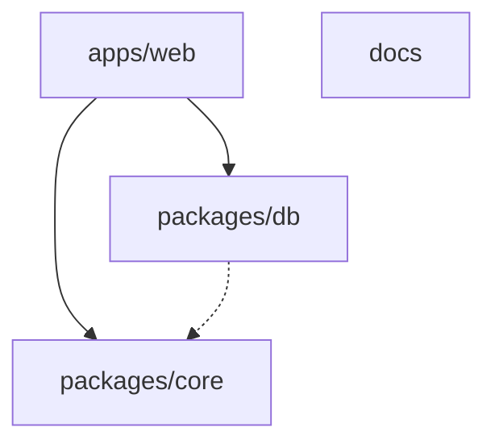

# Estrutura do monorepo

Quem está em cima conhece quem está embaixo. O contrário não acontece: `packages/core` não importa Prisma, Next.js nem React.

`packages/db` só usa o `core` nos scripts (`recover-owner`, `seed-demo`), não no client.

## Pacotes

| Pasta | Nome | O que guarda |
|---|---|---|
| `apps/web` | `@api-hub/web` | Telas em `src/app`, Server Actions, rotas em `src/app/api`, assistente, guardas e Auth.js em `src/lib`, componentes em `src/components`. |
| `packages/core` | `@api-hub/core` | Regras puras: acesso, permissões, spec, ambientes, temas, o menu (`hub-nav.ts`), a busca e os atalhos de criação (`command-search.ts`, `create-shortcuts.ts`), provedores, variáveis, paginação, textos e os esquemas Zod. Os enums do Prisma são espelhados à mão em `types.ts`, para o pacote não depender do client. |
| `packages/db` | `@api-hub/db` | `prisma/schema.prisma`, migrações, o client (`src/index.ts`) e os scripts de recuperação e de demonstração. |
| `docs` | `@api-hub/docs` | Este site (VitePress). Não entra no build do aplicativo. |

Na raiz ficam o `package.json` dos comandos (`pnpm dev`, `pnpm db:up`), o `turbo.json`, o `docker-compose.yml`, o `Dockerfile` e os workflows em `.github/workflows`.

## Onde colocar o que você vai escrever

| Você vai escrever… | Coloque em… |
|---|---|
| Uma decisão que não precisa de banco, sessão nem React | `packages/core/src`, com teste em `packages/core/test` |
| Um esquema Zod usado pela tela e pela API | `packages/core/src/schemas.ts` |
| Tabela, coluna ou enum | `packages/db/prisma/schema.prisma` e uma migração |
| A consulta de uma tela | `query.ts` ao lado da `page.tsx` |
| Uma mutação de formulário | `actions.ts` com `"use server"` |
| Guarda, auditoria, leitura de URL, Auth.js | `apps/web/src/lib` |
| Componente de mais de uma tela (modal, barra de salvar, zona de perigo, trilha) | `apps/web/src/components` |
| Um item do menu lateral | `packages/core/src/hub-nav.ts`, com o grupo e a permissão |
| Um cadastro que também vira atalho no ⌘K e no **+ Novo** | `packages/core/src/create-shortcuts.ts`, com o mesmo `id` do modal |
| Endpoint HTTP | `apps/web/src/app/api/.../route.ts` |

A pergunta prática: se dá para testar com `expect(f(entrada)).toBe(saida)`, a função quer viver no `core`.

## Telas

Cada área do hub é uma pasta em `apps/web/src/app/(hub)/`. A `page.tsx` busca os dados e monta a tela. Pasta com `_` no nome não vira rota. As principais:

| Pasta | O que guarda |
|---|---|
| `(hub)/_catalog` | As peças do Catálogo: filtros, linha, saúde, consulta em SQL. |
| `(hub)/_search` | A Server Action da busca ⌘K (`searchServices`). |
| `(hub)/admin/_registry` | O que as quatro páginas de cadastro (`services`, `repositories`, `links`, `tokens`) dividem: a guarda de acesso (`guard.ts`, que lê o `HUB_NAV`), as consultas, o cabeçalho, as tabelas, as Server Actions e os formulários de modal em `forms/`. |
| `(hub)/admin/settings/tabs` | Uma peça por aba de Configurações (`organization`, `connections`, `environments`, `appearance`). |

`admin/catalog` e `admin/appearance` não têm tela: só redirecionam para as páginas novas. Os componentes compartilhados da interface ficam em `apps/web/src/components` (veja [Interface e design system](/arquitetura/interface)). O passo a passo de uma tela nova está em [Criar uma tela nova](/contribuindo/guias/nova-tela).

O alias `@/` aponta para `apps/web/src`. Os pacotes internos são `@api-hub/core` e `@api-hub/db`.

## O que não entra no Git

`.env`, `apps/web/.env` e `packages/db/.env` ficam de fora. O modelo versionado é `.env.example`. Segredos gerados com `pnpm setup:keys` não são commitados.

## Veja também

- [Padrões de código](/contribuindo/padroes-de-codigo)
- [Modelo de dados](/arquitetura/modelo-de-dados)
- [Comandos (CLI)](/referencia/cli)
