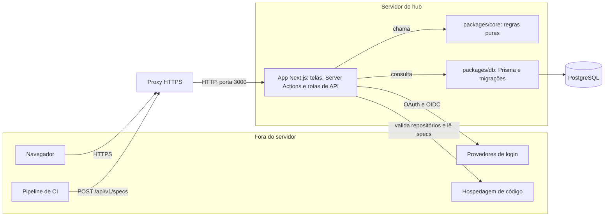
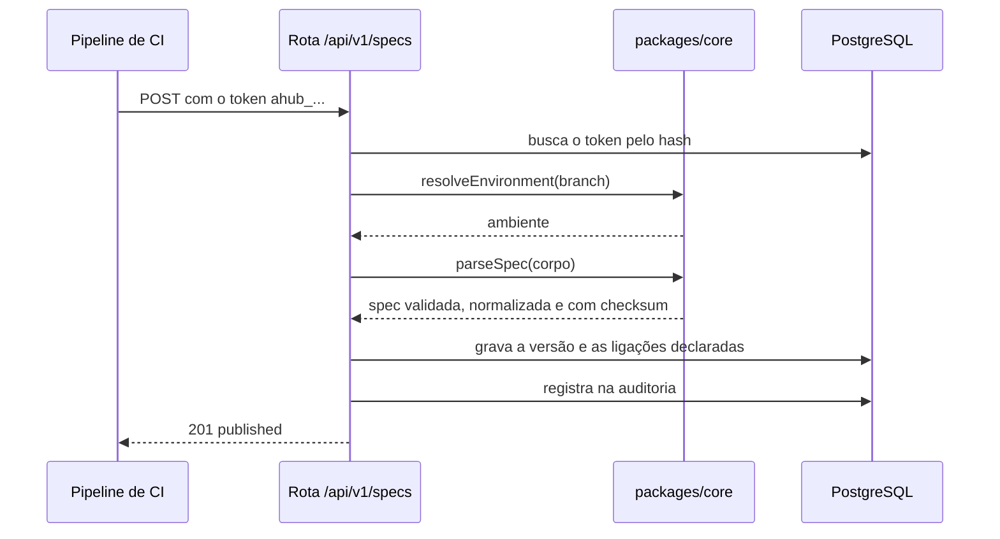

# Visão geral e princípios

Esta página explica por que o Rizoma existe, o que ele quer e não quer ser, os princípios que guiam o código e como as peças se encaixam. Ela serve a quem opera o hub, avalia a arquitetura ou vai contribuir com código. As páginas seguintes da seção aprofundam cada parte.

## O problema

Muitos serviços expõem o Swagger em `/docs`. Isso tem dois custos:

- **Apresentação repetida.** É preciso apresentar serviço por serviço para cada pessoa, e de novo a cada contratação.
- **Contratos internos públicos.** Para o `/docs` ser útil ele precisa estar acessível, e isso costuma significar contratos internos abertos na internet.

## Objetivos

O objetivo é ter **um único lugar, fechado**, onde quem é da empresa encontra todas as APIs, entende quem é dono de cada uma e vê como elas se ligam. Em termos verificáveis, o produto precisa cumprir estes critérios:

- Instalar do zero **só pela tela**, sem editar o banco.
- Uma pessoa nova da organização entrar e ver o catálogo **sem pedir nada a ninguém**.
- Uma pessoa de fora **pedir acesso** e ser aprovada ou recusada por quem administra.
- Um serviço **publicar a spec pelo CI** e aparecer no catálogo, por ambiente.
- O `/docs` público dos serviços poder ser **desligado sem perder a documentação**.

## Não-objetivos

O que o Rizoma deliberadamente não faz:

- **Não é um API gateway.** Não recebe nem roteia o tráfego das suas APIs.
- **Não é um mock server** nem um **portal público de desenvolvedores**.
- **Não executa requisições.** O renderizador da spec roda sem "testar requisição".
- **Não gera a spec.** Recebe, valida, versiona e exibe.
- **Não é multiempresa.** Uma instalação atende **uma** organização.
- **Não escala horizontalmente hoje.** O limite de requisições é em memória, então o hub roda em uma instância (veja o [roadmap](/arquitetura/roadmap)).
- **Não usa outro banco além do PostgreSQL** por enquanto.

## Princípios de design

### Fechado por padrão

Nada é público. Sem sessão, o `proxy.ts` leva a pessoa para o login, e o hub responde `noindex` e bloqueia buscadores no `robots.txt`. Quem entra passa pela política de acesso (vínculo com a empresa, aprovação, prazo). Serviços restritos ao time não vazam pelo catálogo, pelo mapa nem por URL direta.

### Regras de negócio em funções puras e testadas

As decisões do produto (permissões, política de acesso, validação de spec, ambientes por branch, grafo, paginação, temas) vivem em `packages/core`, em funções sem dependência de banco nem de framework. As telas e as rotas só **chamam** essas funções. Isso permite cobrir as regras com testes rápidos e explicar cada uma por código (`RN-xx`), como na [referência de regras de negócio](/referencia/regras-de-negocio).

### Permissão sempre no servidor

Esconder um botão não é controle de acesso. Toda página e ação passa por `requireUser()` ou `requirePermission()` no servidor. As rotas administrativas respondem **404** a quem não tem a permissão, para não revelar que existem. O `proxy.ts` é só uma barreira barata contra quem nem tem cookie de sessão.

### Tudo auditável

As ações que importam (login, decisões de acesso, papéis, permissões, times, serviços, vínculos, tokens, publicações, configurações, recuperação de OWNER e a instalação) vão para a [auditoria](/admin/auditoria), com quem fez, quando e de qual IP. A própria exportação do CSV é registrada.

### Segredo nunca em texto aberto nem em log

- Segredos (variáveis marcadas como segredo, Client secrets, tokens de repositório) são cifrados com **AES-256-GCM**, com uma chave que **não** fica no banco.
- Tokens de publicação, convites e links de nova senha guardam só o **hash** SHA-256. Senhas usam **scrypt**.
- Nenhum valor de variável ou segredo entra na auditoria, e o código do servidor não escreve segredos em log.
- Nada sensível volta para a tela: os campos mostram apenas que "já existe um secret salvo".

### Interface única e padronizada

Todas as listagens usam o mesmo componente de tabela, a mesma paginação (por URL), os mesmos estados vazios, selos, avisos e abas. Testes-guarda falham se alguém montar uma tabela à mão ou esquecer a paginação. Todo o texto é em português do Brasil. Veja [Interface e design system](/arquitetura/interface).

### Auto-hospedado, sem dependência de SaaS

O hub é um aplicativo Node com um PostgreSQL. Não existe serviço em nuvem do projeto, e o renderizador de specs roda sem telemetria e sem recursos que enviem a spec para fora. O hub só se comunica com os provedores de login e de repositório que **você** configurar.

### Instalável e operável sem tocar no banco

O [assistente de instalação](/instalacao/assistente) configura tudo, e as [Configurações](/admin/configuracoes) permitem mudar depois. Recuperar o acesso, atualizar e fazer backup têm caminhos documentados.

## Componentes

| Componente | Papel |
|---|---|
| **Navegador** | Usa o hub. As telas são renderizadas no servidor (React Server Components), e as partes interativas (mapa, tour, editores) rodam no cliente. |
| **Pipeline de CI** | Publica a spec de cada serviço com um token, por `POST /api/v1/specs`. |
| **Proxy HTTPS** | Termina o TLS na frente do app. Veja [HTTPS com proxy reverso](/instalacao/proxy-https). |
| **App Next.js** (`apps/web`) | Um único aplicativo com as telas, as Server Actions, as rotas de API (`/api/v1/*`, `/api/auth/*`, `/api/health`, `/api/setup*`, o CSV da auditoria e o download do `.env`) e o assistente de instalação. |
| **`packages/core`** | As regras de negócio puras: `rbac`, `access-policy`, `spec`, `environments`, `sources`, `envvars`, `crypto`, `password`, `graph`, `themes`, schemas Zod, `hub-nav` e `pagination`. |
| **`packages/db`** | O schema do Prisma, as migrações, o cliente (com o driver `pg`) e os scripts de recuperação de OWNER e de demonstração. |
| **PostgreSQL** | Guarda tudo: configuração, pessoas, serviços, specs por versão, variáveis, auditoria. |
| **Provedores de login** | GitHub, Google, Microsoft, GitLab, Facebook ou OIDC, para autenticar e comprovar vínculo. Veja [Provedores de login](/instalacao/provedores-de-login). |
| **Hospedagem de código** | GitHub, GitLab ou Bitbucket, para validar repositórios e ler arquivos de spec. Opcional. |

### Como uma requisição atravessa as camadas

A publicação de uma spec pelo CI mostra a divisão de responsabilidades: a rota cuida de HTTP, autenticação e persistência, e o `core` decide o que é válido.

Uma tela segue o mesmo caminho: a página chama `requirePermission()` (que usa `can()` do `core`), consulta o banco pelo Prisma e renderiza o resultado.

## Onde ler mais

| Quero entender... | Leia |
|---|---|
| Por que cada decisão foi tomada, com prós e contras | [Decisões de arquitetura](/arquitetura/decisoes) |
| Quais bibliotecas e versões o projeto usa | [Tecnologias](/arquitetura/tecnologias) |
| Onde fica cada pasta e quem depende de quem | [Estrutura do monorepo](/arquitetura/monorepo) |
| Como o banco está modelado | [Modelo de dados](/arquitetura/modelo-de-dados) |
| Como funciona o login, o vínculo e as sessões | [Autenticação e acesso](/arquitetura/autenticacao-e-acesso) |
| Como a spec chega, é validada e versionada | [Ingestão de specs](/arquitetura/ingestao-de-specs) |
| Como a interface é montada e testada | [Interface e design system](/arquitetura/interface) |
| O que vem a seguir | [Roadmap](/arquitetura/roadmap) |
| As regras e os controles de segurança em detalhe | [Regras de negócio](/referencia/regras-de-negocio) e [Segurança](/referencia/seguranca) |
| Como contribuir | [Como contribuir](/contribuindo/) |

## Próximos passos

- [Decisões de arquitetura](/arquitetura/decisoes): o registro de cada escolha importante.
- [Estrutura do monorepo](/arquitetura/monorepo): um passeio pelas pastas do código.
- [Preparar o ambiente](/contribuindo/ambiente): rode o projeto e comece a contribuir.
