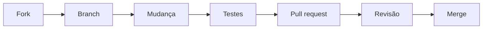

# Como contribuir

O Rizoma é um projeto de código aberto e toda ajuda conta, de uma vírgula errada na documentação a uma tela nova. Esta página mostra as formas de contribuir, onde conversar e o caminho de uma contribuição, do fork ao merge. As páginas seguintes desta seção entram nos detalhes técnicos.

## Formas de ajudar

Você não precisa escrever código para contribuir.

| Quero… | Como fazer |
|---|---|
| **Reportar um bug** | Abra uma issue com o formulário "Bug" em [github.com/wendersonbelko/rizoma/issues](https://github.com/wendersonbelko/rizoma/issues). Informe a versão, a forma de instalação, os passos para reproduzir e o que você esperava ver. |
| **Sugerir uma funcionalidade** | Abra uma issue com o formulário "Sugestão". Descreva o problema que você quer resolver antes da solução: fica mais fácil discutir alternativas. |
| **Melhorar a documentação** | Cada página do site tem o link **Editar esta página no GitHub**. Para mudanças maiores, veja [Esta documentação](/contribuindo/documentacao). |
| **Traduzir** | A interface e o site existem só em pt-BR, e os textos ficam direto no código (não há arquivos de tradução). Traduzir a documentação é bem-vindo; abra uma issue antes para combinarmos a organização das pastas. Internacionalizar a interface é uma mudança grande: comece por uma conversa. |
| **Escrever código** | Corrija um bug, implemente uma sugestão aprovada ou pegue uma issue marcada como `good first issue`. Comece por [Preparar o ambiente](/contribuindo/ambiente). |
| **Revisar pull requests** | Leia os PRs abertos, teste a branch na sua máquina e comente. Revisão é uma das contribuições mais valiosas e não exige ser mantenedor. |
| **Ajudar outras pessoas** | Responda dúvidas nas issues e nas discussões. |

::: tip Ideias fora do código
Um exemplo real de uso, um print atualizado, um trecho de "Solução de problemas" que faltou ou uma dúvida que você teve na instalação viram melhorias de documentação que ajudam a próxima pessoa.
:::

## Onde conversar

- **Issues**: bugs e sugestões concretas, em [github.com/wendersonbelko/rizoma/issues](https://github.com/wendersonbelko/rizoma/issues). Procure antes de abrir uma nova; talvez já exista.
- **Discussions**: perguntas, ideias ainda vagas e conversas sobre rumo do projeto, em [github.com/wendersonbelko/rizoma/discussions](https://github.com/wendersonbelko/rizoma/discussions) (quando ativadas no repositório).
- **Vulnerabilidades**: não use issues públicas. Siga [Reportar uma vulnerabilidade](/contribuindo/seguranca).

Escreva em português. Seja específico: versão, passos, mensagens de erro e prints ajudam mais do que "não funciona".

## O caminho de uma contribuição

1. **Faça um fork** do repositório e clone o seu fork.
2. **Crie uma branch** a partir da `main`, com um nome que diga o que muda (`feat/filtro-por-tag`, `fix/paginacao-auditoria`).
3. **Faça a mudança**, seguindo os [padrões de código](/contribuindo/padroes-de-codigo).
4. **Rode os testes** e a checagem de tipos: `pnpm typecheck` e `pnpm test`. Se mexeu em banco ou em regras de acesso, rode também `pnpm test:integration`. Veja [Testes](/contribuindo/testes).
5. **Abra o pull request** preenchendo o checklist do modelo. Explique o porquê da mudança e, se ela for visual, anexe prints.
6. **Responda à revisão.** Quem revisa pode pedir ajustes; isso é parte normal do processo.
7. **Merge.** Com o CI verde e a aprovação de quem mantém, o PR entra na `main`.

O passo a passo completo, com convenção de commits, checklist e releases, está em [Pull requests e releases](/contribuindo/pull-requests).

## Sua primeira contribuição

1. Leia [Preparar o ambiente](/contribuindo/ambiente) e deixe o hub rodando na sua máquina.
2. Procure issues com o rótulo [`good first issue`](https://github.com/wendersonbelko/rizoma/labels/good%20first%20issue). São tarefas pequenas, com escopo claro.
3. Comente na issue que você quer pegá-la, para ninguém trabalhar em duplicado.
4. Em caso de dúvida, pergunte na própria issue. Ninguém espera que você conheça o projeto inteiro.

Boas primeiras contribuições: corrigir um texto da interface ou da documentação, melhorar uma mensagem de erro, cobrir uma função do `packages/core` com um teste que falta, ou ajustar uma tela para usar os componentes padrão do design system.

::: info Antes de um PR grande
Mudanças que alteram o comportamento do produto, o modelo de dados ou as permissões merecem uma issue ou discussão antes do código. Assim ninguém gasta uma semana numa direção que não vai ser aceita.
:::

## Licença

Ao contribuir, você concorda que sua contribuição será licenciada sob a mesma licença do projeto, descrita no arquivo `LICENSE` na raiz do repositório.

## Comunidade e conduta

Todas as pessoas que participam do projeto seguem o [Código de conduta](/contribuindo/codigo-de-conduta). Se algo estiver fora do combinado, veja lá como nos avisar.

## Veja também

- [Preparar o ambiente](/contribuindo/ambiente)
- [Padrões de código](/contribuindo/padroes-de-codigo)
- [Pull requests e releases](/contribuindo/pull-requests)
- [Estrutura do monorepo](/arquitetura/monorepo)
