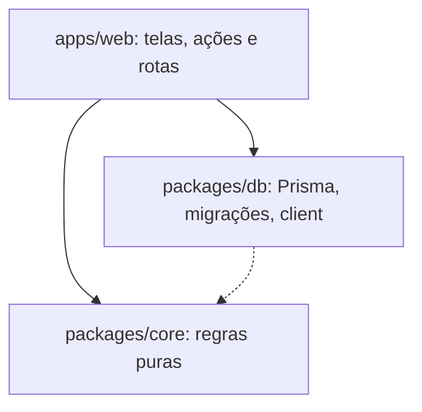

# Padrões de código

Esta página descreve como o código do Rizoma é organizado e escrito, para que sua contribuição pareça parte do projeto e passe pela revisão sem idas e vindas. Tudo aqui foi extraído do código existente: na dúvida, abra um arquivo vizinho e faça igual.

## Arquitetura em camadas

O monorepo tem três camadas de código e uma regra de dependência simples: quem está em cima conhece quem está embaixo, nunca o contrário.



- **`packages/core`** guarda as regras de negócio puras: permissões (`rbac.ts`), política de acesso, leitura de specs, ambientes, paginação, textos, temas, esquemas Zod e o menu (`hub-nav.ts`). Não importa Prisma, Next.js nem React, e por isso é rápido de testar. Como não depende do banco, `types.ts` espelha à mão os enums do Prisma.
- **`packages/db`** guarda o `schema.prisma`, as migrações, o client e os scripts administrativos (`recover-owner.ts`, `seed-demo.ts`). Só os scripts usam o `core`.
- **`apps/web`** é o Next.js: telas, Server Actions, rotas de API, o assistente `/setup` e o backoffice `/admin/*`. É a única camada que junta banco, sessão e interface.

### Onde cada coisa vai

| Você vai escrever… | Coloque em… |
|---|---|
| Uma regra que decide algo sem tocar em banco ou rede (quem pode, o que casa, como formatar) | `packages/core/src`, com teste em `packages/core/test` |
| Um esquema Zod compartilhado por tela e API | `packages/core/src/schemas.ts` |
| Uma tabela, coluna ou enum | `packages/db/prisma/schema.prisma` e uma migração |
| A consulta que alimenta uma tela | `query.ts` na pasta da tela |
| Uma mutação disparada por um formulário ou botão | `actions.ts` na pasta da tela |
| Guardas, auditoria, leitura de URL externa, Auth.js | `apps/web/src/lib` |
| Um componente usado em mais de uma tela | `apps/web/src/components` |
| Um componente de uma tela só | A pasta da própria tela |
| Um endpoint HTTP | `apps/web/src/app/api/.../route.ts` |

::: tip A pergunta que decide
Se a lógica funciona sem banco, sem sessão e sem React, ela é do `core`. Se você consegue testá-la com `expect(f(entrada)).toBe(saida)`, ela quer viver lá. Veja [Estrutura do monorepo](/arquitetura/monorepo).
:::

## Estrutura de uma tela

Cada tela do hub é uma pasta em `apps/web/src/app/(hub)/`. A `page.tsx` **só busca os dados e monta a tela** a partir de peças de responsabilidade única. Veja o Catálogo:

```text
app/(hub)/
  page.tsx                  # busca e monta
  _catalog/                 # pasta privada da tela (o "_" tira a pasta das rotas)
    query.ts                # camada de dados
    search-form.tsx         # a busca
    service-table.tsx       # a tabela (DataTable)
    service-row.tsx         # uma linha da tabela
    no-results.tsx          # estado "sem resultados para o filtro"
    empty-catalog.tsx       # estado "catálogo vazio"
```

| Arquivo | Responsabilidade |
|---|---|
| `page.tsx` | Guarda de permissão, leitura dos parâmetros da URL, chamada de `query.ts`, composição. Nenhuma regra de tabela, chip ou paginação. |
| `query.ts` | Consultas Prisma. Aplica filtros e visibilidade em SQL, para a paginação refletir o total real. |
| `*-table.tsx` | Monta a `DataTable` com cabeçalhos e linhas. |
| `*-row.tsx` | Uma linha: compõe células padrão com o conteúdo do item. |
| `actions.ts` | Server Actions da tela (`"use server"`). |
| `forms/` | Formulários com estado (Client Components). |
| `tabs/` | Uma peça por aba, cada uma buscando seus próprios dados. |
| `_algo/` | Pasta privada: peças da tela que não são rotas. |

Duas regras práticas: um componente faz uma coisa (se o arquivo precisa de um "e" para ser descrito, divida-o), e quem quiser mudar como uma linha é desenhada mexe em `*-row.tsx`, não na página.

Esta é a `page.tsx` do Catálogo, resumida:

```tsx
export default async function CatalogPage({ searchParams }: { searchParams: Promise<{ q?: string; tag?: string; page?: string; size?: string }> }) {
  const user = await requirePermission("catalog:read");
  const sp = await searchParams;
  const { services, info } = await getCatalogPage(user, { q: sp.q, tag: sp.tag }, readPageRequest(sp));

  return (
    <div className="max-w-6xl">
      <h1 className="mb-1 text-2xl font-bold tracking-tight">Catálogo de APIs</h1>
      <CatalogSearchForm defaultValue={sp.q ?? ""} pageSize={sp.size} />
      <ServiceTable services={services} envs={envs} pagination={<Pagination info={info} noun={["serviço", "serviços"]} params={sp} />} />
    </div>
  );
}
```

O passo a passo completo está em [Criar uma tela nova](/contribuindo/guias/nova-tela).

## Nomes e convenções

| O quê | Convenção | Exemplo |
|---|---|---|
| Arquivos | `kebab-case` | `service-row.tsx`, `use-graph-layout.ts` |
| Componentes e tipos | `PascalCase` | `ServiceTable`, `CatalogService` |
| Funções e variáveis | `camelCase` | `getCatalogPage`, `readPageRequest` |
| Constantes globais | `UPPER_SNAKE_CASE` | `HUB_NAV`, `DEFAULT_MATRIX` |
| Esquemas Zod | `nameSchema` | `slugSchema`, `envVarSchema` |
| Permissões | `resource:action` | `catalog:read`, `envvars:reveal` |
| Ações de auditoria | `group.action_in_snake_case` | `team.member_added`, `envvar.revealed` |
| Parâmetros de URL de abas | curtos, em inglês | `?t=services`, `?s=organization`, `?tab=rules` |

- Use **exports nomeados**. `export default` fica só para `page.tsx`, `layout.tsx` e `route.ts`, onde o Next exige.
- Identificadores no código ficam em inglês: arquivos, pastas, variáveis, rotas e parâmetros de URL. Textos da interface, mensagens de erro e comentários ficam em pt-BR.
- As rotas do hub são em inglês, inclusive as que a pessoa recebe por fora do app (`/invite/<token>`, `/reset-password/<token>`, `/signup`, `/login/forgot`). Endereços antigos em português redirecionam para esses.

## Server Components e Client Components

Tudo é Server Component por padrão. Ponha `"use client"` só onde a interface precisa de estado, efeito ou evento do navegador, e o mais fundo possível na árvore (o formulário, não a página inteira). Exemplos no projeto: a matriz de permissões (`matrix.tsx`, com estado dos checkboxes), os formulários com `useActionState`, o tour guiado e o mapa.

Regras que vêm do código:

- **Consultas ao banco e guardas ficam no servidor.** Um arquivo `"use client"` nunca importa `@api-hub/db` nem `@/lib/guards`.
- **Client Components importam o `core` por subcaminho** (`@api-hub/core/rbac`, `@api-hub/core/pagination`, `@api-hub/core/text`…). O índice `@api-hub/core` reexporta módulos que usam `node:crypto`, que não existem no navegador. Se você precisa de algo de um módulo que ainda não tem subcaminho, acrescente-o em `exports` no `packages/core/package.json`.
- Componentes de servidor importam do índice (`@api-hub/core`).

## Server Actions

Toda mutação é uma Server Action num `actions.ts` que começa com `"use server"`. A ordem é sempre a mesma:

1. **Permissão**: `requirePermission(...)` na primeira linha.
2. **Validação** da entrada com Zod.
3. **Regras de escopo** ("só o próprio time", "não o próprio papel").
4. **Mutação**, numa `$transaction` quando há mais de uma escrita.
5. **Auditoria** com `audit(...)`.
6. **`revalidatePath`** das telas afetadas.

A ação mais simples do projeto, criar um time, mostra o padrão:

```ts
"use server";

export async function createTeam(form: FormData) {
  const actor = await requirePermission("team:manage");
  const d = z.object({ name: z.string().trim().min(2).max(60), slug: slugSchema, description: z.string().max(300).optional() }).parse(Object.fromEntries(form));
  const team = await prisma.team.create({ data: d });
  await audit({ actorId: actor.id, action: "team.created", targetType: "team", targetId: team.id });
  revalidatePath("/admin/teams");
}
```

Quando a pessoa pode errar o preenchimento (formulários com campos digitados), a ação **devolve** o erro em vez de lançar, e o formulário mostra a mensagem:

```ts
export type Result = { ok: boolean; message?: string };
const fail = (message: string): Result => ({ ok: false, message });

export async function updateService(_: Result, form: FormData): Promise<Result> {
  const actor = await requirePermission("service:edit");
  const parsed = updateServiceSchema.safeParse(/* … */);
  if (!parsed.success) return fail(parsed.error.issues[0]?.message ?? "Dados inválidos.");
  // …
  return { ok: true, message: "Alterações salvas." };
}
```

No formulário (Client Component), `useActionState(updateService, initialResult)` guarda o estado e um componente `Feedback` mostra a mensagem com `role="status"`. Para ids escondidos em campos `hidden`, que só chegam errados se alguém adulterar a requisição, lançar erro com `.parse()` é aceitável.

::: warning Redirect fora do try/catch
`redirect()` do Next funciona lançando uma exceção. Chame-o fora de blocos `try/catch`, ou o `catch` engole o redirecionamento.
:::

## Validação com Zod

Toda entrada externa é validada com Zod 4: formulários, corpo de API, parâmetros de URL. Nunca confie no tipo que o TypeScript "acha" que veio de um `FormData`.

- Esquemas que tela e API compartilham, ou que merecem teste, moram em `packages/core/src/schemas.ts`.
- Mensagens de erro em pt-BR, escritas para quem preenche o formulário: `"Use só letras minúsculas, números e hífen (2 a 63 caracteres)…"`.
- Em ações com feedback use `safeParse` e devolva `issues[0]?.message`; em rotas de API responda 422 com uma mensagem clara.
- Normalize na borda: `.trim()`, `.toLowerCase()`, `.transform(...)`. O restante do código recebe o dado limpo.
- Limite tamanhos (`.max(...)`). Entrada sem limite é convite a abuso.

## Permissões

- **A checagem acontece no servidor.** Esconder um botão com `can(user, "...")` melhora a interface, mas não protege nada. Toda página e ação chama `requirePermission("recurso:acao")` (ou `requireUser()`), de `apps/web/src/lib/guards.ts`.
- **Sem permissão, a resposta é 404**, não 403: `requirePermission` chama `notFound()` para não revelar que a rota existe (RN-23). Em route handlers, responda `404` da mesma forma.
- **Escopo de time.** Permissões marcadas como "próprio time" exigem também `canManageService(actor, service, "permissao")`. Nunca confie no `serviceId` que veio do formulário: carregue o serviço do banco e confira.
- **Visibilidade.** A regra de quem enxerga cada serviço (RN-30) é aplicada na consulta, em SQL, e não filtrando depois em memória.
- **Nada de exceções para "quem é admin".** Se um papel precisa de algo, dê uma permissão a ele. Veja [Criar uma permissão](/contribuindo/guias/nova-permissao).

## Auditoria

Toda ação administrativa chama `audit()` (`apps/web/src/lib/audit.ts`) depois de mudar o dado:

```ts
await audit({ actorId: actor.id, action: "envvar.updated", targetType: "service", targetId: svc.id, metadata: { key: d.key, env: env.slug, isSecret: d.isSecret } });
```

- O nome da ação é `grupo.acao_em_snake_case`, em inglês. O prefixo do grupo alimenta o filtro por tipo da tela **Auditoria** (`AUDIT_GROUPS`, em `admin/audit/query.ts`).
- Toda ação nova ganha uma frase em `describeAuditEvent` (mesmo arquivo), para a tela mostrar "Vínculo criado: A consome B" em vez de um código técnico.
- `metadata` guarda o contexto útil (chaves, slugs, o que mudou), **nunca valores secretos**. O código comenta isso onde importa: "Nunca registrar o valor na auditoria."
- Registre também o que não muda dados mas é sensível: revelar um segredo, exportar CSV, baixar o `.env`.

## Erros e mensagens

- A pessoa vê **uma mensagem em pt-BR que diz o que fazer**, não um stack trace: `"Você só altera serviços dos seus times."`.
- Falha esperada (validação, regra de negócio) vira `{ ok: false, message }` ou um `throw new Error("mensagem")` com texto pronto para exibir. Falha inesperada deixa o erro subir.
- Não vaze detalhes internos (SQL, caminhos, nomes de tabela) nas mensagens.
- Não use `console.log` para depurar e esquecer. O código de produção quase não tem `console`.

## Textos da interface

Toda a interface é em pt-BR, num tom direto e sem jargão. Fale com a pessoa ("você"), diga o que aconteceu e o que fazer.

| Em vez de… | Escreva… |
|---|---|
| "Erro 500" | "Não foi possível salvar. Tente de novo." |
| "Operação não permitida" | "Você só altera serviços dos seus times." |
| "Entidade não encontrada" | "Serviço não encontrado." |
| "Submit" / "OK" | "Salvar", "Criar time", "Restaurar" (verbos que dizem o efeito) |
| "0 serviços listados" | Um `EmptyState`: "Nenhum serviço cadastrado", com a ação para sair do vazio |

Mais regras: só a primeira letra da frase em maiúscula nos botões e títulos, plural correto com `plural()` e `countLabel()` (`packages/core/src/text.ts`), datas com `toLocaleDateString("pt-BR")` e números com `toLocaleString("pt-BR")`. Nomes de telas e botões que aparecem na documentação devem bater com a interface: se você renomear um, atualize o [tour](/contribuindo/guias/nova-tela) e as páginas do site.

## Comentários

O código do projeto **comenta o porquê, não o quê**, em pt-BR. Um comentário existe para registrar uma decisão, uma armadilha ou uma regra de negócio:

```ts
// RN-31: slug congela depois da primeira spec publicada.
// RN-33: sem service:edit_any, o serviço não sai do próprio time.
// Uma linha inferior como sombra (não border): com border-collapse, a borda some no cabeçalho fixo.
```

- Regras de negócio levam o **código RN** (`RN-30`, `RN-S01`) no comentário, para quem lê achar a regra em [Regras de negócio](/referencia/regras-de-negocio). Se você cria uma regra nova, registre-a lá e cite o código.
- Componentes e módulos importantes começam com um bloco `/** … */` que explica o papel e como usar (veja `table.tsx` e `pagination.tsx`).
- Não narre o óbvio (`// incrementa o contador`) e não deixe código comentado.

## Design system

As telas usam os componentes padrão do hub. Não é uma sugestão: os testes em `apps/web/test/unit/design-system.test.ts` falham se alguém montar `<table>` à mão, listas com divisórias à mão ou uma tabela de listagem sem paginação. Veja [Testes](/contribuindo/testes) e [Interface e design system](/arquitetura/interface).

| Componente | Arquivo | Use para |
|---|---|---|
| `DataTable`, `THead`, `Th`, `TBody`, `Tr`, `Td`, `CellTitle`, `RowActions` | `components/table.tsx` | Toda listagem tabular |
| `CardList`, `CardListItem` | `components/card-list.tsx` | Itens "ricos" que não cabem numa linha de tabela |
| `Pagination` / `ClientPagination` | `components/pagination.tsx`, `client-pagination.tsx` | Paginação por URL (dados do servidor) ou em memória |
| `EmptyState` | `components/empty-state.tsx` | Qualquer lista vazia |
| `Badge` | `components/ui.tsx` | Selos de status e categoria (`neutral`, `accent`, `wait`, `danger`) |
| `Notice` | `components/ui.tsx` | Avisos em faixa (`info`, `wait`, `danger`) |
| `Section` / `Panel` | `components/ui.tsx` | `Section` para conteúdo que já é um card (tabela); `Panel` para formulários |
| `TabNav` | `components/tab-nav.tsx` | Abas de página navegando por URL |
| `FilterChips` | `components/filter-chips.tsx` | Filtros rápidos em pílulas |
| `Button`, `LinkButton`, `Field`, `Input`, `Select` | `components/ui.tsx` | Botões e campos de formulário |
| `Markdown` | `components/markdown.tsx` | Todo Markdown renderizado (sem HTML cru) |

A linha do Catálogo mostra como as peças se encaixam:

```tsx
export function ServiceTable({ services, envs, pagination }: { services: CatalogService[]; envs: Env[]; pagination?: ReactNode }) {
  return (
    <DataTable tour="catalog-list" caption="Serviços do catálogo" minWidth={720} pagination={pagination}>
      <THead>
        <Th>Serviço</Th>
        <Th>Time</Th>
        <Th>Ambientes</Th>
        <Th hideBelow="md">Ligações</Th>
      </THead>
      <TBody>
        {services.map((s) => <ServiceRow key={s.id} service={s} envs={envs} />)}
      </TBody>
    </DataTable>
  );
}
```

E `ServiceRow` só compõe células padrão:

```tsx
<Tr>
  <Td className="max-w-sm">
    <CellTitle title={service.name} href={`/services/${service.slug}`} badge={<LifecycleBadge lifecycle={service.lifecycle} />} />
  </Td>
  <Td><TeamCell name={service.ownerTeam?.name} /></Td>
</Tr>
```

Regras do design system:

- **Lista vazia não vira tabela com uma linha "nenhum item"**: use `EmptyState`.
- **Listagem que cresce com o uso é paginada** (10 por página; o seletor ainda oferece 20, 50 e 100). Só tabelas de tamanho fixo (a matriz de permissões, as formas de login, as origens de código, os ambientes da instalação) ficam sem paginação, e cada exceção é registrada com o motivo em `FIXED_SIZE_TABLES` no teste.
- **Criar ou editar uma entidade abre `FormModal`.** O formulário não fica montado na lista. Segredo e convite não fecham sozinhos depois de salvar, para o valor poder ser copiado.
- **Cores e raios vêm dos tokens do tema**, nunca de valores fixos. As classes são `bg-paper`, `bg-sheet`, `bg-field`, `text-ink`, `text-muted`, `border-line`, `text-accent`, `text-wait`, `text-danger`, `rounded-panel` e `rounded-control`. O tema é editável em **Aparência**, e um hexadecimal fixo quebra o modo escuro e o de alto contraste.
- **Precisa de um padrão que não existe?** Crie um componente em `components/`, documente-o com um bloco `/** */` e use-o nas telas. Não copie marcação de uma tela para outra.

## Acessibilidade

- Tabelas têm `caption` (o `DataTable` a renderiza só para leitores de tela) e cabeçalhos `scope="col"`. Colunas de ação usam `<SrOnly>Ações</SrOnly>`.
- Navegações têm `aria-label` e marcam o item atual com `aria-current` (`TabNav`, `FilterChips`, a paginação).
- Mensagens dinâmicas usam `role="status"` ou `role="alert"` (`Feedback`, `Notice`).
- Todo campo tem rótulo: use `Field`. Botão só com ícone precisa de `aria-label`.
- Não use só a cor para dizer algo: um `Badge` sempre tem texto.
- O foco visível é global (`:focus-visible`); não o desligue. Animações respeitam `prefers-reduced-motion`.
- O contraste dos temas é validado em `packages/core` (WCAG AA). Ao mudar uma cor do tema, o teste `themes.test.ts` vai avisar.
- O mapa tem o modo **Lista**, uma tabela navegável por teclado, justamente para quem não usa o grafo.

## Segurança

- **Nunca confie no cliente.** IDs, papéis e "é do meu time" vindos de formulário são conferidos no servidor.
- **Segredos.** Cifre com `encryptSecret` e leia com `decryptSecret` (`@api-hub/core`). Nunca escreva um segredo em log, em `metadata` de auditoria, em mensagem de erro ou em resposta de API.
- **Tokens.** Só o hash é salvo (SHA-256 para tokens de CI, scrypt para senhas).
- **Markdown.** Renderize sempre com o componente `Markdown`, que não aceita HTML cru. O projeto não usa `dangerouslySetInnerHTML`.
- **URLs externas.** Leia com `safeFetchText` (`apps/web/src/lib/sources.ts`), que bloqueia loopback, link-local e metadados de nuvem (RN-S17) e limita tempo e tamanho.
- **Rotas de API.** Confira sessão e `tokenVersion`, responda 404 sem permissão e aplique `rateLimit` onde a rota aceita chamadas automáticas.
- **Exportações.** Neutralize células que começam com `=`, `+`, `-` ou `@` em CSV.
- A CSP e os cabeçalhos ficam em `apps/web/next.config.ts`. Se a sua mudança carrega algo de outro domínio, ela precisa de um ajuste consciente ali.

Para reportar uma falha de segurança que você encontrou, veja [Reportar uma vulnerabilidade](/contribuindo/seguranca).

## TypeScript estrito

O `tsconfig.base.json` liga `strict` e `noUncheckedIndexedAccess`, e o projeto usa `isolatedModules`. Na prática:

- Acessar `lista[0]` devolve `T | undefined`. Trate o caso, ou use `!` só quando o código acabou de garantir que existe.
- Importe tipos com `import type` (ou o modificador `type` no import).
- Evite `any` e `as any`. Derive tipos do Prisma (`Prisma.ServiceGetPayload<…>`) e do Zod (`z.infer<typeof schema>`).
- O `pnpm typecheck` roda também sobre os arquivos de teste. Ele precisa passar limpo antes do PR.

## Tamanho, pastas e dependências

- Um arquivo não cresce até misturar assuntos. Quando a próxima mudança faria isso, o arquivo é dividido antes.
- Arquivos de um mesmo contexto ficam numa pasta só. Se esse contexto começa a se espalhar por pastas sem relação, ele ganha a pasta dele.
- Uma função pequena que dá para escrever não vira dependência npm. O lugar dela é `packages/core` (regra pura), `apps/web/src/lib` (entrada e saída da web) ou a pasta da funcionalidade, quando só ela usa. Não se cria um pacote do monorepo para um único uso.
- Código novo segue estes padrões. O que não cabe neles para e pergunta como seguir. Se a decisão mudar uma regra daqui, a pergunta seguinte é se os arquivos de agente (`AGENTS.md`) devem ser atualizados.
- O estilo obrigatório é o TypeScript de `tsconfig.base.json` (`strict`, `noUncheckedIndexedAccess`, `isolatedModules`), conferido com `pnpm typecheck`, e o ESLint da raiz, conferido com `pnpm lint`.

## Instruções para agentes de código

O mesmo padrão está escrito para o Cursor e para o Claude Code, em inglês, em `AGENTS.md` na raiz e na pasta de cada área (`apps/web`, `packages/core`, `packages/db`, `docs`). O Claude lê o `CLAUDE.md` ao lado, que importa esse arquivo. A resposta ao usuário fica em português. Se uma regra daqui mudar, atualize o `AGENTS.md` da mesma área.

## Veja também

- [Criar uma tela nova](/contribuindo/guias/nova-tela)
- [Testes](/contribuindo/testes)
- [Interface e design system](/arquitetura/interface)
- [Regras de negócio](/referencia/regras-de-negocio)
