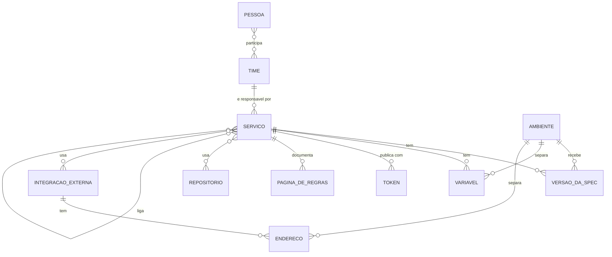
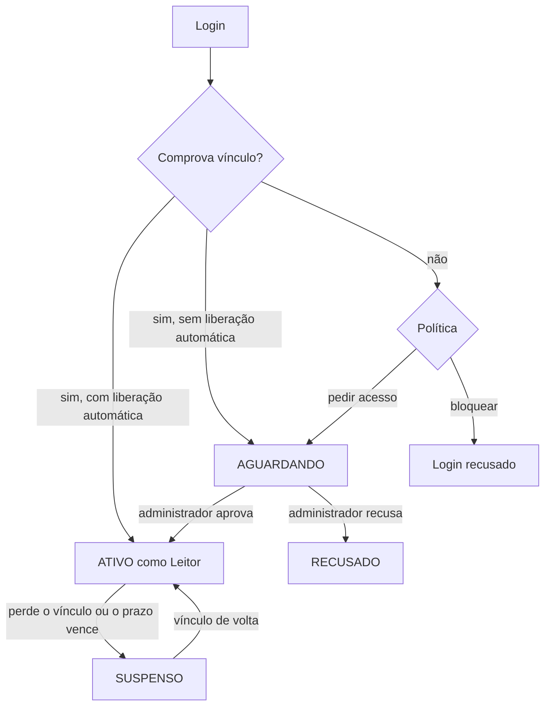

# Conceitos principais

Esta página explica os conceitos em que o Rizoma se apoia e como eles se relacionam. Ela serve a quem instala, a quem administra e a quem usa o hub no dia a dia. Se você só precisa de uma definição curta, veja o [Glossário](/referencia/glossario).

## Como tudo se relaciona

O **serviço** é o centro. Ele pertence a um **time**, tem **versões da spec** e **variáveis** separadas por **ambiente**, pode ter **páginas de regras de negócio**, ligações com outros serviços, repositórios e **integrações externas**, e publica com um **token**. As **pessoas** entram nos times e cada uma tem um **papel**.

## Instalação e organização

Cada hub tem uma única **instalação**: a configuração da empresa que o usa. Ela guarda o nome da empresa, um identificador curto (por exemplo, `acme`), o nome do sistema e a cor de destaque (a marca), o que conta como vínculo com a empresa e as regras de acesso.

Você define tudo isso no [assistente de instalação](/instalacao/assistente) e edita depois em [Configurações](/admin/configuracoes). O identificador é a única exceção: não muda depois da instalação, porque aparece em logs e integrações.

O **tema** (Claro, Escuro ou Sistema) não faz parte da instalação: cada pessoa escolhe o seu, no menu do avatar, e a escolha vale só para ela. A instalação define apenas a marca. Veja [Aparência](/admin/aparencia).

## Vínculo com a empresa

Vínculo é a prova de que uma pessoa é da sua empresa. Ele decide se a pessoa entra direto ou precisa de aprovação. Cada forma de login comprova o vínculo de um jeito:

| Forma de login | O que comprova o vínculo |
|---|---|
| GitHub | Ser membro **ativo** de uma das organizações do GitHub aceitas |
| Google, GitLab e OIDC | E-mail de um dos domínios aceitos (no Google e no OIDC, o e-mail precisa estar verificado) |
| Microsoft | Conta do diretório (tenant) informado, ou e-mail de um domínio aceito |
| Facebook | **Nunca** comprova vínculo |
| E-mail e senha | **Nunca** comprova vínculo: entra por convite ou aprovação |

O vínculo é conferido no login e depois a cada N horas (padrão 12). Só o GitHub permite reconsultar sem novo login. Veja [Provedores de login](/instalacao/provedores-de-login).

## Pessoa e status

Uma **pessoa** é identificada pelo usuário do GitHub ou pelo e-mail. Ela tem um **status** que controla se pode usar o hub:

| Status na tela | Significado |
|---|---|
| aguardando | Entrou, mas ainda não foi liberada. Vê a tela de solicitação de acesso. |
| ativo | Pode usar o hub, conforme o papel. |
| suspenso | Perdeu o vínculo, teve o prazo vencido ou foi suspensa por um administrador. |
| recusado | A solicitação foi recusada. Só um administrador reabre. |

Pontos importantes:

- **Solicitação de acesso.** Enquanto espera, a pessoa pode escrever quem é e por que precisa de acesso (de 10 a 500 caracteres). A solicitação expira em N dias (padrão 14) e ela pode entrar de novo para abrir outra.
- **Acesso com prazo.** Quem aprova pode dar um prazo, útil para consultorias. Vencido o prazo, a pessoa é suspensa.
- **Suspensão automática** por perda de vínculo é desfeita sozinha quando a pessoa volta a comprovar o vínculo. Suspensão feita por um administrador, só ele desfaz.
- **Sessão.** É um token assinado (JWT) com um contador de versão. Suspender, trocar a senha ou usar **Encerrar todas as sessões** invalida as sessões na próxima requisição.

## Papel e permissão

O **papel** de uma pessoa define o que ela pode fazer. Existem quatro, e as telas mostram o nome em português: **Proprietário** (`OWNER`), **Administrador** (`ADMIN`), **Mantenedor** (`MAINTAINER`) e **Leitor** (`VIEWER`). Os códigos entre parênteses aparecem só em textos técnicos, como a linha de comando e o banco.

Uma **permissão** é uma ação específica, como `envvars:reveal` (revelar segredos) ou `audit:read` (ver a auditoria). Há 21 permissões. Cada papel tem um conjunto delas, que a pessoa administradora edita em **Permissões** (veja [Permissões](/admin/permissoes)).

- O **Proprietário** sempre tem tudo, e o hub nunca fica sem pelo menos um.
- Ver o catálogo (`catalog:read`) é obrigatório para todos os papéis.
- As permissões administrativas só podem ir para o Administrador (e o Proprietário as tem sempre).
- Ninguém altera o próprio papel.

Uma regra que confunde no início é a de **próprio time**: sem `service:edit_any`, a pessoa só cria e edita os serviços do time de que participa. Veja [Papéis e permissões](/referencia/permissoes).

## Time

Um **time** agrupa pessoas e é o dono dos serviços. Cada pessoa participa como **líder** ou **membro**. Os times servem para:

- dizer quem responde por cada serviço;
- limitar quem edita o quê (a regra de "próprio time");
- restringir a visibilidade de serviços ao time, quando o serviço é marcado como **Só o time responsável**.

Um time não tem permissões próprias. As permissões vêm do papel de cada pessoa. Veja [Times](/admin/times).

## Serviço

O **serviço** é a unidade do catálogo: uma API, com sua documentação, seu dono e suas ligações.

- **Slug (o endereço do serviço).** Identificador único, com letras minúsculas, números e hífen (2 a 63 caracteres). Nas telas aparece como texto pequeno abaixo do nome (`/services/pedidos-api · editar endereço`), é gerado a partir do nome e também entra nas dependências declaradas na spec. Depois que o serviço publica a primeira spec, o slug fica congelado.
- **Time responsável.** No máximo um. Quem não tem `service:edit_any` só cadastra serviços para os seus times.
- **Visibilidade.** **Toda a empresa** (qualquer pessoa ativa com `catalog:read`) ou **Só o time responsável** (o time e quem tem `catalog:read_private`). Serviços restritos não aparecem no catálogo, no mapa nem por URL direta.
- **Tipo.** **API**, **Frontend** ou **Worker**. A API publica contrato HTTP; frontend e worker entram no mapa pelos vínculos.
- **Situação.** **Experimental**, **Em produção** ou **Descontinuado**. Informativa: o descontinuado aparece destacado.
- **Tags.** Até 10 palavras livres, usadas para filtrar o catálogo.
- **Rascunho.** Criar um serviço pede só nome, time e tipo. Enquanto faltar algo (vincular o repositório, escolher como a spec chega, gerar o token de CI), a página dele mostra o selo **Rascunho** e uma checklist de próximos passos para quem o gerencia. O serviço já aparece no catálogo.
- **Arquivado.** Sai do catálogo e do mapa, e todos os tokens são revogados. O histórico de specs é mantido. Restaurar não reativa os tokens.

## Spec e versão

A **spec** é o arquivo que descreve a API: OpenAPI 3.0, 3.1 ou Swagger 2.0, em JSON ou YAML, com até 5 MB. Precisa ter `info` e ao menos `paths`, `webhooks` ou `components`.

Cada spec recebida vira uma **versão**, guardada por serviço **e por ambiente**. O nome da versão vem do campo `info.version`. Duas regras:

- A versão mais recente de cada ambiente é a padrão na documentação daquele ambiente. As 20 anteriores ficam navegáveis.
- Reenviar exatamente a mesma spec (o hub compara um checksum) no mesmo ambiente **não cria versão nova**.

## Ambiente e regra de branch

Um **ambiente** é um estágio pelo qual a API passa: desenvolvimento, homologação, produção ou os nomes que fizerem sentido para você. Cada ambiente tem nome, identificador curto (por exemplo, `hml`), cor e uma marca "É produção". A instalação já traz `dev`, `hml` e `prod`.

A **regra de branch** diz quais branches caem em cada ambiente. Ela usa curingas:

| Padrão | Casa com |
|---|---|
| `main` | Exatamente `main` |
| `release/*` | `release/1.2`, mas não `release/1/2` (o `*` não cruza barra) |
| `feature/**` | `feature/login`, `feature/a/b` (o `**` cruza barras) |
| `hotfix-*` | `hotfix-123`, `hotfix-pagamentos` |

A **primeira** regra que casar, na ordem dos ambientes, define o ambiente da publicação. Cada ambiente também tem uma **branch de leitura**, usada quando a spec vem de um arquivo no repositório. Veja [Ambientes por branch](/receitas/ambientes-por-branch).

## Origem da spec

A **origem** diz de onde o hub obtém a spec de um serviço. Cada serviço escolhe uma:

| Origem | Quando usar |
|---|---|
| **Enviada pelo CI** (padrão) | O pipeline publica a cada deploy. É a forma recomendada. |
| **Arquivo no repositório** | A spec vive no repositório e o hub a lê na branch de leitura de cada ambiente. |
| **Lida de uma URL** | O serviço já expõe a spec numa URL interna. Um `{env}` na URL vira o identificador do ambiente. |
| **Importação manual** | Serviço legado ou spec avulsa, enviada pela tela. |

Veja [Publicar pelo GitHub Actions](/receitas/publicar-pelo-github-actions) e [Ler a spec de uma URL](/receitas/spec-por-url).

## Token de CI (token de publicação)

O **token de CI**, também chamado de token de publicação, é a credencial que o pipeline usa para enviar a spec de **um** serviço. Ele começa com `ahub_` e é mostrado uma única vez, ao ser criado. O hub guarda só o hash (SHA-256). Tem validade de 1 a 365 dias e pode ser revogado a qualquer momento. Um token só publica no serviço a que pertence. Veja a [API HTTP](/referencia/api).

## Repositório

Um **repositório** é um projeto de código no GitHub, GitLab ou Bitbucket (ou "Outro", informando a URL). Você o cadastra na página **Repositórios** e o liga aos serviços na página **Vínculos**, com um **papel**: código-fonte, SDK cliente, infraestrutura ou contrato. Repositórios também se ligam entre si. Para cadastrar um repositório de um provedor, o token da integração precisa enxergá-lo.

## Vínculo (ligação)

Um **vínculo** registra que uma coisa se relaciona com outra. Eles alimentam o [mapa de ligações](/uso/mapa).

- **Serviço para serviço:** consome a API de, publica eventos em, assina eventos de, compartilha biblioteca com, depende de.
- **Serviço para repositório:** código-fonte, SDK cliente, infraestrutura, contrato.
- **Repositório para repositório:** os mesmos tipos entre serviços.

Um item não se liga a ele mesmo, e a mesma ligação não se repete. Você cria vínculos na página **Vínculos** do menu (o **+ Vínculo** do mapa abre o mesmo formulário) ou declarando `x-api-hub.dependsOn` na spec (essas ligações ficam marcadas como "Declarado na spec"). Não confunda com o "vínculo com a empresa", que trata de pessoas.

## Integração externa e endereço por ambiente

Uma **integração externa** é qualquer dependência que não é um serviço do hub: uma API de terceiros, uma fila, um tópico, um webhook, um banco, um cache, um armazenamento ou um serviço de e-mail e SMS. Cada tipo aceita relações que fazem sentido para ele (por exemplo, fila: "publica em" e "assina").

O **endereço por ambiente** é onde a integração está em cada ambiente: a URL da API, o nome da fila, o host do banco. A integração é compartilhada entre serviços, e o serviço a "usa" com uma relação. Veja [Integrações externas](/uso/integracoes).

## Variável e segredo

Uma **variável** é um par `NOME=valor` de um serviço em um ambiente. Um **segredo** é uma variável marcada como sensível: fica cifrada com AES-256-GCM, o valor não aparece na tela e revelá-lo exige permissão e fica na auditoria. Nomes como `*_KEY`, `*_SECRET` e `*_TOKEN` pedem confirmação para serem salvos em texto aberto. Veja [Variáveis de ambiente](/uso/variaveis).

## Regras de negócio (páginas Markdown)

Cada serviço pode ter várias **páginas de regras de negócio**, escritas em Markdown pelo time dono. Elas explicam o que a API faz e por quê, e valem para todos os ambientes.

::: info Dois sentidos de "regras de negócio"
Nesta documentação, a seção [Regras de negócio](/referencia/regras-de-negocio) da referência descreve as regras do **próprio Rizoma** (com códigos como RN-01). Já as páginas de regras de negócio de um serviço são o conteúdo que o **seu time** escreve sobre a sua API.
:::

## Auditoria

A **auditoria** é o registro das ações importantes: quem fez, quando e sobre o quê. Ela cobre login e saída, decisões de acesso, papéis e permissões, serviços, vínculos, tokens, publicações, configurações e a recuperação de OWNER. Nenhum valor de variável ou segredo entra nela. Veja [Auditoria](/admin/auditoria).

## Veja também

- [Glossário](/referencia/glossario): definições curtas de todos os termos.
- [Tudo o que o sistema faz](/guia/funcionalidades): cada conceito em ação.
- [Modelo de dados](/arquitetura/modelo-de-dados): como isso é guardado no banco.
