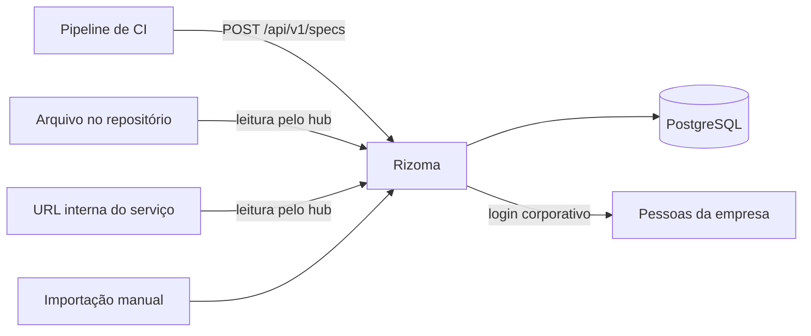

# O que é o Rizoma

O Rizoma é um catálogo fechado da documentação OpenAPI de todos os serviços da sua empresa. Esta página explica o problema que ele resolve, para quem ele serve e o que ele não é. Leia antes de instalar, para saber se ele se encaixa no seu caso.

## O problema

Muitos times expõem o Swagger de cada serviço em `/docs`. Isso tem dois custos:

- **Apresentação repetida.** Alguém precisa mostrar serviço por serviço para cada pessoa nova, e de novo a cada contratação. Quem chega precisa descobrir sozinha quais APIs existem, onde estão e quem é dono de cada uma.
- **Contratos internos públicos.** Para o `/docs` ser útil, ele precisa estar acessível. Na prática, isso costuma significar uma rota aberta na internet, com o desenho completo da API à vista de qualquer pessoa.

Há ainda um custo menos visível: as versões. Cada ambiente (desenvolvimento, homologação, produção) tem o seu `/docs`, com endereços diferentes, e ninguém sabe ao certo qual versão do contrato está em produção agora.

## A solução

O Rizoma junta tudo num único lugar, fechado, onde quem é da empresa encontra todas as APIs, entende quem é dono de cada uma e vê como elas se ligam.

- O pipeline de CI de cada serviço envia a spec para o hub (ou o hub a lê do repositório ou de uma URL interna).
- O hub guarda cada versão, **por ambiente**, e renderiza a documentação.
- Só entra quem comprova vínculo com a empresa (organização do GitHub, domínio de e-mail, convite ou aprovação).
- O `/docs` público de cada serviço pode ser desligado. A spec continua sendo gerada; só deixa de ser servida ao mundo.

*Catálogo de serviços. A tela evoluiu desde este print; a ideia é a mesma.*

## Para quem é

| Quem | O que ganha |
|---|---|
| Times de plataforma | Um ponto único para publicar, governar e auditar o acesso à documentação das APIs. |
| Tech leads | Visão de quem é dono de cada serviço, de quem depende de quem e do impacto de uma mudança. |
| Pessoas desenvolvedoras | Documentação por ambiente, variáveis de cada serviço e regras de negócio num só lugar. |
| QA | O contrato certo de cada ambiente, sem pedir a ninguém o endereço do Swagger. |
| Produto | Regras de negócio em Markdown, escritas pelo time dono do serviço. |
| Consultorias e terceiros | Acesso temporário, com prazo, sem abrir contratos para a internet. |

## O que o Rizoma é

- Um **catálogo** de serviços com a spec OpenAPI (3.0, 3.1) ou Swagger 2.0 de cada ambiente, com histórico de versões.
- Um **mapa de ligações** entre serviços, repositórios, times e integrações externas.
- Um lugar para guardar **variáveis de ambiente** por serviço, com segredos cifrados.
- Um **portal fechado**, com login corporativo, times, papéis, permissões e auditoria.
- Um projeto de **código aberto** que você instala no seu próprio servidor.

## O que o Rizoma não é

- **Não é um API gateway.** Ele não recebe o tráfego das suas APIs nem faz roteamento, autenticação de chamadas ou limite de uso delas.
- **Não é um mock server.** Ele não simula respostas a partir da spec.
- **Não é um portal público de desenvolvedores.** Ele é fechado por padrão e pensado para gente de dentro da empresa. Não há área pública.
- **Não executa requisições.** O renderizador da spec roda sem o botão de testar requisições e sem enviar dados para fora. As chamadas continuam sendo feitas pelas suas ferramentas de sempre.
- **Não gera a spec.** Quem gera é o seu serviço ou o seu pipeline. O hub recebe, valida, guarda e mostra.

## Como funciona

1. **Você cadastra o serviço** (nome, time e tipo bastam) e escolhe de onde vem a spec: enviada pelo CI, lida de um arquivo no repositório, lida de uma URL ou importada manualmente.
2. **O hub descobre o ambiente** pela branch (por exemplo, `main` vira produção e `release/*` vira homologação) e guarda a versão daquele ambiente.
3. **As pessoas entram** com a conta da empresa. Quem comprova vínculo entra direto; as demais pedem acesso ou entram por convite.
4. **Cada pessoa vê o que pode ver.** Serviços restritos ao time só aparecem para o time. As ações administrativas ficam na auditoria.

Tudo roda num único aplicativo (Next.js) com um banco PostgreSQL. Veja os detalhes em [Visão geral da arquitetura](/arquitetura/visao-geral).

## Princípios

- **Fechado por padrão.** Nada é público. Sem login e sem vínculo, não há acesso. O hub também pede aos buscadores que não o indexem.
- **Auto-hospedado.** Os dados ficam no seu servidor e no seu banco. Não existe um serviço em nuvem do projeto: o hub só se comunica com os provedores de login e de repositório que você configurar.
- **Regras testadas.** As regras de negócio (permissões, política de acesso, validação de spec, ambientes, grafo) vivem em funções puras, cobertas por testes.
- **Código aberto.** Você pode ler, auditar, adaptar e contribuir.
- **Permissão sempre no servidor.** Esconder um botão não é controle de acesso. Toda ação é conferida no servidor.

## Código aberto e gratuito

O Rizoma é gratuito e não tem edição paga. Ele foi desenvolvido por [Belko](https://belko.com.br) e colaboradores. Para os termos de uso e redistribuição, veja o arquivo `LICENSE` do repositório.

## Próximos passos

- [Início rápido](/guia/inicio-rapido): rode o hub na sua máquina em poucos minutos.
- [Tudo o que o sistema faz](/guia/funcionalidades): o catálogo completo de funcionalidades.
- [Conceitos principais](/guia/conceitos): os termos que aparecem em toda a documentação.
- [Requisitos](/instalacao/requisitos): o que você precisa para instalar em produção.
