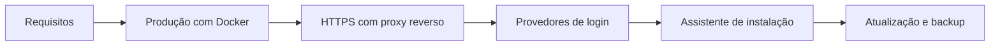

# Visão geral

Esta seção reúne tudo o que você precisa para instalar o Rizoma: para avaliar, para desenvolver ou para rodar em produção. Comece pela tabela abaixo para escolher o caminho e siga a ordem sugerida das páginas.

## Qual caminho escolher

| Você quer... | Caminho | O que sobe | Página |
|---|---|---|---|
| **Avaliar** o produto em poucos minutos | Docker Compose local | PostgreSQL, migração e app em `http://localhost:3000`, sem HTTPS | [Início rápido](/guia/inicio-rapido) |
| **Desenvolver** ou contribuir com o código | pnpm e Docker só para o banco | Next.js em modo de desenvolvimento, com recarga automática | [Desenvolvimento local](/instalacao/desenvolvimento-local) |
| **Usar de verdade** na empresa | Docker Compose em servidor, atrás de proxy HTTPS | PostgreSQL (ou um gerenciado), migração e app, com domínio e certificado | [Produção com Docker](/instalacao/docker) |

::: tip Comece avaliando
Mesmo que o destino seja produção, rode o caminho de avaliação primeiro. Em 5 minutos você vê o assistente, o catálogo e o mapa com dados de demonstração, e decide se o produto serve para você antes de mexer em domínio e login corporativo.
:::

## Ordem recomendada

Para uma instalação de produção, leia e execute nesta ordem:

1. **[Requisitos](/instalacao/requisitos):** confirme servidor, versões, rede, domínio e as contas que você vai precisar criar.
2. **[Variáveis de ambiente](/instalacao/variaveis-de-ambiente):** entenda cada variável e gere as chaves. Você vai preencher o `.env` no passo seguinte.
3. **[Produção com Docker](/instalacao/docker):** suba o PostgreSQL, a migração e o app.
4. **[HTTPS com proxy reverso](/instalacao/proxy-https):** coloque o hub atrás de Nginx, Caddy ou Traefik com o seu domínio.
5. **[Provedores de login](/instalacao/provedores-de-login):** crie os aplicativos no GitHub, Google, Microsoft ou no seu SSO, com a URL de callback do domínio de produção.
6. **[Assistente de instalação](/instalacao/assistente):** abra o hub e conclua as 10 etapas.
7. **[Atualização e backup](/instalacao/atualizacao-e-backup):** configure o backup **antes** de as pessoas começarem a usar.

Quando o hub estiver no ar, siga para [Administração](/admin/) e para o [Primeiro acesso e tour](/uso/primeiro-acesso).

::: warning Conclua o assistente antes de divulgar o endereço
O assistente não pede token de instalação, porque o projeto é de código aberto. Quem abrir a URL primeiro define o administrador do hub. Mantenha o endereço fora do alcance de terceiros (por firewall, VPN ou lista de IPs no proxy) até a etapa **Revisar e concluir**.
:::

## Checklist de produção

Marque cada item antes de liberar o hub para a empresa.

**Servidor e rede**

- [ ] Servidor com Docker e Compose v2 (ou o ambiente de containers da sua empresa).
- [ ] PostgreSQL 16 ou superior: o container do Compose ou um banco gerenciado.
- [ ] Domínio com DNS apontando para o servidor, por exemplo `apihub.suaempresa.com`.
- [ ] Proxy reverso com certificado HTTPS válido e renovação automática.
- [ ] Porta `3000` do app e porta `5432` do PostgreSQL **não** expostas para a internet.
- [ ] Saída HTTPS liberada para os provedores de login e de repositório que você vai usar.

**Configuração**

- [ ] `.env` de produção criado no servidor, fora do repositório, com permissão restrita a quem administra.
- [ ] `ENCRYPTION_KEY` e `AUTH_SECRET` **novas**, geradas para este ambiente (nunca reaproveite as de desenvolvimento).
- [ ] `AUTH_URL` com a URL pública em `https://`, sem barra no final.
- [ ] `POSTGRES_PASSWORD` forte, usando só letras e números.
- [ ] Token do cron gerado em **Configurações → Repositórios**, se você vai sincronizar specs por agendamento.
- [ ] Aplicativos OAuth criados com a URL de callback de produção.

**Depois de instalar**

- [ ] Assistente concluído e endereço já liberado só para a empresa.
- [ ] Pelo menos **dois** OWNERs ativos (as [Configurações](/admin/configuracoes) avisam quando há só um).
- [ ] Backup diário do banco funcionando e **restauração testada** ([Atualização e backup](/instalacao/atualizacao-e-backup)).
- [ ] `ENCRYPTION_KEY`, `AUTH_SECRET` e o `.env` guardados em local seguro, separado dos backups do banco.
- [ ] Monitoramento simples em `GET /api/health`.
- [ ] `/docs` públicos dos serviços desligados depois de a publicação funcionar ([Tirar o /docs público do ar](/receitas/tirar-docs-do-ar)).
- [ ] Regras de acesso conferidas: liberação automática, política para quem não comprova vínculo e duração da sessão.

## Se algo não funcionar

- O assistente não avança na etapa **Banco de dados**: veja [Desenvolvimento local](/instalacao/desenvolvimento-local) e [Produção com Docker](/instalacao/docker).
- O login volta com erro de redirecionamento: confira `AUTH_URL` e a URL de callback. Veja [Provedores de login](/instalacao/provedores-de-login).
- Outros problemas: [Solução de problemas](/referencia/solucao-de-problemas).

## Próximos passos

- [Requisitos](/instalacao/requisitos): o primeiro passo de qualquer instalação de produção.
- [Assistente de instalação](/instalacao/assistente): o que cada etapa pede e como decidir.
- [Arquitetura: visão geral](/arquitetura/visao-geral): como as peças se encaixam, para quem opera o hub.
