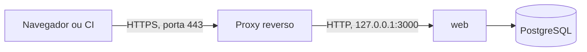

# HTTPS com proxy reverso

O app do Rizoma fala HTTP na porta `3000` e espera que um proxy reverso cuide do HTTPS na frente dele. Esta página mostra exemplos para Nginx, Caddy e Traefik e explica os cabeçalhos e as configurações que fazem o login e o assistente funcionarem atrás de um proxy. Ela serve a quem administra o servidor.

## Antes de começar

- O hub já está de pé em `127.0.0.1:3000`, como em [Produção com Docker](/instalacao/docker).
- O DNS do seu domínio (por exemplo, `apihub.suaempresa.com`) aponta para o servidor.
- As portas `80` e `443` estão liberadas no firewall.

## Como o tráfego passa



Só o proxy fica exposto. O app e o banco ficam na rede interna.

## O que vale para qualquer proxy

### `AUTH_URL` é a URL pública

Defina no `.env`:

```bash
AUTH_URL="https://apihub.suaempresa.com"
AUTH_TRUST_HOST="true"
```

O `AUTH_URL` precisa ser **exatamente** a URL que as pessoas digitam no navegador: com `https://`, com o domínio certo e sem barra no final. Ele é usado para:

- montar as URLs de callback dos provedores de login (a tela mostra a URL pronta a partir dele);
- gerar os links de convite e de nova senha;
- reconhecer o host do assistente de instalação (veja abaixo).

Se ele estiver como `http://localhost:3000` em produção, os provedores vão recusar o login por URL de retorno inválida.

### Cabeçalhos `X-Forwarded-*`

Faça o proxy repassar o host e o protocolo originais:

| Cabeçalho | Para quê |
|---|---|
| `Host` | O domínio que a pessoa acessou |
| `X-Forwarded-Proto` | `https`. Sem ele, o app pode tratar a conexão como HTTP (cookies sem o atributo `Secure` e URLs com `http://`, o que quebra o login) |
| `X-Forwarded-Host` | O domínio público. O assistente de instalação também o aceita |
| `X-Forwarded-For` | O IP real de quem acessa. A auditoria registra o primeiro valor da lista |

::: tip Sobrescreva o `X-Forwarded-For`, não acrescente
A auditoria grava o **primeiro** IP do `X-Forwarded-For`. Se o proxy apenas acrescentar o IP à lista, uma pessoa pode mandar um cabeçalho falso e o IP dela na auditoria seria o forjado. Por isso os exemplos abaixo usam o IP da conexão (`$remote_addr`), e Caddy e Traefik já descartam o cabeçalho enviado por clientes não confiáveis.
:::

### A checagem de mesma origem do assistente

As ações do assistente (`POST /api/setup`) só aceitam requisições vindas da própria página do hub. O app compara o host do `Origin` (ou do `Referer`) com três valores: o `Host` da requisição, o `X-Forwarded-Host` e o host do **`AUTH_URL`**. Basta um deles bater.

Na prática, atrás de um proxy que reescreve o `Host`, o assistente continua funcionando **desde que o `AUTH_URL` tenha o mesmo domínio que o navegador usa**. Se o assistente responder "Origem da requisição inválida.", confira o `AUTH_URL` e o `X-Forwarded-Host`.

### Tamanho da requisição e tempo de espera

- **Tamanho do corpo.** O CI envia a spec, que pode ter até **5 MB**. O Nginx limita o corpo a 1 MB por padrão e responderia `413`. Configure pelo menos `6m`.
- **Tempo de espera.** A rota `POST /api/v1/sync` (sincronização por cron) pode levar minutos com muitos serviços. Ela tem um limite interno de 300 segundos, então dê ao proxy um tempo de leitura de pelo menos esse valor.

### HSTS e HTTPS

O app já envia `Strict-Transport-Security: max-age=63072000; includeSubDomains; preload`, além de CSP, `X-Frame-Options: DENY`, `nosniff` e `X-Robots-Tag: noindex`. Você não precisa duplicar esses cabeçalhos no proxy. Como o HSTS vale para os subdomínios, não hospede num domínio que tenha subdomínios sem HTTPS.

### O que não expor

- **A porta `3000`.** Publique só em `127.0.0.1` (veja o aviso em [Produção com Docker](/instalacao/docker)). Quem acessa a `3000` direto não passa pelo HTTPS nem pelas suas regras de proxy.
- **O PostgreSQL (`5432`).** No Compose ele já escuta só em `127.0.0.1`. Não abra a porta no firewall.
- **O `.env` e os backups.** Nunca dentro de uma pasta servida pelo proxy.

## Nginx

Arquivo `/etc/nginx/conf.d/apihub.conf`:

```nginx
server {
    listen 80;
    server_name apihub.suaempresa.com;
    return 301 https://$host$request_uri;
}

server {
    listen 443 ssl;
    http2 on;                 # Nginx 1.25.1 ou superior. Em versões antigas: listen 443 ssl http2;
    server_name apihub.suaempresa.com;

    ssl_certificate     /etc/letsencrypt/live/apihub.suaempresa.com/fullchain.pem;
    ssl_certificate_key /etc/letsencrypt/live/apihub.suaempresa.com/privkey.pem;

    # A spec pode ter até 5 MB; o padrão do Nginx é 1 MB.
    client_max_body_size 6m;

    location / {
        proxy_pass http://127.0.0.1:3000;
        proxy_http_version 1.1;

        proxy_set_header Host              $host;
        proxy_set_header X-Forwarded-Proto $scheme;
        proxy_set_header X-Forwarded-Host  $host;
        proxy_set_header X-Forwarded-For   $remote_addr;
        proxy_set_header X-Real-IP         $remote_addr;

        proxy_read_timeout 300s;
    }
}
```

Emita o certificado com o Certbot e recarregue:

```bash
sudo certbot certonly --nginx -d apihub.suaempresa.com
sudo nginx -t && sudo systemctl reload nginx
```

Se o Nginx roda no mesmo servidor que o Docker, o `proxy_pass` para `127.0.0.1:3000` funciona porque a porta está publicada no loopback.

## Caddy

O Caddy obtém e renova o certificado sozinho. O `Caddyfile` inteiro:

```caddyfile
apihub.suaempresa.com {
    reverse_proxy 127.0.0.1:3000
}
```

O Caddy já repassa `Host`, `X-Forwarded-For`, `X-Forwarded-Proto` e `X-Forwarded-Host`, não impõe limite de corpo e não corta respostas demoradas. Para cada domínio, ele só precisa das portas `80` e `443` livres.

## Traefik

Com o Traefik rodando em Docker, a forma comum é usar rótulos (labels) no serviço `web`. Este exemplo, em um `docker-compose.override.yml`, assume que o Traefik já roda com um entrypoint `websecure`, um resolvedor de certificados chamado `letsencrypt` e uma rede externa `traefik-public`:

```yaml
services:
  web:
    networks: [default, traefik-public]
    labels:
      - traefik.enable=true
      - traefik.docker.network=traefik-public
      - traefik.http.routers.apihub.rule=Host(`apihub.suaempresa.com`)
      - traefik.http.routers.apihub.entrypoints=websecure
      - traefik.http.routers.apihub.tls.certresolver=letsencrypt
      - traefik.http.services.apihub.loadbalancer.server.port=3000

networks:
  traefik-public:
    external: true
```

O Traefik alcança o `web` pela rede Docker, então a publicação da porta `3000` no host deixa de ser necessária. Se preferir removê-la, use `ports: !reset []` no serviço `web` (Compose 2.24 ou superior). O Traefik já envia os cabeçalhos `X-Forwarded-*` e sobrescreve os que chegam de clientes não confiáveis. Se você configurou um limite de tamanho de corpo no Traefik, mantenha pelo menos 6 MB.

## Como saber que deu certo

1. Abra `https://apihub.suaempresa.com`. O navegador deve mostrar o cadeado e o hub deve levar você ao assistente (ou ao login, se já estiver instalado).
2. Teste o healthcheck pelo domínio público:

   ```bash
   curl -fsS https://apihub.suaempresa.com/api/health
   ```

   A resposta esperada é `{"ok":true}`.
3. Confira que o HSTS está chegando:

   ```bash
   curl -sI https://apihub.suaempresa.com/login | grep -i strict-transport
   ```

4. Confirme que a porta `3000` **não** responde de fora do servidor: de outra máquina, `curl http://IP-DO-SERVIDOR:3000` deve falhar.

## Restringir o acesso até concluir a instalação

Como o assistente não usa token de instalação, restrinja o acesso ao seu IP enquanto você não concluir a etapa **Revisar e concluir**. No Nginx, por exemplo, dentro do `location /`:

```nginx
allow 203.0.113.10;   # o seu IP
deny  all;
```

Remova essas duas linhas e recarregue o Nginx assim que o assistente terminar. Veja [Assistente de instalação](/instalacao/assistente).

## Problemas comuns

| Sintoma | Causa provável | O que fazer |
|---|---|---|
| O provedor de login recusa com erro de URL de retorno (`redirect_uri_mismatch` ou parecido) | `AUTH_URL` errado, ou callback cadastrada no provedor diferente da URL pública | Ajuste o `AUTH_URL` e a callback. Recrie o `web` depois de editar o `.env` |
| O login entra em loop ou volta para a tela de login | O proxy não envia `X-Forwarded-Proto: https` ou `Host` | Repasse os cabeçalhos da tabela acima |
| O assistente responde "Origem da requisição inválida." | O `AUTH_URL` não bate com o domínio usado no navegador | Corrija o `AUTH_URL` |
| O CI recebe `413` ao publicar a spec | O proxy limita o corpo | Suba o limite para pelo menos `6m` |
| `502 Bad Gateway` | O `web` não está de pé ou o proxy não o alcança | `docker compose --profile app ps` e `curl http://127.0.0.1:3000/api/health` no servidor |
| A sincronização por cron termina em `504` | Tempo de espera do proxy menor que o da sincronização | Aumente o tempo de leitura para 300 segundos ou mais |

## Veja também

- [Produção com Docker](/instalacao/docker): o `web` publicado só no loopback.
- [Variáveis de ambiente](/instalacao/variaveis-de-ambiente): `AUTH_URL` e `AUTH_TRUST_HOST`.
- [Provedores de login](/instalacao/provedores-de-login): a URL de callback de cada provedor.
- [Segurança](/referencia/seguranca): os cabeçalhos e controles que o app aplica.
