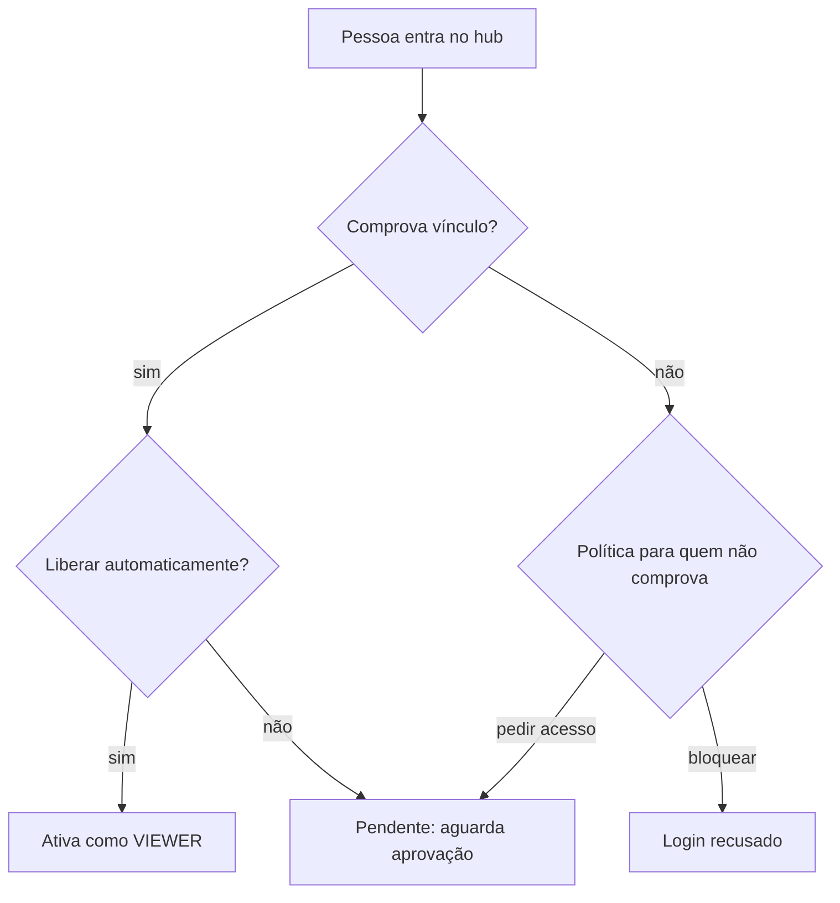

# Acesso automático para a empresa

Por padrão, todo mundo que entra no hub pede acesso e espera um administrador. Esta receita configura o que "ser da empresa" significa (organização do GitHub ou domínio de e-mail) e liga a liberação automática: quem comprova vínculo entra direto, como **VIEWER**, e é suspenso sozinho se perder o vínculo. É para quem administra o hub.

## Antes de começar

- Você enxerga **Configurações** no menu. Com os papéis padrão, só o OWNER tem essa permissão (`settings:manage`). Para promover papéis no fim, você também precisa de `user:manage` (ADMIN e OWNER têm).
- A forma de login que você vai usar já está criada no provedor: um OAuth App no GitHub, um cliente OAuth no Google ou na Microsoft, ou um cliente OIDC. Veja [Provedores de login](/instalacao/provedores-de-login) e, para o Keycloak, [Login com Keycloak (OIDC)](/receitas/login-com-keycloak).
- O `AUTH_URL` do hub aponta para o endereço público, porque as URLs de retorno (callback) são montadas com ele. Veja [Variáveis de ambiente](/instalacao/variaveis-de-ambiente).
- Você sabe o nome da organização no GitHub (por exemplo, `acme`) ou os domínios de e-mail da empresa (por exemplo, `suaempresa.com`).

### Como o hub decide

A cada login, e de novo a cada revalidação, o hub aplica esta regra:

## Passo a passo

### 1. Ligue a forma de login

Abra **Configurações**, seção **Formas de login**. Em um provedor (por exemplo, **GitHub**), clique em **Ligar**, preencha **Client ID** e **Client secret** e clique em **Salvar**. O modal mostra a **URL de retorno (callback)** que você deve cadastrar no provedor, no formato `<AUTH_URL>/api/auth/callback/<id>`.

O GitHub e o OIDC são testados antes de salvar. O GitHub pede só os escopos `read:user`, `user:email` e `read:org`; o `read:org` é o que permite ao hub conferir a organização.

### 2. Diga o que conta como vínculo

Na seção **Organização**, preencha:

- **Organizações do GitHub aceitas**: os nomes das organizações, separados por vírgula (até 10). O campo só aparece depois que o GitHub está salvo como forma de login.
- **Domínios de e-mail da empresa**: por exemplo, `suaempresa.com, suaempresa.com.br` (até 20). Subdomínios contam: `time.suaempresa.com` casa com `suaempresa.com`.

Clique em **Salvar organização**. Cada forma de login comprova o vínculo de um jeito:

| Forma de login | O que comprova o vínculo |
|---|---|
| GitHub | Ser **membro ativo** de uma das organizações aceitas |
| Google | E-mail **verificado** de um domínio aceito (Google Workspace) |
| Microsoft | Conta do diretório informado em **Tenant (ID do diretório)** ou e-mail de um domínio aceito |
| GitLab | E-mail de um domínio aceito |
| OIDC (Keycloak, Okta, Auth0) | E-mail **verificado** de um domínio aceito |
| Facebook | Nunca comprova: todo acesso passa por aprovação |
| E-mail e senha | Nunca comprova: entra por convite ou por aprovação |

Enquanto o provedor estiver marcado sem organização ou domínio, um aviso no alto das abas **Organização** e **Formas de login** lembra que "todos pedem acesso".

### 3. Aprove o app na organização do GitHub, se ela restringe OAuth Apps

Algumas organizações bloqueiam OAuth Apps que não foram aprovados. Nesse caso o GitHub não deixa o hub enxergar a organização, e todo mundo aparece como "sem vínculo comprovado", mesmo sendo membro. Peça a um **owner da organização** no GitHub para aprovar o app nas configurações de acesso de terceiros (OAuth apps) da organização.

### 4. Ligue "Liberar automaticamente"

Na seção **Regras de acesso**, marque **Liberar automaticamente quem comprova vínculo com a empresa**. Ela já vem marcada em instalações novas. Desmarcada, todo mundo passa pela aprovação, inclusive quem é da empresa.

### 5. Escolha a política para quem não comprova

Em **Quem não comprova vínculo**, escolha uma opção:

- **Pode pedir acesso e aguardar aprovação**: a pessoa vira "aguardando", escreve uma justificativa e um administrador decide. É o que você quer para consultorias (veja [Acesso temporário para terceiros](/receitas/acesso-temporario-para-terceiros)).
- **Não pode entrar (convites e aprovações manuais continuam valendo)**: o login é recusado. Convites por e-mail continuam funcionando.

### 6. Ajuste a revalidação

Ainda em **Regras de acesso**, defina **Revalidar vínculo (horas)**, de 1 a 72 (padrão 12), e clique em **Salvar regras**. É o intervalo com que o hub confere se a pessoa continua na empresa (RN-10):

- **GitHub**: o hub pergunta ao GitHub de novo, sem exigir novo login.
- **Google, Microsoft, GitLab e OIDC**: valem os dados do último login. A conferência acontece quando a pessoa entra de novo, e a sessão dura o tempo de **Sessão (horas)** (padrão 8).

Quem entrou por vínculo e depois o perde (saiu da organização do GitHub, por exemplo) é **suspenso automaticamente** (RN-06). Se ele voltar a comprovar o vínculo, entra de novo sozinho, com o mesmo papel que tinha (RN-08). Suspensão feita por um administrador nunca é desfeita sozinha.

Se você mudar a lista de organizações ou domínios, o hub confere todo mundo no próximo acesso. Para forçar agora, abra a seção **Sessões e recuperação** e clique em **Conferir vínculos de todos**.

### 7. Teste com uma conta da empresa

Numa janela anônima, abra o hub e entre com uma conta que pertença à organização. A pessoa deve cair direto no catálogo (depois do tour guiado do primeiro acesso), sem tela de "Pedido de acesso enviado". Faça também um teste negativo com uma conta de fora, para ver o comportamento da política do passo 5.

### 8. Promova quem precisa de mais

Todo mundo entra como **VIEWER**. Em **Pessoas e acesso**, na tabela **Pessoas**, escolha o novo papel no seletor da linha e clique em **Salvar**:

- **MAINTAINER** para quem publica specs e mantém serviços do próprio time.
- **ADMIN** só pode ser dado por um OWNER. Um ADMIN promove até MAINTAINER.

Mudar o papel encerra a sessão da pessoa; ela entra de novo com o papel novo. Nada disso altera a matriz de permissões: para isso, veja [Papel com permissões sob medida](/receitas/papel-personalizado).

## Como saber que deu certo

- Na tabela **Pessoas**, a conta de teste aparece como **ativo**, com origem **da empresa** e papel **VIEWER**.
- Em **Auditoria**, o tipo **Acesso** mostra "Status mudou de PENDING para ACTIVE automaticamente" para essa pessoa, sem que ninguém tenha decidido, e o autor aparece como "sistema".
- O selo de pedidos pendentes do menu (**Pessoas e acesso**) não sobe quando alguém da empresa entra.

## Problemas comuns

| Sintoma | Causa e solução |
|---|---|
| Todos caem em "Pedido de acesso enviado" | Faltam organizações ou domínios (o aviso aparece nas abas **Organização** e **Formas de login**), ou **Liberar automaticamente** está desmarcado. |
| Membros do GitHub aparecem como "sem vínculo comprovado" | A organização restringe OAuth Apps e o app não foi aprovado (passo 3), ou o nome da organização está errado. |
| Uma pessoa recém-convidada para a organização não entra | O convite do GitHub precisa estar **aceito**: só o vínculo em estado "ativo" conta. |
| Pessoas do Google ou do Keycloak não comprovam vínculo | O e-mail não está verificado no provedor ou o domínio não está em **Domínios de e-mail da empresa**. |
| Uma pessoa que saiu da organização continua entrando | Ela ainda está dentro do intervalo de revalidação (padrão 12 h). Use **Conferir vínculos de todos** ou suspenda a pessoa em **Pessoas e acesso**. |
| Tirei um domínio da lista e quem usa Google ainda entra | Nesses provedores o vínculo só é reavaliado no próximo login. |
| "Precisamos confirmar seu vínculo com a empresa. Entre de novo." | O token do GitHub da pessoa expirou ou foi revogado. Basta entrar de novo. |
| A pessoa saiu da organização e não foi suspensa | Só quem entrou pelo vínculo é suspenso. Quem foi **aprovado manualmente sem vínculo comprovado**, ou convidado por e-mail, mantém o acesso até um administrador suspender. |
| "Sua conta não comprova vínculo com a empresa, e esta instalação não aceita pedidos de fora." | A política está em **Não pode entrar** e a conta não comprova vínculo. Mude a política ou use um convite. |

## Veja também

- [Acesso temporário para terceiros](/receitas/acesso-temporario-para-terceiros): quem não comprova vínculo, com prazo.
- [Onboarding de uma pessoa nova](/receitas/onboarding-de-pessoa-nova): o que fazer depois que ela entra.
- [Pessoas e acesso](/admin/pessoas-e-acesso): a tela de pedidos, papéis e suspensões.
- [Autenticação e acesso](/arquitetura/autenticacao-e-acesso): a decisão de acesso por dentro.
