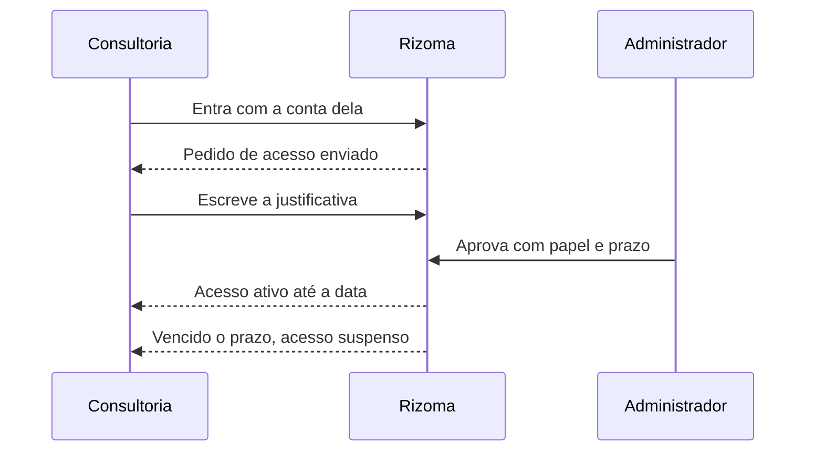

# Acesso temporário para terceiros

Uma consultoria ou um freelancer precisa ler a documentação de algumas APIs por alguns meses, e não deve ficar com acesso para sempre nem ver o que não é da conta dela. Esta receita cobre o ciclo inteiro: a pessoa pede acesso, você aprova com papel e prazo, ajusta o que ela enxerga e, no fim, o acesso vence ou é revogado. É para quem aprova solicitações de acesso.

## Antes de começar

- Você enxerga **Pessoas e acesso** no menu (grupo **Pessoas**). Precisa de `access:decide` (Administrador e Proprietário têm). Para suspender antes do prazo, precisa de `user:manage`.
- A política **Quem não comprova vínculo** (**Configurações → Organização e acesso → Regras de acesso**) está em **Pode pedir acesso e aguardar aprovação**. Com **Não pode entrar**, a solicitação de quem é de fora nem chega a você; nesse caso use um [convite por e-mail](/receitas/convidar-por-email), lembrando que o convite não tem prazo.
- Você sabe qual papel e quantos dias a pessoa precisa. O papel **Administrador** só pode ser concedido por um Proprietário.
- A pessoa tem um jeito de entrar: uma forma de login que você habilitou (GitHub pessoal, Google, e-mail e senha…). Ela não precisa comprovar vínculo, e a conta dela vai justamente para a fila de aprovação.

## Passo a passo

### 1. A pessoa entra e pede acesso

Mande para ela o endereço do hub (`https://apihub.suaempresa.com`). Ao entrar com uma conta que não comprova vínculo, ela cai em **Pedido de acesso enviado**. Nessa tela, peça que ela preencha **Quem é você e por que precisa de acesso?** (de 10 a 500 caracteres) e clique em **Enviar justificativa**. Um bom texto diz a empresa, o motivo e até quando: "Consultoria X, integração com o serviço de pedidos, até dezembro".

*A pessoa vê esta tela até alguém decidir. Captura de uma versão anterior da interface.*

A solicitação vale por N dias (padrão 14, ajustável em **Solicitação expira (dias)**, nas regras de acesso). Se ninguém decidir, ela expira, e a pessoa pode entrar de novo para abrir outra. Se você habilitou o cadastro aberto, ela também pode usar `/signup`, que sempre gera uma solicitação pendente (veja [Convidar por e-mail](/receitas/convidar-por-email)).

### 2. Aprove com papel e prazo

Abra **Pessoas e acesso**. O número no item do menu conta as solicitações pendentes. Clique no filtro **Solicitações de acesso**: cada solicitação mostra quem é, quando pediu ("solicitou há 2 h"), um selo **sem vínculo comprovado** e a justificativa.

*Solicitações de acesso, com papel, prazo e observação. Captura de uma versão anterior da interface, quando a seção se chamava "Pedidos aguardando" e o botão era "Aprovar".*

1. Escolha o **Papel**: **Leitor** para ler; **Mantenedor** se ela vai publicar specs e editar serviços de um time (só nos serviços dos times de que participa).
2. Escolha o **Prazo do acesso**: **Sem prazo**, **Por 30 dias**, **Por 90 dias** ou **Por 180 dias**. Para quem não comprova vínculo, o padrão da tela é 90 dias.
3. Escreva uma **Observação (opcional)**. Ela fica no registro da decisão.
4. Clique em **Aprovar acesso** (ou **Recusar**).

Você não decide a própria solicitação. O acesso vale a partir de agora, e a tabela **Pessoas** passa a mostrar "até *data*" abaixo do status da pessoa.

### 3. Restrinja o que a pessoa vê

Não existe uma lista de serviços permitidos por pessoa. A visibilidade é decidida **por serviço**: **Toda a empresa** ou **Só o time responsável** (RN-30). Um leitor de fora vê todos os serviços "Toda a empresa" e, dos restritos, só os de times de que participa.

Por padrão, o que essa pessoa enxerga:

| Tela | O que aparece para ela |
|---|---|
| **Catálogo** e **página do serviço** | Serviços "Toda a empresa" e os "Só o time responsável" dos times dela. |
| Aba **Variáveis de ambiente** | Os valores das variáveis comuns aparecem (só os segredos ficam ocultos). |
| **Mapa de ligações** | Serviços conforme a visibilidade, mais times, pessoas que estão em times, repositórios e integrações. |
| **Integrações externas** | Todas as integrações e o endereço de cada ambiente. Elas não têm visibilidade por time. |

Para reduzir o que ela enxerga:

1. Em **Times**, crie um time para o trabalho (por exemplo, `Consultoria X`) com **Novo time** → **Criar time**. Adicione a pessoa com **Adicionar membro** (só pessoas com acesso ativo entram em times; por isso este passo vem depois da aprovação).
2. Nos serviços que ela **não** deve ver, abra o serviço, clique em **Editar serviço**, troque **Quem pode ver** para **Só o time responsável** e clique em **Salvar alterações**.
3. Para o serviço em que ela vai trabalhar, deixe-o visível (ou restrito ao time da consultoria) e coloque a pessoa nesse time.
4. Se variáveis comuns e o mapa não devem aparecer para nenhum leitor, ajuste o papel em [Papel com permissões sob medida](/receitas/papel-personalizado). A mudança vale para todas as pessoas com aquele papel.

::: warning Integrações externas são da empresa inteira
Nomes e endereços de bancos, filas e APIs de terceiros aparecem para qualquer pessoa com acesso ao catálogo. Se algum não pode ser visto por terceiros, não o cadastre no hub.
:::

### 4. O que acontece no vencimento

Na primeira vez que a pessoa abrir o hub depois da data (RN-07), o acesso é suspenso: a sessão cai, ela volta ao login com "Seu acesso está suspenso. Fale com um administrador." e o status vira **suspenso**. Até lá, a tabela pode mostrar **ativo** com a data "até" já passada. Nada é apagado: o time, os registros e o histórico permanecem.

::: info O prazo vale para acesso aprovado manualmente
Ele vale para quem foi aprovado sem vínculo comprovado (o caso da consultoria). Se a pessoa já comprova vínculo (o selo diz **vínculo comprovado**), o acesso segue o vínculo, e o prazo não se aplica. Convites por e-mail também não têm prazo.
:::

Hoje não existe um botão para prorrogar. **Reativar acesso** numa conta vencida não muda a data, e a conta volta a ser suspensa no acesso seguinte. Se o trabalho pode se estender, aprove já com um prazo maior.

### 5. Revogue antes do prazo, se precisar

1. Em **Pessoas e acesso**, clique no nome da pessoa e, no bloco **Segurança**, clique em **Suspender acesso** e confirme. As sessões dela caem na próxima requisição (RN-14), e só um administrador desfaz a suspensão, com **Reativar acesso**.
2. Em **Times**, clique em **Remover** na linha da pessoa, em cada time dela. Aparece **Desfazer** por alguns segundos.
3. Se ela era Mantenedora e gerou tokens de CI, revogue-os em **Tokens de CI** (grupo **Cadastros**), com **Revogar** na linha de cada token. Suspender a pessoa não revoga tokens. Para descobrir quais foram criados por ela, use a **Auditoria**, no tipo de evento **Tokens** ("criou um token de CI para o serviço …").
4. Se ela revelou segredos, confira na **Auditoria** ("revelou o valor de um segredo …") e troque o que for necessário.

## Como saber que deu certo

- Na tabela **Pessoas**, a pessoa aparece como **ativo**, com origem **aprovado ou convidado**, o papel escolhido e "até *data*".
- Em **Histórico**, o evento "… aprovou o acesso de … como Leitor" aparece, e a **Auditoria** guarda o papel e o prazo em **Detalhes**, nos dados do evento.
- Peça que ela confirme o que enxerga: só os serviços que você quis, e nenhuma tela de administração.
- Depois do prazo, o status vira **suspenso** e o login recusa.

## Problemas comuns

| Sintoma | Causa e solução |
|---|---|
| A solicitação não chega a **Solicitações de acesso** | A política está em **Não pode entrar**, ou a solicitação expirou. Mude a política ou peça que ela entre de novo. |
| "Só um Proprietário concede o papel Administrador." | O papel **Administrador** só aparece para o Proprietário. |
| "Você não pode decidir a própria solicitação." | Peça a outra pessoa com `access:decide`. |
| A pessoa vê 404 ao abrir um serviço | O serviço é **Só o time responsável** e ela não é do time. Foi o pretendido, ou adicione-a ao time. |
| O prazo não expirou o acesso | Ela foi aprovada com **vínculo comprovado**, ou por convite. O prazo só vale para aprovação manual sem vínculo. |
| Não consigo adicionar a pessoa ao time | "… ainda não tem acesso ativo ao hub." Aprove a solicitação antes. |

## Veja também

- [Pessoas e acesso](/admin/pessoas-e-acesso): a tela de solicitações, papéis e suspensões.
- [Convidar por e-mail](/receitas/convidar-por-email): quando a solicitação de fora está bloqueada.
- [Papel com permissões sob medida](/receitas/papel-personalizado): ajustar o que um Leitor enxerga.
- [Times](/admin/times): montar o time da consultoria.
