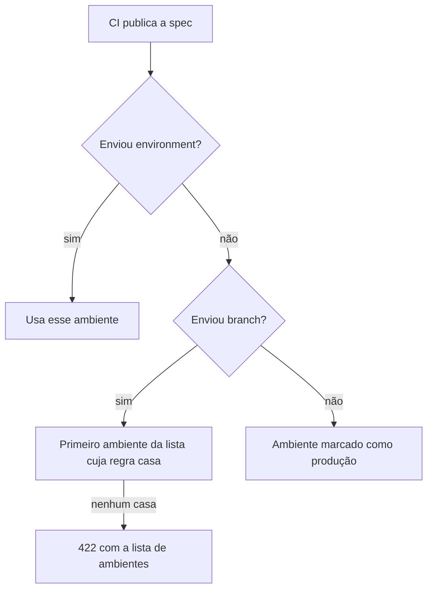

# Ambientes por branch

O hub guarda um contrato por serviço **e por ambiente**. Quando o CI publica uma spec, o hub descobre o ambiente pela branch. Esta receita mostra como cadastrar os ambientes, escrever as regras de branch, testar com uma publicação de verdade e, depois, renomear ou remover um ambiente. É para quem administra o hub.

## Antes de começar

- Você enxerga **Configurações → Ambientes e sessões**. Com os papéis padrão, só o Proprietário tem essa permissão (`settings:manage`); o Administrador abre Configurações, mas só vê a aba **Aparência**. Veja [Permissões](/admin/permissoes).
- Você sabe qual branch (ou padrão de branch) faz deploy em cada ambiente. Anote antes de abrir a tela.
- Para o teste do passo 7, você tem o token de um serviço (em **Tokens de CI**, no grupo **Cadastros** do menu) e `curl` instalado. Se ainda não tem token, veja [Do zero ao primeiro serviço](/receitas/primeiro-servico).

### Como o hub escolhe o ambiente

A decisão acontece a cada `POST /api/v1/specs`, nesta ordem:



Por isso três coisas importam: **as regras de branch**, **a ordem da lista** (o primeiro que casa vence) e **qual ambiente é o de produção**.

## Passo a passo

### 1. Abra a tela de ambientes

No menu, abra **Configurações** e escolha a aba **Ambientes e sessões** (o endereço termina em `/admin/settings?s=environments`). O primeiro bloco, **Ambientes**, mostra numa tabela os ambientes que o assistente de instalação criou, com as colunas **Nome**, **Identificador** e **Branches**. **Adicionar ambiente** e **Editar** abrem um modal.

### 2. Cadastre os ambientes

Clique em **Adicionar ambiente** para cada um e preencha:

| Campo | O que colocar |
|---|---|
| **Nome** | Como as pessoas veem (por exemplo, `Homologação`). De 2 a 40 caracteres. |
| **Identificador** | O slug do ambiente (por exemplo, `hml`). Letras minúsculas, números e hífen, até 20 caracteres. Ele aparece na URL (`?env=hml`), no `{env}` da leitura por URL e no parâmetro `environment` da API. |
| **Cor** | Cor da pílula do ambiente no catálogo e na página do serviço. |

Você pode ter até 10 ambientes, com qualquer nome: `dev`, `hml`, `prod`, `sandbox`, `qa`, `staging`. Ao terminar o modal, clique em **Criar ambiente**.

::: warning Escolha bem o identificador
Depois que o ambiente é criado, o identificador fica travado: o campo vira só leitura em **Editar** (veja o passo 8). O **Nome**, a **Cor** e as regras mudam quando você quiser.
:::

### 3. Escreva as regras de branch

No campo **Branches** do modal, digite uma regra e clique em **+** (**Adicionar branch**). Todo ambiente precisa de pelo menos uma. A regra precisa casar com o nome inteiro da branch, e maiúsculas e minúsculas contam.

| Curinga | Significa |
|---|---|
| `*` | Qualquer trecho **sem barra** |
| `**` | Qualquer coisa, **inclusive barras** |
| `?` | Um caractere qualquer, menos a barra |

| Regra | Casa com | Não casa com |
|---|---|---|
| `main` | `main` | `main-antiga`, `Main` |
| `release/*` | `release/1.4`, `release/2026-10` | `release`, `release/1.4/rc1` |
| `release/**` | `release/1.4`, `release/1.4/rc1` | `release` |
| `feature/**` | `feature/login`, `feature/pedidos/cupom` | `feature`, `features/login` |
| `hotfix-*` | `hotfix-123`, `hotfix-cupom` | `hotfix/123` |
| `v*` | `v1.4.0` (tag) | `1.4.0` |
| `rc-?` | `rc-1` | `rc-10` |

O prefixo `refs/heads/` é removido antes da comparação, então o CI pode mandar `refs/heads/main` ou só `main`. Os caracteres aceitos são letras, números, `.`, `_`, `-`, `/`, `*` e `?`, até 100 no total.

Pontos de partida por estratégia de branches:

| Estratégia | `dev` | `hml` | `prod` |
|---|---|---|---|
| **GitFlow** | `develop`, `feature/**` | `release/*`, `hotfix/*` | `main` |
| **Trunk-based** com release por tag | `feature/**`, `fix/**` | `main` | `v*` |
| **Só `main`** (todo o resto é dev) | `**` | (não cadastre) | `main` |
| **Hotfix com hífen** (`hotfix-123`) | `develop` | `release/*`, `hotfix-*` | `main` |

::: tip Pipeline que roda em tag
Num pipeline disparado por tag, o "nome da branch" que o CI manda é o nome da tag (`v1.4.0`). Sem uma regra como `v*`, a publicação é recusada. Outra saída é o pipeline de produção enviar `environment=prod` de forma explícita.
:::

### 4. Ponha os ambientes na ordem certa

O hub testa os ambientes de cima para baixo e **usa o primeiro que casar**. Use **Subir** e **Descer**, na linha do ambiente, para reordenar: cada clique salva na hora, sem modal. A regra prática: **coloque as regras específicas antes das genéricas**.

Na estratégia "Só `main`", por exemplo, `dev` usa `**` (casa com tudo). Se ele ficar no topo, `main` também cai em `dev`. Deixe `prod` (`main`) acima de `dev` (`**`).

A ordem da lista também é a ordem em que os ambientes aparecem no seletor da página do serviço e nas pílulas do catálogo.

### 5. Marque a produção e defina a branch de leitura

- Marque **É produção** no ambiente de produção. Ele ganha um escudo na interface (e a etiqueta **Produção** na tabela), abre por padrão na página do serviço e é o destino quando o CI publica sem `branch` e sem `environment`. Marque só um.
- Em **Avançado**, no campo **Branch de leitura**, informe a branch de onde o hub lê o arquivo da spec quando o serviço usa a origem **Arquivo no repositório** (por exemplo, `main` em produção e `develop` em dev). Sem ela, o **Sincronizar agora** mostra falha para aquele ambiente. Veja [Ler a spec do repositório](/receitas/spec-do-repositorio).

### 6. Salve

O botão do modal salva na hora: **Criar ambiente** num ambiente novo e **Salvar ambiente** na edição. Subir e Descer também salvam sozinhos. Não existe um botão **Salvar ambientes** para a tela toda. A tela responde "Ambientes salvos. Novas publicações do CI já usam as regras de branch." Não é preciso reiniciar nada.

### 7. Teste com uma publicação

Use um serviço de teste: a spec enviada fica no histórico do serviço.

```bash
export API_HUB_URL="https://apihub.suaempresa.com"
export API_HUB_TOKEN="ahub_..."   # token do serviço de teste

cat > teste.yaml <<'EOF'
openapi: 3.0.3
info:
  title: Teste de ambientes
  version: "0.0.1"
paths: {}
EOF

curl -sS -X POST "$API_HUB_URL/api/v1/specs?branch=release/1.4&commitSha=teste" \
  -H "Authorization: Bearer $API_HUB_TOKEN" \
  -H "Content-Type: application/yaml" \
  --data-binary @teste.yaml
```

A resposta diz em qual ambiente a spec caiu:

```json
{ "status": "published", "id": "…", "version": "0.0.1", "environment": "hml", "unknownDependencies": [] }
```

Repita com outras branches (`branch=develop`, `branch=feature/login`, `branch=main`) e confira o campo `environment`. Se a mesma spec for para o mesmo ambiente de novo, a resposta é `"status": "unchanged"` e nenhuma versão nova é criada; para ver uma versão nova, mude o `version` do arquivo.

Agora provoque o erro de propósito, com uma branch que nenhuma regra cobre (`branch=experimento/x`). A resposta é um `422` que lista as regras configuradas:

```json
{
  "error": "A branch \"experimento/x\" não corresponde a nenhum ambiente. Informe \"environment\" ou ajuste as regras em Configurações → Ambientes e sessões.",
  "environments": [
    { "slug": "dev", "branches": ["develop", "feature/**"] },
    { "slug": "hml", "branches": ["release/*", "hotfix/*"] },
    { "slug": "prod", "branches": ["main"] }
  ]
}
```

Para publicar num ambiente específico, ignorando a branch, acrescente `&environment=hml` à URL (ou o campo `environment` no corpo JSON).

### 8. Renomeie ou remova um ambiente

- **Renomear:** clique em **Editar** e troque o **Nome**. O **Identificador** não muda: o campo fica só leitura.
- **Remover:** no fim da aba, na **Zona de perigo**, clique em **Remover ambiente** na linha do ambiente (**Remover o ambiente** seguido do nome) e digite o nome dele para confirmar. A ação não tem desfazer. Ela só aparece quando existe mais de um ambiente. Um ambiente só pode ser removido se **não tiver specs nem variáveis** (RN-92). Se tiver, o hub recusa e sugere renomear.

O hub reconhece o ambiente pelo identificador. Por isso a tela não deixa trocá-lo depois de criado: seria o mesmo que remover o antigo e criar um novo, e o hub recusa isso quando o ambiente já tem dados. Ambientes de teste que receberam uma spec no passo 7 também deixam de poder ser removidos.

## Como saber que deu certo

- A resposta do `curl` traz o `environment` esperado para cada branch testada.
- No **Catálogo**, o serviço de teste mostra uma pílula com a versão, na coluna **Ambientes**, para cada ambiente que recebeu spec.
- Na página do serviço, o seletor de ambientes aparece na ordem que você definiu, e o de produção mostra o escudo e a etiqueta "prod".
- Em **Auditoria**, o grupo **Configurações** registra a atualização dos ambientes, e o grupo **Publicação de specs** registra cada publicação do CI com o ambiente.

## Problemas comuns

| Sintoma | Causa e solução |
|---|---|
| `422` com `A branch "x" não corresponde a nenhum ambiente` | Nenhuma regra casa. Adicione a regra ao ambiente certo ou envie `environment`. A resposta lista as regras em `environments`. |
| A spec caiu no ambiente errado | A ordem: outro ambiente, mais acima, também casa. Use **Subir** e **Descer** e deixe as regras específicas primeiro. |
| Publicação de tag recusada | O CI mandou o nome da tag (`v1.4.0`). Crie uma regra como `v*` ou envie `environment`. |
| `Ambiente "x" não existe` | O `environment` enviado não é o identificador de nenhum ambiente. Confira o campo **Identificador**. |
| Publicar sem `branch` e sem `environment` é recusado | Nenhum ambiente está marcado como **É produção**. Marque um. |
| "Informe ao menos uma branch ou padrão." | Todo ambiente exige uma regra. Se um ambiente só recebe publicações com `environment`, dê a ele uma regra que nenhuma branch real usa (por exemplo, `manual/**`). |
| "Identificador do ambiente: letras minúsculas, números e hífen (até 20)." | O identificador tem espaço, acento, maiúscula ou passa de 20 caracteres. |
| "Não dá para remover … já tem specs ou variáveis." | Regra RN-92. Renomeie o ambiente em vez de removê-lo. |
| "O ambiente … não tem branch de leitura configurada." | O serviço lê a spec do repositório e o ambiente ficou sem **Branch de leitura**. Preencha o campo. |

## Veja também

- [Publicar pelo GitHub Actions](/receitas/publicar-pelo-github-actions): o passo do pipeline que envia a branch.
- [Ler a spec do repositório](/receitas/spec-do-repositorio): como a branch de leitura entra em cena.
- [Configurações](/admin/configuracoes): as outras abas da tela.
- [Regras de negócio](/referencia/regras-de-negocio): RN-90 a RN-93 e RN-42.
