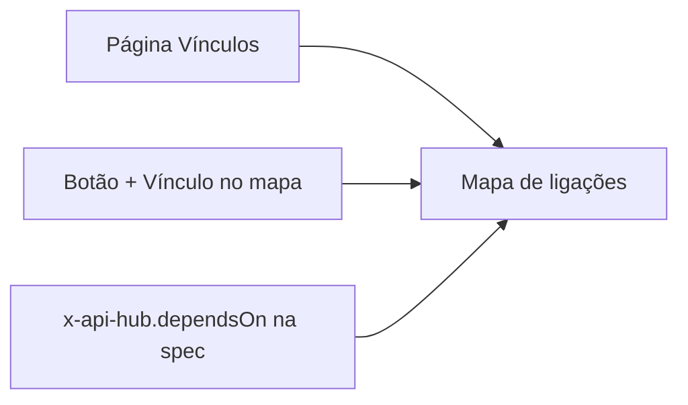

# Mapear dependências

Esta receita mostra os três jeitos de registrar quem depende de quem no hub (o modal **Novo vínculo** da página **Vínculos**, o botão **+ Vínculo** do mapa e a extensão `x-api-hub.dependsOn` na spec), quando usar cada um, como ligar um serviço ao repositório dele e como usar o **Mapa de ligações** para saber o impacto de uma mudança antes de fazê-la. É para quem mantém serviços e para quem coordena mudanças entre times.



## Antes de começar

- Os serviços das duas pontas já estão cadastrados no hub. Para vínculos com repositórios, os repositórios também (**Cadastros → Repositórios**).
- Para criar vínculos à mão (página Vínculos ou mapa), você tem `link:edit` e o serviço de origem (**De**) é de um time do qual você faz parte, ou você tem `service:edit_any`. Com os papéis padrão, Mantenedor, Administrador e Proprietário têm `link:edit`. O **Para** pode ser qualquer serviço.
- Para declarar pela spec, o serviço já publica pelo CI. Veja [Publicar pelo GitHub Actions](/receitas/publicar-pelo-github-actions).
- Para ver o mapa, `graph:read`, que o papel Leitor tem por padrão.

## Passo a passo

### 1. Escolha o jeito certo

| Jeito | Quando usar | Como aparece |
|---|---|---|
| **Página Vínculos** | Você sabe os nomes e quer cadastrar vários vínculos em sequência, escolhendo as pontas em listas. Serve para qualquer tipo de ligação. | Origem **Manual** |
| **Botão + Vínculo no Mapa** | Você está explorando o mapa e vê o que falta. O contexto visual ajuda a escolher as pontas. | Origem **Manual** |
| **`x-api-hub.dependsOn` na spec** | A dependência é de API (o serviço consome outro) e você quer que ela acompanhe o código e se atualize a cada publicação. | **Declarado na spec** |

Os três alimentam o mesmo mapa.

### 2. Registre pela página Vínculos

1. No menu, no grupo **Cadastros**, abra **Vínculos**. Se preferir, use o botão **+ Novo** da barra lateral ou a busca (**Ctrl+K**, **⌘K** no Mac) e escolha **Novo vínculo**.
2. Clique em **Novo vínculo**. Em **O que ligar**, deixe **Serviço → serviço**.
3. Em **De**, escolha o serviço que depende (o campo começa vazio, e só lista serviços que você mantém). Em **Tipo de vínculo**, escolha a relação. Em **Para**, escolha o serviço do qual ele depende (a lista nunca oferece o mesmo item do **De**). **Protocolo** (HTTP, gRPC ou WebSocket) e **Observação** ficam em **Detalhes opcionais** (por exemplo, a observação `consulta estoque no checkout`).
4. Clique em **Criar vínculo**. O botão só habilita quando **De** e **Para** estão escolhidos.

Os tipos de vínculo entre serviços:

| Tipo | Lê-se |
|---|---|
| consome a API de | Pedidos consome a API de Estoque |
| publica eventos em | Pedidos publica eventos em Notificações |
| assina eventos de | Notificações assina eventos de Pedidos |
| compartilha biblioteca com | Pedidos compartilha biblioteca com Pagamentos |
| depende de | uso genérico, quando nenhum tipo acima serve |

A lista da página **Vínculos** mostra **De**, **Relação**, **Para** e **Origem** (**Declarado na spec**, **Manual** ou **Repositórios**). Para apagar um vínculo, clique em **Remover**: durante alguns segundos aparece **Desfazer**, e passado esse tempo a remoção vale.

Um item não pode ser ligado a ele mesmo, e o mesmo vínculo (origem, destino e tipo) não se repete.

### 3. Registre direto no Mapa

1. Abra o **Mapa de ligações**. Ele abre em foco: no item que veio no endereço (`?focus=`) ou no serviço mais conectado. Para mudar o ponto de partida, clique em outro nó ou escolha em **Foco** (a lista tem busca por nome).
2. Clique em **+ Vínculo**, no canto do mapa. O botão só aparece no modo **Mapa** e para quem tem `link:edit`. A página **Vínculos** abre com o modal **Novo vínculo** e o **De** já preenchido com o item em foco, quando ele é um serviço ou um repositório.
3. Escolha o **Para** e o **Tipo de vínculo**, escreva a **Observação** se quiser e clique em **Criar vínculo**.

Integrações externas são ligadas pela aba **Integrações** do serviço (veja [Cadastrar uma integração externa](/receitas/integracao-externa)). Se o serviço de origem não for de um time seu, o campo **De** não o lista: escolha outro lado.

### 4. Declare pela spec

Na raiz da spec do serviço, liste os slugs dos serviços que ele consome:

```yaml
openapi: 3.1.0
info: { title: Pedidos API, version: 2.4.0 }
x-api-hub:
  dependsOn: [estoque-api, pagamentos-api]
```

A cada publicação que crie uma versão nova, cada slug vira uma ligação **consome a API de**, marcada como **declarado na spec**. O que vale saber:

- Só existe o tipo **consome a API de** por esse caminho. Os outros tipos (publica eventos, assina eventos, biblioteca, depende de) são criados à mão.
- Slugs que não existem no hub, ou o do próprio serviço, não geram ligação e voltam na resposta da publicação em `unknownDependencies`. Cadastre o serviço no hub primeiro.
- Um vínculo detectado pode ser removido à mão, mas volta na próxima publicação que criar uma versão nova, se o slug continuar na spec (RN-54, em [Regras de negócio](/referencia/regras-de-negocio)). Para removê-lo de vez, tire o slug da spec e apague o vínculo.
- Tirar o slug da spec não apaga uma ligação que já existe: remova-a em **Vínculos**.

Detalhes da extensão em [Extensão x-api-hub](/referencia/extensao-x-api-hub).

### 5. Ligue o serviço ao repositório, com o papel

1. Em **Vínculos → Novo vínculo**, escolha **Serviço → repositório** em **O que ligar**.
2. Em **De**, escolha o serviço. Em **Para**, o repositório.
3. Em **Papel do repositório**, escolha o que ele é para o serviço:

| Papel | Uso |
|---|---|
| **Código-fonte** | O repositório onde o serviço é desenvolvido. |
| **SDK cliente** | A biblioteca que outros times usam para chamar o serviço. |
| **Infraestrutura** | Terraform, Helm charts e afins. |
| **Contrato** | O repositório com a spec ou o contrato do serviço. |

4. Clique em **Criar vínculo**.

Num serviço recém-criado, o passo **Vincular repositório** do quadro **Próximos passos** abre este mesmo modal, com o serviço já no **De** (use o papel **Código-fonte**). Também há **Repositório → repositório** (por exemplo, um SDK que depende de uma biblioteca compartilhada), com os mesmos tipos de vínculo da tabela do passo 2. Os repositórios ligados a um serviço aparecem no cabeçalho da página dele, com o papel.

### 6. Confira no mapa

Abra **Mapa de ligações**, ou clique em **Ver no mapa** na aba **Integrações** do serviço (o mapa abre já em foco nele).


- O mapa abre **em foco**: o item escolhido e os vizinhos dentro do alcance ficam nítidos, e o resto fica esmaecido (a 25% de opacidade, mas continua clicável). Um clique num nó troca o foco; duplo clique abre o serviço, a integração ou o repositório.
- **1º grau**, **2º grau** e **Tudo** definem o alcance a partir do foco (`?depth=1`, `?depth=2` ou `?depth=all` no endereço). **Tudo** mostra o mapa inteiro, sem esmaecer.
- O menu **Tipos** escolhe o que aparece: **Serviços**, **Integrações externas**, **Repositórios**, **Times** e **Pessoas**, além dos tipos de serviço (API, Frontend, Worker). A legenda fixa do mapa mostra o desenho de cada tipo.
- O modo **Lista** mostra as mesmas ligações numa tabela (**De**, **Relação**, **Para**), paginada e navegável por teclado, com **Focar no mapa** em cada linha.
- O botão de câmera, **Tirar um print das ligações** (só no modo **Mapa**), baixa uma imagem das ligações em foco, depois de uma confirmação. O hub registra quem tirou o print.

### 7. Faça a análise de impacto

Antes de mudar, descontinuar ou derrubar um serviço, descubra quem depende dele:

1. No mapa, foque o serviço (clique nele ou use **Foco**) e deixe o alcance em **1º grau**. Os serviços que **consomem a API de** ele, ou assinam os eventos dele, são os afetados diretos. A seta e a **Relação** indicam o sentido.
2. Passe para **2º grau** (ou **Tudo**) para enxergar quem depende dos afetados. No menu **Tipos**, desmarque **Times** e **Pessoas**: sem isso, o time responsável liga todos os serviços dele entre si e o alcance passa a incluir serviços sem relação técnica.
3. Confirme na página do serviço, aba **Integrações**, tabela **Outros serviços do hub**: as linhas **chega aqui** são quem depende dele. No **Catálogo**, a coluna **Vínculos** mostra, em cada serviço, os de saída (↗), os de entrada (↙) e as integrações externas, no formato `1 ↗ · 2 ↙ · 1 externa`.
4. Avise os times responsáveis pelos serviços afetados (o time aparece na página de cada um).

::: warning
A análise só enxerga o que foi registrado. Se um consumidor não declarou a dependência, ele não aparece. Vale insistir no `dependsOn` na spec e na revisão periódica dos vínculos.
:::

## Como saber que deu certo

- Em **Vínculos**, a linha nova aparece com a **Origem** certa (**Manual**, **Declarado na spec** ou **Repositórios**).
- No mapa, a ligação aparece como uma aresta entre os dois nós, com o rótulo da relação.
- Na aba **Integrações** do serviço, a ligação aparece em **Outros serviços do hub**, como **sai daqui** ou **chega aqui**.
- Em **Auditoria**, o grupo **Vínculos** registra o vínculo criado, com os nomes das duas pontas.
- Pela spec, a resposta da publicação traz `unknownDependencies` vazio.

## Problemas comuns

| Mensagem ou sintoma | Causa e solução |
|---|---|
| `Um item não pode ser ligado a ele mesmo.` | As duas pontas são o mesmo item. |
| `Esse vínculo já existe.` | Origem, destino e tipo já estão cadastrados. |
| `Você só altera serviços dos seus times.` | O serviço de origem é de outro time. Peça ao time dele, ou inverta o vínculo se fizer sentido. |
| Não há botão **+ Vínculo** no mapa | Falta `link:edit`, ou o mapa está no modo **Lista** (o botão só aparece no modo **Mapa**). |
| O serviço não aparece no **De** do formulário | O **De** só lista serviços que você mantém e que não estão arquivados. |
| O slug volta em `unknownDependencies` | Slug errado ou serviço ainda não cadastrado. Confira o slug em **Serviços**, no grupo **Cadastros** do menu. |
| Apaguei um vínculo declarado na spec e ele voltou | Comportamento esperado enquanto o slug estiver na spec. Tire-o de `dependsOn`. |
| Tirei o slug da spec e a ligação continua | Ligações existentes não são apagadas sozinhas. Remova-a em **Vínculos**. |
| O serviço não aparece no mapa | Está arquivado, o tipo **Serviços** está desmarcado em **Tipos**, o alcance deixou o serviço esmaecido (use **Tudo**), ou o serviço é **Só o time responsável** e você não é do time. |
| Não vejo o vínculo serviço→repositório na tabela | A página **Vínculos** lista serviço→serviço e repositório→repositório. Os vínculos serviço→repositório aparecem no cabeçalho do serviço e no mapa. |

## Veja também

- [Mapa de ligações](/uso/mapa): todos os recursos do mapa.
- [Serviços, repositórios, vínculos e tokens](/admin/servicos-e-vinculos)
- [Cadastrar uma integração externa](/receitas/integracao-externa)
- [Publicar pelo GitHub Actions](/receitas/publicar-pelo-github-actions)
