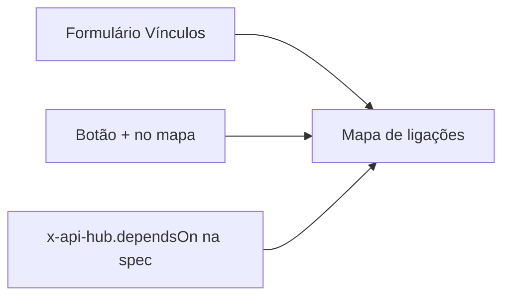

# Mapear dependências

Esta receita mostra os três jeitos de registrar quem depende de quem no hub (o formulário de **Vínculos**, o botão **+** do mapa e a extensão `x-api-hub.dependsOn` na spec), quando usar cada um, como ligar um serviço ao repositório dele e como usar o **Mapa de ligações** para saber o impacto de uma mudança antes de fazê-la. É para quem mantém serviços e para quem coordena mudanças entre times.



## Antes de começar

- Os serviços das duas pontas já estão cadastrados no hub. Para vínculos com repositórios, os repositórios também (**Serviços e repositórios → Repositórios**).
- Para criar vínculos à mão (formulário ou mapa), você tem `link:edit` e o serviço de origem (**De**) é de um time do qual você faz parte, ou você tem `service:edit_any`. Com os papéis padrão, MAINTAINER, ADMIN e OWNER têm `link:edit`. O **Para** pode ser qualquer serviço.
- Para declarar pela spec, o serviço já publica pelo CI. Veja [Publicar pelo GitHub Actions](/receitas/publicar-pelo-github-actions).
- Para ver o mapa, `graph:read`, que o papel VIEWER tem por padrão.

## Passo a passo

### 1. Escolha o jeito certo

| Jeito | Quando usar | Como aparece |
|---|---|---|
| **Formulário de Vínculos** | Você sabe os nomes e quer cadastrar vários vínculos em sequência, escolhendo as pontas em listas. Serve para qualquer tipo de ligação. | Origem **manual** |
| **Botão + no Mapa** | Você está explorando o mapa e vê o que falta. O contexto visual ajuda a escolher as pontas. | Origem **manual** |
| **`x-api-hub.dependsOn` na spec** | A dependência é de API (o serviço consome outro) e você quer que ela acompanhe o código e se atualize a cada publicação. | **declarado na spec** |

Os três alimentam o mesmo mapa.

### 2. Registre pelo formulário de Vínculos

1. Abra **Serviços e repositórios** e a aba **Vínculos**.
2. Clique em **Novo vínculo** e escolha **Serviço → serviço**.
3. Em **De**, escolha o serviço que depende. Em **Tipo de ligação**, escolha a relação. Em **Para**, escolha o serviço do qual ele depende. A **Observação** é opcional (por exemplo, `consulta estoque no checkout`).
4. Clique em **Criar vínculo**.

Os tipos de ligação entre serviços:

| Tipo | Lê-se |
|---|---|
| consome a API de | Pedidos consome a API de Estoque |
| publica eventos em | Pedidos publica eventos em Notificações |
| assina eventos de | Notificações assina eventos de Pedidos |
| compartilha biblioteca com | Pedidos compartilha biblioteca com Pagamentos |
| depende de | uso genérico, quando nenhum tipo acima serve |

A tabela **Vínculos cadastrados** lista **De**, **Relação**, **Para** e **Origem**. Para apagar um vínculo, clique em **Remover**: durante alguns segundos aparece **Desfazer**, e passado esse tempo a remoção vale.

Um item não pode ser ligado a ele mesmo, e o mesmo vínculo (origem, destino e tipo) não se repete.

### 3. Registre direto no Mapa

1. Abra o **Mapa de ligações** e clique no serviço de origem. Se selecionar vários, o último é o ponto de partida.
2. Clique no botão **+** (**Novo vínculo**), no canto do mapa. A tela de vínculos abre com o **De** preenchido, quando o último item é um serviço ou um repositório.
3. Escolha o **Para**, o **Tipo de ligação**, escreva a **Observação** se quiser e clique em **Criar vínculo**.

Integrações externas são ligadas pela aba **Integrações** do serviço (veja [Cadastrar uma integração externa](/receitas/integracao-externa)). Se o serviço de origem não for de um time seu, o campo **De** não o lista: escolha outro lado.

### 4. Declare pela spec

Na raiz da spec do serviço, liste os slugs dos serviços que ele consome:

```yaml
openapi: 3.1.0
info: { title: Pedidos API, version: 2.4.0 }
x-api-hub:
  dependsOn: [estoque-api, pagamentos-api]
```

A cada publicação que crie uma versão nova, cada slug vira uma ligação **consome a API de**, marcada como **declarado na spec**. O que vale saber:

- Só existe o tipo **consome a API de** por esse caminho. Os outros tipos (publica eventos, assina eventos, biblioteca, depende de) são criados à mão.
- Slugs que não existem no hub, ou o do próprio serviço, não geram ligação e voltam na resposta da publicação em `unknownDependencies`. Cadastre o serviço no hub primeiro.
- Um vínculo detectado pode ser removido à mão, mas volta na próxima publicação que criar uma versão nova, se o slug continuar na spec (RN-54, em [Regras de negócio](/referencia/regras-de-negocio)). Para removê-lo de vez, tire o slug da spec e apague o vínculo.
- Tirar o slug da spec não apaga uma ligação que já existe: remova-a em **Vínculos**.

Detalhes da extensão em [Extensão x-api-hub](/referencia/extensao-x-api-hub).

### 5. Ligue o serviço ao repositório, com o papel

1. Em **Serviços e repositórios → Vínculos → Novo vínculo**, escolha **Serviço → repositório**.
2. Em **De**, escolha o serviço. Em **Para**, o repositório.
3. Em **Papel do repositório**, escolha o que ele é para o serviço:

| Papel | Uso |
|---|---|
| **Código-fonte** | O repositório onde o serviço é desenvolvido. |
| **SDK cliente** | A biblioteca que outros times usam para chamar o serviço. |
| **Infraestrutura** | Terraform, Helm charts e afins. |
| **Contrato** | O repositório com a spec ou o contrato do serviço. |

4. Clique em **Criar vínculo**.

O mesmo vínculo pode ser criado no passo 3 do assistente **Novo serviço**. Também há **Repositório → repositório** (por exemplo, um SDK que depende de uma biblioteca compartilhada), com os mesmos tipos de ligação da tabela do passo 2. Os repositórios ligados a um serviço aparecem no cabeçalho da página dele, com o papel.

### 6. Confira no mapa

Abra **Mapa de ligações**, ou clique em **Ver no mapa** na aba **Integrações** do serviço.


- Clique num nó para ver só a vizinhança dele. Duplo clique abre o serviço, a integração ou o repositório.
- **Distância** (1 a 4) define quantos saltos a partir do nó focado. **Mostrar tudo** volta ao mapa inteiro.
- As caixas de tipo (**Serviços**, **Integrações externas**, **Repositórios**, **Times**, **Pessoas**) filtram o que aparece.
- O modo **Lista** mostra as mesmas ligações numa tabela (**De**, **Relação**, **Para**), navegável por teclado, com **Focar no mapa** em cada linha.

### 7. Faça a análise de impacto

Antes de mudar, descontinuar ou derrubar um serviço, descubra quem depende dele:

1. No mapa, clique no serviço e deixe a **Distância** em 1. Os serviços que **consomem a API de** ele, ou assinam os eventos dele, são os afetados diretos. A seta e a **Relação** indicam o sentido.
2. Aumente a **Distância** para 2 ou 3 para enxergar quem depende dos afetados. Desmarque **Times** e **Pessoas**: sem isso, o time responsável liga todos os serviços dele entre si e o alcance passa a incluir serviços sem relação técnica.
3. Confirme na página do serviço, aba **Integrações**, tabela **Outros serviços do hub**: as linhas **chega aqui** são quem depende dele. No **Catálogo**, a coluna **Ligações** mostra `N chegam` para cada serviço.
4. Avise os times responsáveis pelos serviços afetados (o time aparece na página de cada um).

::: warning
A análise só enxerga o que foi registrado. Se um consumidor não declarou a dependência, ele não aparece. Vale insistir no `dependsOn` na spec e na revisão periódica dos vínculos.
:::

## Como saber que deu certo

- Em **Vínculos**, a linha nova aparece com a **Origem** certa (**manual**, **declarado na spec** ou **repositórios**).
- No mapa, a ligação aparece como uma aresta entre os dois nós, com o rótulo da relação.
- Na aba **Integrações** do serviço, a ligação aparece em **Outros serviços do hub**, como **sai daqui** ou **chega aqui**.
- Em **Auditoria**, o grupo **Vínculos** registra `Vínculo criado: Pedidos consome a API de Estoque`.
- Pela spec, a resposta da publicação traz `unknownDependencies` vazio.

## Problemas comuns

| Mensagem ou sintoma | Causa e solução |
|---|---|
| `Um item não pode ser ligado a ele mesmo.` | As duas pontas são o mesmo item. |
| `Esse vínculo já existe.` | Origem, destino e tipo já estão cadastrados. |
| `Você só altera serviços dos seus times.` | O serviço de origem é de outro time. Peça ao time dele, ou inverta o vínculo se fizer sentido. |
| Não há botão **+** no mapa | Falta `link:edit`. |
| O serviço não aparece no **De** do formulário | O **De** só lista serviços que você mantém e que não estão arquivados. |
| O slug volta em `unknownDependencies` | Slug errado ou serviço ainda não cadastrado. Confira o slug em **Serviços e repositórios → Serviços**. |
| Apaguei um vínculo declarado na spec e ele voltou | Comportamento esperado enquanto o slug estiver na spec. Tire-o de `dependsOn`. |
| Tirei o slug da spec e a ligação continua | Ligações existentes não são apagadas sozinhas. Remova-a em **Vínculos**. |
| O serviço não aparece no mapa | Está arquivado, a caixa **Serviços** está desmarcada, ou o serviço é **Só o time responsável** e você não é do time. |
| Não vejo o vínculo serviço→repositório na tabela | A tabela **Vínculos cadastrados** lista serviço→serviço e repositório→repositório. Os vínculos serviço→repositório aparecem no cabeçalho do serviço e no mapa. |

## Veja também

- [Mapa de ligações](/uso/mapa): todos os recursos do mapa.
- [Serviços e vínculos](/admin/servicos-e-vinculos)
- [Cadastrar uma integração externa](/receitas/integracao-externa)
- [Publicar pelo GitHub Actions](/receitas/publicar-pelo-github-actions)
