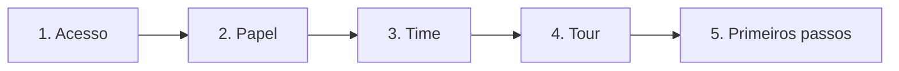

# Onboarding de uma pessoa nova

Chegou alguém novo no time e você quer que ela abra o hub, encontre as APIs certas e comece a contribuir no primeiro dia. Esta receita é um roteiro para quem recebe a pessoa (líder do time ou administrador): garantir o acesso, dar o papel certo, colocá-la no time, avisar do tour guiado obrigatório e mostrar o que vale ver primeiro.

## Antes de começar

- Você sabe o **usuário do GitHub** ou o **e-mail** da pessoa, o **time** dela e o **papel** que ela terá (na dúvida, Leitor).
- Cada etapa exige uma permissão diferente. Com os papéis padrão, o Administrador e o Proprietário fazem tudo abaixo:
  - decidir solicitações de acesso: `access:decide`;
  - mudar papéis e convidar: `user:manage`;
  - montar times: `team:manage`.
- Se você é líder de um time mas não é administrador, faça o roteiro em parceria com quem administra: os passos 1 a 3 precisam dessas permissões.

## Passo a passo

### 1. Garanta o acesso

O caminho depende de como a sua empresa configurou o hub:

| Situação | O que fazer |
|---|---|
| **A empresa libera automaticamente** (organização do GitHub ou domínio de e-mail) | Nada. Mande o endereço do hub (`https://apihub.suaempresa.com`). Ao entrar, ela já fica ativa como **Leitor**. Veja [Acesso automático para a empresa](/receitas/acesso-automatico-pela-organizacao). |
| **Todo acesso passa por aprovação** | Peça que ela entre. Em **Pessoas e acesso**, no filtro **Solicitações de acesso**, escolha o papel e o prazo e clique em **Aprovar acesso**. |
| **A pessoa não tem conta que o hub reconheça** | Clique em **Convidar pessoa** em **Pessoas e acesso**, copie o link e envie pelo canal da empresa. Veja [Convidar por e-mail](/receitas/convidar-por-email). |

Enquanto a solicitação não é decidida, a pessoa vê a tela "Pedido de acesso enviado" e pode escrever quem é e por que precisa (10 a 500 caracteres). O número no item **Pessoas e acesso** do menu mostra quantas solicitações esperam decisão.

### 2. Ajuste o papel

Em **Pessoas e acesso**, clique no nome da pessoa e, no bloco **Papel**, escolha o papel e clique em **Salvar papel**:

- **Leitor** (padrão): lê o catálogo, o mapa e as variáveis (segredos ocultos).
- **Mantenedor**: para quem vai publicar specs, editar serviços, mexer em variáveis e gerar tokens de CI, **nos serviços dos times de que participa**.
- **Administrador** só pode ser dado por um Proprietário.

Mudar o papel encerra a sessão da pessoa, e ela entra de novo com o papel novo. Faça isso antes de ela começar a usar o hub. Se a sua empresa personalizou as permissões, confira o resultado em [Papel com permissões sob medida](/receitas/papel-personalizado).

### 3. Adicione a pessoa ao time

O papel diz **o que** ela pode fazer; o time diz **em quais serviços**.

1. Abra **Times** (grupo **Cadastros**) e clique no nome do time.
2. Clique em **Adicionar membro** e digite o usuário do GitHub ou o e-mail em **@usuário do GitHub ou e-mail** (`@fulano` ou `fulano@suaempresa.com`).
3. Escolha **Membro** ou **Líder** e clique em **Adicionar membro**.

Só pessoas com acesso **ativo** entram em times. Se ela ainda não entrou ou a solicitação não foi aprovada, o hub responde que ela "ainda não tem acesso ativo ao hub". Se o time já existe no GitHub, **Sincronizar com o GitHub** traz de uma vez todo mundo que já tem conta ativa (veja [Times](/admin/times)).

Ser do time muda três coisas:

- Ela vê os serviços marcados como **Só o time responsável** desse time.
- Se for Mantenedora, ela edita, publica e gera tokens **só** nos serviços do time.
- Para revelar segredos, ela precisa de `envvars:reveal` **e** ser do time do serviço.

::: info Líder é um rótulo
Hoje **Líder** aparece como selo e ordena a lista, mas não dá permissões extras. As permissões vêm só do papel e da participação no time.
:::

### 4. Avise sobre o tour guiado obrigatório

No primeiro acesso, o hub **bloqueia o uso** até a pessoa concluir um panorama no Catálogo: o menu inteiro e os quatro grupos (**Explorar**, **Cadastros**, **Pessoas** e **Sistema**, só os que o papel dela mostra), a busca (Ctrl+K ou ⌘K), o botão **+ Novo**, a interrogação e o menu da conta. **Concluir tour** libera o hub. Cada tela depois se ensina sozinha, pelo botão **?** dela.

Combine com ela reservar uns 10 minutos. Depois do tour, o botão **?** no canto da tela explica a tela atual e oferece **Iniciar tour desta tela** sempre que ela quiser rever. A conclusão fica na **Auditoria** ("concluiu o tour guiado"). Veja [Primeiro acesso e tour](/uso/primeiro-acesso).

### 5. Mostre o que importa primeiro

Uma visita de 20 a 30 minutos, na ordem:

1. **Catálogo.** Mostre a busca ("Buscar por nome, slug ou endpoint"), os filtros **Time**, **Tipo** e **Situação** e os atalhos **Sem spec** e **Meus serviços**. A coluna **Time** diz quem é dono de cada serviço, e a coluna **Ambientes** mostra a versão publicada em cada um. Comece pelos serviços do time dela.
2. **Página de um serviço do time.** Percorra as abas: **Documentação da API**, **Regras de negócio**, **Integrações**, **Variáveis de ambiente** e **Configurações**. Mostre o seletor de ambiente (a página abre em produção, com o escudo).
3. **Regras de negócio.** Abra a aba e mostre as páginas em Markdown que o time escreveu. É onde está o "porquê" da API.
4. **Mapa de ligações.** O mapa já abre em foco, no serviço mais conectado. Troque o **Foco** para um serviço do time dela e use **1º grau**, **2º grau** ou **Tudo** para ver quem depende de quem. Os itens fora do alcance ficam esmaecidos, mas continuam clicáveis.
5. **Variáveis e segredos.** Explique que os valores comuns ficam visíveis, que os segredos só aparecem sob pedido e que cada revelação é registrada. Veja [Segredos, .env e cópia entre ambientes](/receitas/segredos-e-env).
6. **Como publicar.** Se ela é Mantenedora, mostre a página **Tokens de CI** (grupo **Cadastros**) e a receita [Publicar pelo GitHub Actions](/receitas/publicar-pelo-github-actions).

### 6. Feche com o checklist

- [ ] A pessoa entrou e está **ativa** em **Pessoas e acesso**.
- [ ] O papel está correto (e ela entrou de novo depois da mudança).
- [ ] Ela aparece no time certo, em **Times**.
- [ ] Ela concluiu o tour guiado.
- [ ] Ela achou, no **Catálogo**, os três serviços que mais vai usar.
- [ ] Ela abriu o **Mapa de ligações** focado num serviço do time.
- [ ] Ela sabe onde pedir ajuda: o botão **?** e o time.
- [ ] Se for publicar specs: ela tem um token de CI (ou sabe quem gera) e conhece a receita de publicação.

## Como saber que deu certo

- Na tabela **Pessoas**, ela aparece como **ativo**, com o papel escolhido.
- Na seção do time, em **Times**, ela está na lista de membros.
- Em **Auditoria**, aparecem "… aprovou o acesso de … como Leitor" (ou, no acesso automático, "Sistema teve o status mudado de aguardando para ativo automaticamente"), "… mudou o papel de …" e "… concluiu o tour guiado".
- No catálogo, ela vê os serviços do time, inclusive os **Só o time responsável**.

## Problemas comuns

| Sintoma | Causa e solução |
|---|---|
| "… ainda não tem acesso ativo ao hub." ao adicionar ao time | A pessoa ainda não entrou ou a solicitação não foi aprovada. Faça o passo 1 antes. |
| A pessoa vê "Pedido de acesso enviado" | A solicitação está esperando decisão em **Solicitações de acesso**, ou a empresa não libera automaticamente. |
| Ela não vê um serviço que o time usa | O serviço é **Só o time responsável** e ela não está no time (passo 3). |
| Ela não consegue editar ou publicar | O papel é Leitor, ou ela não é do time responsável pelo serviço. |
| Ela caiu na tela de login depois da mudança de papel | É esperado: mudar o papel encerra a sessão. Basta entrar de novo. |
| Ela não consegue fechar o tour | O panorama do primeiro acesso é obrigatório. Só **Concluir tour** libera o hub. |
| Ela não vê **Mapa de ligações** no menu | O papel dela não tem `graph:read` (matriz personalizada). |

## Veja também

- [Primeiro acesso e tour](/uso/primeiro-acesso): a experiência dela, do ponto de vista dela.
- [Times](/admin/times): montar e manter times.
- [Pessoas e acesso](/admin/pessoas-e-acesso): solicitações, papéis e suspensões.
- [Acesso temporário para terceiros](/receitas/acesso-temporario-para-terceiros): quando a pessoa nova é de fora.
