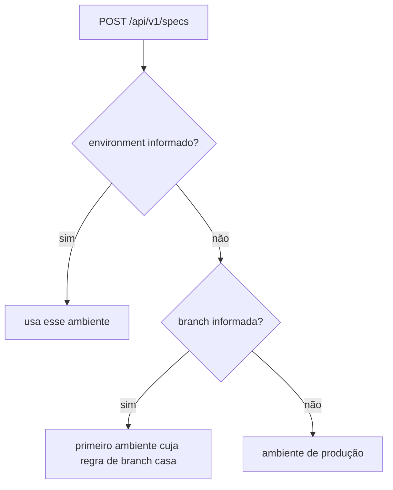

# Publicar pelo GitHub Actions

Esta receita configura um workflow do GitHub Actions que envia a spec OpenAPI do serviço para o hub a cada push. O ambiente (dev, homologação, produção…) é descoberto pela branch. É para quem mantém um serviço e quer a documentação sempre atualizada, sem passo manual.

É também a página que a interface do hub abre em **Como configurar o CI**.

## Antes de começar

- O serviço já está cadastrado no hub. Se não estiver, veja [Do zero ao primeiro serviço](/receitas/primeiro-servico).
- Você tem `token:manage` e é do time responsável pelo serviço (ou tem `service:edit_any`). Com os papéis padrão, Mantenedor, Administrador e Proprietário têm.
- Os ambientes e as regras de branch estão configurados em **Configurações → Ambientes e sessões**. Quem publica sem informar o ambiente depende dessas regras. Veja [Ambientes por branch](/receitas/ambientes-por-branch).
- O runner do GitHub alcança o hub pela rede. Se o hub só abre na rede interna, use um runner self-hosted dentro dela.
- A spec do serviço existe como arquivo (`openapi.yaml` ou `openapi.json`) ou pode ser gerada no build (passo 4).

::: warning
Um token vale para um serviço só. Num repositório com vários serviços, crie um token por serviço e um segredo por token (por exemplo, `API_HUB_TOKEN_PEDIDOS` e `API_HUB_TOKEN_ESTOQUE`).
:::

## Passo a passo

### 1. Gere o token de publicação

1. No hub, abra **Tokens de CI** (grupo **Cadastros** do menu). Se você está na página do serviço, o botão **Gerar** do passo **Gerar token de CI** abre o mesmo modal, já com o serviço escolhido.
2. Clique em **Novo token**, escolha o **Serviço** (o campo começa vazio) e informe o **Nome do token** (`github-actions`). A **Validade (dias)**, de 1 a 365, fica em **Detalhes opcionais**; o padrão é 90.
3. Clique em **Gerar token**, depois em **Copiar token**. O valor (`ahub_...`) só aparece uma vez, nesse modal.

Quando o token vencer, o CI passa a receber 401. A coluna **Expira** da lista de **Tokens de CI** destaca a data quando faltam menos de 14 dias: gere um novo antes disso e troque o segredo.

### 2. Guarde o token e a URL no GitHub

No repositório do serviço, abra **Settings → Secrets and variables → Actions**:

| Onde | Nome | Valor |
|---|---|---|
| Aba **Secrets** → **New repository secret** | `API_HUB_TOKEN` | o token do passo 1 |
| Aba **Variables** → **New repository variable** | `API_HUB_URL` | `https://apihub.suaempresa.com` (sem barra no final) |

A URL não é segredo, por isso vai numa variável. Nunca escreva o token dentro do YAML.

### 3. Crie o workflow

Crie `.github/workflows/publicar-spec.yml`. O exemplo publica a partir de quatro branches e deixa o hub decidir o ambiente de cada uma:

```yaml
name: Publicar spec no Rizoma

on:
  push:
    branches:
      - develop
      - homolog
      - "release/**"
      - main

jobs:
  publicar:
    runs-on: ubuntu-latest
    steps:
      - uses: actions/checkout@v4

      # Se a spec nasce do código, gere o arquivo aqui (passo 4).

      - name: Publicar no Rizoma
        env:
          API_HUB_URL: ${{ vars.API_HUB_URL }}
          API_HUB_TOKEN: ${{ secrets.API_HUB_TOKEN }}
        run: |
          if ! curl --fail-with-body -sS -o resposta.json -X POST \
            "${API_HUB_URL}/api/v1/specs?commitSha=${GITHUB_SHA}&branch=${GITHUB_REF_NAME}" \
            -H "Authorization: Bearer ${API_HUB_TOKEN}" \
            -H "Content-Type: application/yaml" \
            --data-binary @openapi.yaml; then
            echo "::error::O Rizoma recusou a publicação. Resposta abaixo."
            cat resposta.json || true
            echo
            exit 1
          fi

          cat resposta.json
          echo
          jq -r '"Rizoma: \(.status), versão \(.version), ambiente \(.environment)"' resposta.json
          jq -r '(.unknownDependencies // []) | select(length > 0) | "::warning::Dependências que não existem no hub: " + join(", ")' resposta.json
```

O que o passo faz:

- `--fail-with-body` faz o `curl` terminar com erro em qualquer HTTP 4xx ou 5xx, mas ainda grava o corpo da resposta. É ele que explica o motivo de um 422.
- O `if !` imprime a resposta do hub e derruba o job. Assim uma spec inválida, um token vencido ou uma branch sem ambiente (422) quebram o pipeline em vez de passar despercebidos.
- `commitSha` e `branch` ficam registrados na versão e aparecem ao passar o mouse sobre ela na aba **Documentação da API**.
- `Content-Type: application/yaml` serve para YAML e para JSON. O hub descobre o formato pelo conteúdo. Com `application/json` ele espera o formato `{ "spec": ... }` de [Publicar por outros CIs](/receitas/publicar-por-outros-ci).

Enviar a mesma spec de novo é seguro: o hub responde 200 com `unchanged` e não cria versão.

### 4. Gere a spec no build (se ela nasce do código)

Gere o arquivo antes do passo de publicação e aponte o `--data-binary` para ele. Em todos os casos abaixo o gerador sobe ou importa a aplicação, então ela precisa iniciar no CI (variáveis e dependências de teste incluídas). Os comandos foram escritos para funcionar em CI, sem interface.

#### NestJS com @nestjs/swagger

Crie `scripts/gerar-openapi.ts`:

```ts
import { NestFactory } from '@nestjs/core';
import { DocumentBuilder, SwaggerModule } from '@nestjs/swagger';
import { writeFileSync } from 'node:fs';
import { AppModule } from '../src/app.module';

async function gerar() {
  const app = await NestFactory.create(AppModule, { logger: false });
  const config = new DocumentBuilder()
    .setTitle('Pedidos API')
    .setVersion(process.env.npm_package_version ?? '1.0.0')
    .build();
  const document = SwaggerModule.createDocument(app, config);
  writeFileSync('openapi.json', JSON.stringify(document, null, 2));
  await app.close();
}

gerar();
```

Rode `npx ts-node scripts/gerar-openapi.ts` antes de publicar (troque `openapi.yaml` por `openapi.json` no `curl`). Se o projeto usa o plugin do `@nestjs/swagger` no `nest-cli.json`, ele só atua na compilação: compile com `nest build` e execute o script compilado para obter a mesma spec da aplicação.

#### FastAPI

Crie `scripts/exportar_openapi.py`:

```python
import json

from app.main import app  # ajuste o caminho do seu módulo

with open("openapi.json", "w", encoding="utf-8") as arquivo:
    json.dump(app.openapi(), arquivo, ensure_ascii=False, indent=2)
```

No workflow:

```yaml
      - run: pip install -r requirements.txt
      - run: PYTHONPATH=. python scripts/exportar_openapi.py
```

`app.openapi()` funciona mesmo com `openapi_url=None`, então você pode desligar o `/docs` em produção sem perder a exportação.

#### Spring Boot com springdoc

O springdoc serve a spec em `/v3/api-docs` (JSON) e `/v3/api-docs.yaml`. O jeito mais simples de gerar o arquivo no CI é subir o jar por alguns segundos e baixar a spec:

```bash
mvn -B -DskipTests package
java -jar target/pedidos-api.jar --server.port=8089 --spring.profiles.active=ci &
APP_PID=$!

for i in $(seq 1 60); do
  curl -fsS http://localhost:8089/v3/api-docs.yaml -o openapi.yaml && break
  sleep 2
done
kill "$APP_PID"
test -s openapi.yaml
```

Use um perfil de CI que mantenha o springdoc ligado, não o de produção (que, depois da receita [Tirar o /docs público do ar](/receitas/tirar-docs-do-ar), o desliga). Os plugins do springdoc para Maven e Gradle automatizam esse mesmo fluxo dentro do build; a documentação do springdoc traz a configuração da versão que você usa.

#### ASP.NET Core com Swashbuckle

A CLI do Swashbuckle lê o assembly compilado e escreve a spec sem subir o servidor. Uma vez, na raiz da solução (faça commit do manifesto gerado):

```bash
dotnet new tool-manifest
dotnet tool install Swashbuckle.AspNetCore.Cli
```

No CI:

```bash
dotnet tool restore
dotnet build -c Release
dotnet swagger tofile --output openapi.json bin/Release/net8.0/PedidosApi.dll v1
```

Ajuste a versão do .NET e o nome do projeto no caminho do `.dll`. O último argumento (`v1`) é o nome do documento registrado em `SwaggerDoc`. Use a versão da CLI compatível com a do pacote `Swashbuckle.AspNetCore` do projeto.

#### Spec escrita à mão

Mantenha `openapi.yaml` no repositório e publique direto. Para pegar erros antes de publicar, valide no CI, por exemplo:

```yaml
      - run: npx @redocly/cli lint openapi.yaml
```

::: tip
O número da versão exibido no hub vem de `info.version` da spec. Se o conteúdo muda e `info.version` não, o hub cria uma nova versão com o mesmo número. Atualize `info.version` a cada release.
:::

### 5. Publique em vários ambientes

Você não precisa de um workflow por ambiente. O hub resolve o ambiente assim:



Com estes ambientes em **Configurações → Ambientes e sessões** (exemplo):

| Ambiente | Regras de branch |
|---|---|
| `dev` | `develop`, `feature/**` |
| `hml` | `release/*`, `homolog` |
| `prod` | `main` |

o workflow do passo 3 publica assim:

| Push em | Cai em |
|---|---|
| `develop` | `dev` |
| `release/1.4` | `hml` |
| `homolog` | `hml` |
| `main` | `prod` |

Quem decide quais branches disparam a publicação é a lista `on.push.branches` do workflow; quem decide o ambiente de cada uma são as regras do hub. Se uma branch não casar com nenhuma regra, a publicação é recusada com 422 e a resposta traz a lista de ambientes e regras.

### 6. Force o ambiente quando a branch não basta

Em tags de release ou em execuções manuais, a branch não diz o ambiente. Informe `environment` explicitamente; ele tem prioridade sobre a branch:

```yaml
name: Publicar spec no Rizoma (release)

on:
  push:
    tags: ["v*"]
  workflow_dispatch:
    inputs:
      ambiente:
        description: "Identificador do ambiente no Rizoma"
        required: true
        default: hml

jobs:
  publicar:
    runs-on: ubuntu-latest
    steps:
      - uses: actions/checkout@v4

      - name: Publicar no Rizoma
        env:
          API_HUB_URL: ${{ vars.API_HUB_URL }}
          API_HUB_TOKEN: ${{ secrets.API_HUB_TOKEN }}
          # Tag publica em produção; a execução manual usa o ambiente escolhido.
          AMBIENTE: ${{ inputs.ambiente || 'prod' }}
        run: |
          curl --fail-with-body -sS -X POST \
            "${API_HUB_URL}/api/v1/specs?environment=${AMBIENTE}&commitSha=${GITHUB_SHA}&branch=${GITHUB_REF_NAME}" \
            -H "Authorization: Bearer ${API_HUB_TOKEN}" \
            -H "Content-Type: application/yaml" \
            --data-binary @openapi.yaml
```

O valor de `environment` é o identificador do ambiente (`hml`, `prod`), não o nome de exibição. Um identificador inexistente devolve 422.

### 7. Declare dependências na própria spec (opcional)

Para o mapa de ligações mostrar de quem o serviço depende, acrescente `x-api-hub.dependsOn` na raiz da spec, com os slugs dos serviços consumidos:

```yaml
openapi: 3.1.0
info: { title: Pedidos API, version: 2.4.0 }
x-api-hub:
  dependsOn: [estoque-api, pagamentos-api]
```

Cada slug vira uma ligação **consome a API de**, marcada como **declarado na spec**. Slugs que não existem no hub, ou o do próprio serviço, voltam na resposta em `unknownDependencies` (o workflow do passo 3 mostra um aviso). As ligações só são criadas quando a publicação gera uma versão nova. Tirar um slug da lista não apaga a ligação já criada: remova-a em **Vínculos** (clique em **Remover**; dá para desfazer logo em seguida).

Numa spec gerada, adicione a extensão na exportação. No NestJS, depois de `createDocument`: `Object.assign(document, { 'x-api-hub': { dependsOn: ['estoque-api'] } })`. No FastAPI: `schema = app.openapi(); schema["x-api-hub"] = {"dependsOn": ["estoque-api"]}`. Em outros casos, pós-processe o JSON, por exemplo com `jq '. + {"x-api-hub": {"dependsOn": ["estoque-api"]}}' openapi.json`. Detalhes em [Extensão x-api-hub](/referencia/extensao-x-api-hub) e [Mapear dependências](/receitas/mapear-dependencias).

## Como saber que deu certo

O log do passo mostra a resposta do hub. Estes são os resultados possíveis:

| Status | Corpo | Significado |
|---|---|---|
| 201 | `"status": "published"` | Nova versão salva como a atual do ambiente. |
| 200 | `"status": "unchanged"` | Spec idêntica à que já existe no ambiente; nada mudou. |
| 401 | `Token ausente.` ou `Token inválido, revogado ou expirado.` | Segredo vazio, token revogado ou vencido, ou serviço arquivado. |
| 413 | `Spec maior que 5 MB.` | Corpo grande demais. Um arquivo só um pouco acima de 5 MB pode voltar como 422 com a mensagem `A spec passa de 5 MB.` |
| 422 | mensagem em `error` | Spec inválida, corpo inválido, ambiente inexistente ou branch sem ambiente (neste caso vem a lista `environments`). |
| 429 | `Limite de 30 publicações por minuto.` | Mais de 30 publicações por minuto com o mesmo token. |

Depois de um 201:

- No hub, o **Catálogo** mostra a pílula do ambiente, na coluna **Ambientes**, com a versão nova.
- Na aba **Documentação da API** do serviço, a versão aparece com o marcador de atual. Passe o mouse sobre ela para ver data, origem e branch.
- Em **Tokens de CI**, o **Último uso** do token é atualizado.
- Em **Auditoria**, o grupo **Publicação de specs** registra a publicação pelo CI, com o ambiente e a versão. Abra o registro para ver o prefixo do token, a branch e o commit. Respostas `unchanged` não geram evento.

Exemplo de resposta 422 quando a branch não tem ambiente:

```json
{
  "error": "A branch \"experimento/x\" não corresponde a nenhum ambiente. Informe \"environment\" ou ajuste as regras em Configurações → Ambientes e sessões.",
  "environments": [
    { "slug": "dev", "branches": ["develop", "feature/**"] },
    { "slug": "hml", "branches": ["release/*", "homolog"] },
    { "slug": "prod", "branches": ["main"] }
  ]
}
```

## Problemas comuns

| Sintoma | O que fazer |
|---|---|
| 401 `Token ausente.` | O segredo `API_HUB_TOKEN` não existe ou está vazio. Segredos não chegam a workflows disparados por pull requests de forks: publique só em `push`. |
| 401 com token inválido, revogado ou expirado | Gere outro token em **Tokens de CI** e atualize o segredo. Arquivar o serviço revoga todos os tokens dele. |
| 422 dizendo que a branch não corresponde a nenhum ambiente | Ajuste as regras em **Configurações → Ambientes e sessões** (exige `settings:manage`) ou informe `environment`. |
| 422 `Corpo inválido` | O arquivo foi enviado com `Content-Type: application/json`. Use `application/yaml` para o arquivo cru. |
| 422 com erro de leitura da spec | A spec não é OpenAPI 3.0/3.1 nem Swagger 2.0, ou não tem `info` e `paths`, `webhooks` ou `components`. Rode o `lint` localmente. |
| `curl: (22)` sem explicação | Falta `--fail-with-body`, ou a resposta não foi impressa. Use o trecho do passo 3. |
| `curl: (3)` ou erro de URL sem endereço | A variável `API_HUB_URL` não existe. Ela precisa estar na aba **Variables**, não em **Secrets**, porque o workflow a lê com `vars`. |
| Timeout ou conexão recusada | O runner não alcança o hub. Use um runner na rede interna. |
| A spec não aparece no ambiente esperado | Confira o seletor de ambiente na página do serviço: a versão pode ter caído em outro. A resposta do `curl` traz `environment`. |
| Aviso "Esta versão não veio…" na aba **Documentação da API** | A versão chegou pelo CI, mas a origem configurada do serviço não é **Enviada pelo CI**. Clique em **Ver origem** e, se o CI é o caminho certo, escolha **Enviada pelo CI** em **Editar serviço**. Veja [Importar a spec manualmente](/receitas/importar-spec-manualmente). |
| 429 | Mais de 30 publicações por minuto com o mesmo token. Confira se há um laço no pipeline. |

## Veja também

- [Publicar pelo GitLab CI](/receitas/publicar-pelo-gitlab-ci) e [Publicar por outros CIs](/receitas/publicar-por-outros-ci)
- [Tirar o /docs público do ar](/receitas/tirar-docs-do-ar): próximo passo depois que a publicação estiver funcionando.
- [Ambientes por branch](/receitas/ambientes-por-branch)
- [API HTTP](/referencia/api): referência completa do endpoint.
