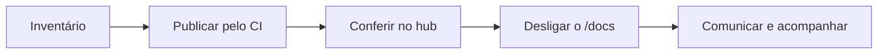

# Tirar o /docs público do ar

Muitos serviços expõem o Swagger ou o Redoc em `/docs`, o que deixa o contrato interno acessível a quem tem o endereço. Este plano leva serviço por serviço do `/docs` público para o hub, sem perder documentação no caminho: publicar pelo CI, conferir, desligar e comunicar. É para tech leads e para quem conduz a adoção do hub. Faz parte das regras do produto que o hub seja a única vitrine das specs (RN-47, em [Regras de negócio](/referencia/regras-de-negocio)).



## Antes de começar

- O hub está no ar, com o login da empresa funcionando e os ambientes configurados. Veja [Ambientes por branch](/receitas/ambientes-por-branch).
- Você consegue mexer no código, na configuração ou no proxy de cada serviço.
- Você sabe quem acessa o `/docs` hoje. Se parceiros externos ou clientes usam esse endereço, saiba que o hub é fechado: quem não é da empresa não entra sem acesso concedido. Veja [Acesso temporário para terceiros](/receitas/acesso-temporario-para-terceiros).
- Faça um serviço de cada vez, começando por um de baixo risco e por dev e homologação, antes de produção.

## Passo a passo

### 1. Faça o inventário

Para cada serviço, anote em uma planilha:

- o serviço e o time responsável;
- onde a documentação é exposta (`/docs`, `/redoc`, `/swagger`, `/openapi.json`, `/v3/api-docs`) e em quais ambientes;
- quem acessa hoje (os logs do proxy mostram);
- o framework e se já existe pipeline de CI.

### 2. Garanta a publicação pelo CI

Nenhum `/docs` deve sair do ar antes de a spec estar no hub, em todos os ambientes onde ele existia:

- Com pipeline: [GitHub Actions](/receitas/publicar-pelo-github-actions), [GitLab CI](/receitas/publicar-pelo-gitlab-ci) ou [outros CIs](/receitas/publicar-por-outros-ci).
- Sem pipeline, mas com a spec no repositório: [ler do repositório](/receitas/spec-do-repositorio).
- Sistema legado que só expõe a spec por HTTP: [ler de uma URL](/receitas/spec-por-url).
- Sem nenhuma dessas opções: [importe à mão](/receitas/importar-spec-manualmente) enquanto o CI não sai.

A spec continua sendo gerada no build; só deixa de ser servida ao público.

### 3. Confira no hub

Para cada ambiente, abra o serviço no **Catálogo** e compare com o `/docs` atual:

- o serviço aparece com o selo do ambiente e a versão esperada;
- na aba **Documentação da API**, os endpoints, os schemas e os servidores estão iguais aos do `/docs`;
- o time responsável e a visibilidade (**Toda a empresa** ou **Só o time responsável**) estão certos;
- quem precisa consultar a documentação tem acesso ao hub e a permissão de ver o serviço.

Uma diferença importante: o hub renderiza a spec com o Scalar sem o recurso de testar requisições. Quem usava o **Try it out** do Swagger UI passa a usar Postman, Insomnia ou `curl`.

### 4. Desligue o /docs em produção

Escolha entre desligar a interface ou restringi-la à rede interna. Comece por dev e homologação e deixe produção por último.

::: warning
Se o hub lê a spec do serviço por URL (origem **Lida de uma URL**), não desligue o endpoint que a entrega: restrinja-o à rede interna e libere o servidor do hub. Desligado, a sincronização passa a falhar com `A origem respondeu 404.`
:::

Exemplos por framework, usando uma variável de ambiente ou o perfil da aplicação. Use apenas o que existe na sua versão e no seu projeto:

::: code-group
```python [FastAPI]
import os
from fastapi import FastAPI

em_producao = os.getenv("APP_ENV") == "production"

app = FastAPI(
    docs_url=None if em_producao else "/docs",
    redoc_url=None if em_producao else "/redoc",
    openapi_url=None if em_producao else "/openapi.json",
)
```

```ts [NestJS]
// main.ts
if (process.env.NODE_ENV !== 'production') {
  const document = SwaggerModule.createDocument(app, config);
  SwaggerModule.setup('docs', app, document);
}
```

```ini [Spring Boot]
# application-prod.properties
springdoc.api-docs.enabled=false
springdoc.swagger-ui.enabled=false
```

```csharp [ASP.NET Core]
// Program.cs
if (app.Environment.IsDevelopment())
{
    app.UseSwagger();
    app.UseSwaggerUI();
}
```

```js [Express]
// swagger-ui-express: só monta a rota fora de produção
if (process.env.NODE_ENV !== 'production') {
  app.use('/docs', swaggerUi.serve, swaggerUi.setup(spec));
}
```
:::

Para restringir em vez de desligar, bloqueie os caminhos no proxy. Exemplo em nginx (ajuste os caminhos ao seu framework e mantenha as diretivas do seu `location` principal):

```nginx
location ~ ^/(docs|redoc|swagger|openapi\.json|v3/api-docs) {
    allow 10.0.0.0/8;
    allow 192.168.0.0/16;
    deny all;
    proxy_pass http://pedidos_api;
}
```

O gerador de spec do CI precisa continuar funcionando depois do desligamento:

- FastAPI: `app.openapi()` funciona mesmo com `openapi_url=None`.
- NestJS: o script que chama `SwaggerModule.createDocument` não depende do `SwaggerModule.setup`.
- ASP.NET Core: a CLI `swagger tofile` lê o assembly e não depende do `UseSwagger` no pipeline HTTP.
- Spring Boot: gere a spec com um perfil de CI em que o springdoc está ligado, não com o perfil `prod`.

### 5. Comunique o time

Antes de desligar em produção, avise com antecedência. Uma mensagem curta basta:

::: details Modelo de aviso
A documentação das nossas APIs agora fica no Rizoma: `https://apihub.suaempresa.com`. A partir de DD/MM, o `/docs` de `pedidos-api` (e dos demais serviços listados abaixo) sai do ar em produção. Entre com a sua conta da empresa e procure o serviço no **Catálogo** (por exemplo, `https://apihub.suaempresa.com/services/pedidos-api`). Se você não conseguir entrar, peça acesso a `fulano@suaempresa.com`. O hub não tem "Testar requisição": use Postman, Insomnia ou `curl`.
:::

Depois, atualize os links antigos (README, wiki, gateway, coleções do Postman) para o endereço do serviço no hub. Adicione `?env=prod` (o identificador do ambiente) se quiser abrir direto no ambiente certo. Se houve pessoas ou parceiros de fora, conceda o acesso pelo [Acesso temporário para terceiros](/receitas/acesso-temporario-para-terceiros).

### 6. Acompanhe e finalize

- Nos primeiros dias, olhe os logs do proxy: acessos a `/docs` devolvendo 404 mostram quem ainda usa o endereço antigo.
- Depois de uma ou duas semanas sem reclamações, remova do serviço as dependências e o código que só serviam à interface (o pacote do Swagger UI, por exemplo).
- Volte à planilha do passo 1 e marque o serviço como concluído.

## Como saber que deu certo

Confira este checklist para cada serviço:

- [ ] A spec está publicada no hub em todos os ambientes onde o `/docs` existia.
- [ ] O CI publica a cada deploy, e o último pipeline terminou verde.
- [ ] A documentação no hub foi comparada com o `/docs` antigo.
- [ ] O time e a visibilidade do serviço no hub estão corretos.
- [ ] Quem consulta a documentação tem acesso ao hub.
- [ ] O `/docs` em produção responde 404 (ou deixa de responder fora da rede interna).
- [ ] A geração da spec no CI continua funcionando.
- [ ] O time foi avisado e os links antigos foram atualizados.
- [ ] Quem usava o **Try it out** sabe da alternativa.

## Problemas comuns

| Sintoma | Causa e solução |
|---|---|
| O pipeline quebrou ao gerar a spec depois do desligamento | O gerador depende do endpoint que foi desligado. Use um perfil ou variável de CI com a documentação ligada. |
| A sincronização por URL passou a falhar com `A origem respondeu 404.` | O hub lê de um endpoint que você desligou. Restrinja o endpoint à rede interna e libere o servidor do hub, ou troque a origem para CI ou repositório. |
| `/openapi.json` ainda responde publicamente | Só a interface foi desligada. Desligue também o endpoint do documento (por exemplo, `openapi_url=None` no FastAPI). |
| Parceiros sem acesso à documentação | O hub é fechado. Conceda [acesso temporário](/receitas/acesso-temporario-para-terceiros) ou entregue a spec por outro canal. |
| A documentação no hub está desatualizada | O CI só publica nas branches configuradas e o hub só mostra a versão mais recente de cada ambiente. Confira o ambiente selecionado e o último pipeline. |
| Falta o botão de testar requisição | O hub não envia requisições. Use Postman, Insomnia ou `curl`. |

Se precisar voltar atrás, religue o `/docs` (o inverso do passo 4). A documentação no hub não é afetada.

## Veja também

- [Publicar pelo GitHub Actions](/receitas/publicar-pelo-github-actions)
- [Ler a spec de uma URL](/receitas/spec-por-url)
- [Acesso temporário para terceiros](/receitas/acesso-temporario-para-terceiros)
- [Onboarding de uma pessoa nova](/receitas/onboarding-de-pessoa-nova)
