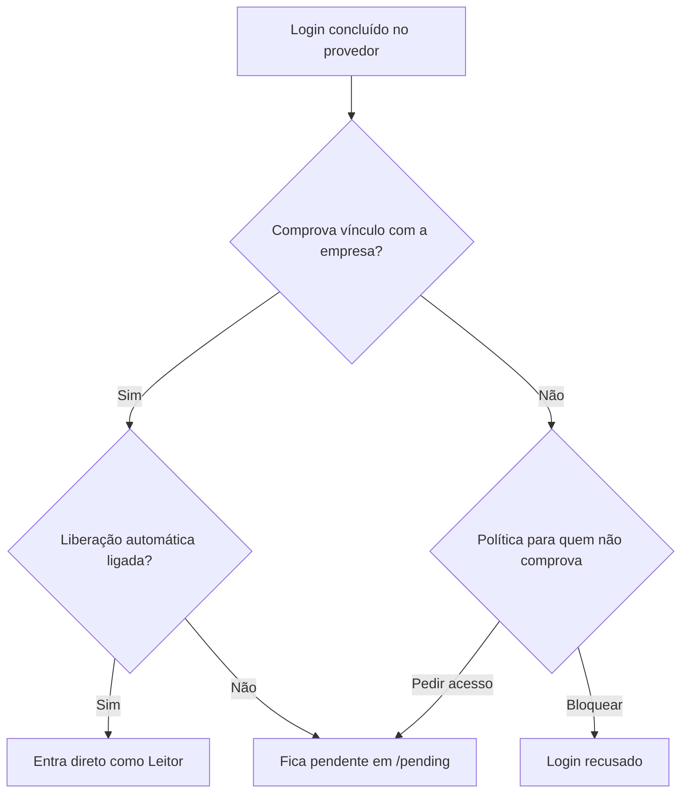

# Primeiro acesso e tour

Esta página mostra o caminho de quem abre o Rizoma pela primeira vez: a tela de login, o que o hub faz conforme o seu vínculo com a empresa, como usar um convite ou um link de nova senha, o tour guiado que você precisa concluir, o menu lateral, a busca rápida e o menu da conta. É para qualquer pessoa que vai usar o hub no dia a dia.

## A tela de login

Ao abrir o endereço do hub (por exemplo `https://apihub.suaempresa.com`) sem uma sessão ativa, você cai em `/login`. A tela mostra o nome da empresa, o título do sistema e a frase "Documentação das APIs internas. Entre com a conta da empresa."

*A tela de login. Os botões mudam conforme as formas de login que a sua empresa ativou.*

Quem administra o hub escolhe quais formas de login existem. Para cada uma ativa, aparece um botão:

| Botão | Provedor |
|---|---|
| **Entrar com GitHub** | GitHub |
| **Entrar com Google** | Google |
| **Entrar com Microsoft** | Microsoft (Entra ID) |
| **Entrar com GitLab** | GitLab, inclusive instalação própria |
| **Entrar com Facebook** | Facebook |
| **Entrar com** e o nome escolhido pelo admin (ou **SSO**) | Qualquer provedor OpenID Connect, como Keycloak, Okta ou Auth0 |

Se o login por **E-mail e senha** também estiver ativo, os botões ficam acima de um separador "ou", e abaixo dele aparece o formulário com os campos **E-mail** e **Senha** e o botão **Entrar**. Sob o formulário, o hub lembra: "Esqueceu a senha? Peça um link de redefinição ao administrador." Se o cadastro aberto estiver liberado, aparece também o link **Pedir acesso**.

::: info Uma forma de login por pessoa
Use sempre a mesma forma de login da primeira vez. Se você entrar com outro provedor usando o mesmo e-mail, o hub avisa "Esse e-mail já entra por outra forma de login. Use a mesma de antes."
:::

### Mensagens de erro no login

Quando algo impede a entrada, a tela de login volta com um aviso em vermelho:

| Mensagem | O que significa |
|---|---|
| Sua conta não comprova vínculo com a empresa, e esta instalação não aceita pedidos de fora. | A política do hub é bloquear quem não comprova vínculo. Peça um convite. |
| Seu acesso está suspenso. Fale com um administrador. | Um admin suspendeu você, ou você perdeu o vínculo ou o prazo do acesso. |
| Seu pedido de acesso foi recusado. Fale com um administrador. | O pedido foi recusado. Só quem administra reabre a conta. |
| Precisamos confirmar seu vínculo com a empresa. Entre de novo. | O hub não conseguiu reconferir o vínculo sem um novo login. |
| Sua sessão foi encerrada. Entre de novo. | Suspensão, troca de senha ou "encerrar todas as sessões" invalidou a sessão. |
| E-mail ou senha incorretos. | Credenciais erradas no login por e-mail e senha. |
| Muitas tentativas erradas. A conta fica bloqueada por 15 minutos. | Cinco erros seguidos de senha bloqueiam a conta por 15 minutos. |
| A instalação ainda não terminou. Só o administrador definido no assistente pode entrar. | O [assistente de instalação](/instalacao/assistente) ainda não foi concluído. |

Depois de salvar uma senha por convite ou por link de redefinição, a tela volta com "Senha salva. Entre com seu e-mail."

## O que acontece depois do login

O hub decide o seu acesso a cada login, e de novo a cada poucas horas de uso (o padrão é 12 horas). O resultado depende de dois fatores: se o seu login **comprova vínculo com a empresa** e como o admin configurou as **regras de acesso**.

O que comprova vínculo depende do provedor: GitHub pela organização, Google, GitLab e OIDC pelo domínio do e-mail verificado, Microsoft pelo tenant ou pelo domínio. **Facebook** e **e-mail e senha** nunca comprovam vínculo sozinhos. Veja os detalhes em [Provedores de login](/instalacao/provedores-de-login).

| Situação | O que você vê |
|---|---|
| Vínculo comprovado e liberação automática ligada | Você entra direto no Catálogo com o papel Leitor. |
| Sem liberação automática, ou sem vínculo com a política "pedir acesso" | Você cai em `/pending`, aguardando decisão de um administrador. |
| Sem vínculo com a política "bloquear" | O login é recusado. Convites e acessos aprovados manualmente continuam valendo. |
| Perdeu o vínculo depois de entrar (por exemplo, saiu da organização) | Você é suspenso. Se o vínculo voltar, a suspensão automática some sozinha. |
| Pedido recusado | Sua conta fica como recusada. Só um admin reabre. |

Veja as regras completas (RN-04 a RN-12) em [Regras de negócio](/referencia/regras-de-negocio).

## Aguardando aprovação

Enquanto o pedido está aberto, a tela `/pending` mostra "Pedido de acesso enviado", a conta que pediu (`@usuario` ou e-mail) e as datas: quando foi enviado e até quando ele vale. Se ninguém decidir até essa data, o pedido expira, e você pode entrar de novo para abrir outro. O prazo padrão é de 14 dias.

*A tela de pedido de acesso, com o campo de justificativa.*

Nessa tela você pode explicar quem é e por que precisa de acesso. O campo se chama **Quem é você e por que precisa de acesso?**, aceita de 10 a 500 caracteres e aparece para quem decide.

1. Escreva a justificativa, por exemplo "consultoria X, integração com o serviço de pedidos, até dezembro".
2. Clique em **Enviar justificativa**. Se já havia um texto, o botão se chama **Atualizar justificativa**.
3. Aguarde a mensagem "Justificativa enviada ao administrador."
4. Use **Sair** se quiser encerrar a sessão enquanto espera.

Quando o pedido for aprovado, recarregue a página ou entre de novo: você vai direto para o Catálogo. Só existe um pedido aberto por pessoa.

## Cadastro aberto

Se o admin liberou o cadastro no login por e-mail e senha (e a política é "pedir acesso"), o formulário de login mostra **Pedir acesso**, que leva a `/signup`. Se o cadastro estiver fechado, essa página responde "não encontrada".

O formulário pede **Nome**, **E-mail**, **Senha**, **Confirmar senha** e **Por que precisa de acesso?** (de 10 a 500 caracteres). Ao enviar, o hub registra um pedido pendente e mostra "Pedido registrado. Quando um administrador aprovar, você entra com seu e-mail e senha." O hub responde igual mesmo se o e-mail já existir, para não revelar quem tem conta. O limite é de 5 cadastros por hora por endereço.

## Convite por e-mail

Quando alguém da administração convida você, ela gera um link em **Pessoas e acesso**. Com SMTP configurado, o link chega no seu e-mail; sem SMTP, a pessoa envia o link por um canal da empresa. O link tem o formato `/invite/<token>`, vale por 7 dias e só funciona uma vez.

1. Abra o link. A tela **Criar sua senha** mostra o e-mail convidado e até quando o link vale.
2. Confira ou ajuste o campo **Seu nome**.
3. Escolha uma **Senha** e repita em **Confirmar senha**.
4. Clique em **Salvar senha**. O hub leva você ao login com a mensagem "Senha salva. Entre com seu e-mail."
5. Entre com o e-mail e a senha que você acabou de criar.

Quem entra por convite fica ativo com o papel definido no convite, mesmo se a política do hub for bloquear quem não comprova vínculo. Se o link tiver expirado ou já tiver sido usado, a tela mostra **Link inválido ou expirado**: peça um novo.

## Redefinição de senha

Não existe "esqueci minha senha" automático. Quem administra gera um link de nova senha para você em **Pessoas e acesso**, no formato `/reset-password/<token>`. Ele vale por 1 hora e só funciona uma vez.

1. Abra o link. A tela **Nova senha** mostra a conta e o prazo.
2. Escolha uma senha nova e confirme.
3. Clique em **Salvar senha** e entre de novo.

Ao usar o link, todas as suas sessões abertas são encerradas.

### Regras de senha

Vale para cadastro, convite e redefinição (RN-16):

- de 12 a 128 caracteres;
- pelo menos três dos quatro tipos: minúsculas, maiúsculas, números e símbolos;
- sem sequências comuns, como `123456` ou `senha`;
- sem a parte inicial do seu e-mail.

Depois de 5 senhas erradas seguidas, a conta fica bloqueada por 15 minutos.

## O tour guiado obrigatório

No primeiro acesso, o hub abre um **tour obrigatório** no Catálogo. É um panorama único: ele mostra o menu, a busca, o botão **+ Novo** e a interrogação, mas não entra em cada tela. Enquanto você não concluir, o hub o leva de volta ao Catálogo, mesmo que você digite outro endereço. Durante o tour, a busca, o **+ Novo** e o botão **?** ficam desligados.

Os passos são:

1. **Bem-vindo**: uma frase de apresentação, sem destacar nada.
2. **Menu completo**: tudo o que o seu papel pode abrir. O que não aparece na lista, você não usa.
3. **Explorar**: Catálogo, Mapa de ligações e Integrações externas.
4. **Cadastros**: Serviços, Repositórios, Vínculos, Tokens de CI e Times.
5. **Pessoas**: Pessoas e acesso e Permissões.
6. **Sistema**: Auditoria e Configurações.
7. **Buscar**: o atalho Ctrl+K (⌘K no Mac), que funciona em qualquer tela.
8. **Novo**: os atalhos para criar serviço, vínculo, token de CI, integração, time e convite.
9. **Interrogação**: o botão **?** que ensina cada tela.

Um passo cujo elemento não está na tela é pulado. Quem só consulta, por exemplo, não vê os grupos **Cadastros**, **Pessoas** e **Sistema** nem o botão **+ Novo**, e o tour segue sem eles.

Use **Próximo →** e **← Anterior**. No último passo, o botão é **Concluir tour**. Clicar fora, apertar Esc ou mexer na página não fecha o tour. O hub só guarda o progresso quando você conclui: se fechar o navegador no meio, o panorama recomeça do primeiro passo no próximo acesso.

Ao concluir, o hub mostra "Tour concluído! Use o botão "?" em qualquer tela para rever." A conclusão fica na [Auditoria](/admin/auditoria).

O botão **?** de cada tela abre o tour daquela tela, sob demanda. Esses tours não são obrigatórios:

| Tela | O que o tour mostra |
|---|---|
| **Catálogo** | Busca, filtros, lista de serviços e a sua conta |
| **Mapa de ligações** | Mapa ou lista, foco, alcance, tipos, navegação, legenda, novo vínculo e print |
| **Integrações externas** | O que é uma integração, filtro por tipo e a lista |
| **Serviços** | Os seus serviços, o botão de novo serviço e a lista |
| **Repositórios** | O que a tela mostra, o botão de novo repositório e a lista |
| **Vínculos** | O que é um vínculo, o botão de novo vínculo e a lista |
| **Tokens de CI** | Para que serve o token, o botão de novo token e os tokens ativos |
| **Times** | Novo time, busca e filtros e a lista (o clique abre as pessoas) |
| **Pessoas e acesso** | Solicitações de acesso, convite, pessoas e histórico |
| **Permissões** | Matriz, regras fixas, grupos e mudanças, restaurar o padrão |
| **Auditoria** | Filtros, registros e exportar |
| **Configurações** | Sobre a instalação, as abas e o conteúdo da aba |
| **Página do serviço** | Cabeçalho, ambiente e as abas |

## O botão "?"

Em toda tela do hub, no canto inferior direito, há um botão redondo com um **?**. Ele fica desabilitado enquanto o tour obrigatório está em andamento.

1. Clique no **?**. Abre-se um cartão com o título da tela e uma explicação curta do que ela faz.
2. Clique em **Iniciar tour desta tela** para rever os passos guiados só dessa tela. Diferente do tour obrigatório, esse pode ser fechado com o **X**, com Esc ou clicando fora, e o último passo tem o botão **Fechar**.
3. Feche o cartão com Esc, clicando fora ou no próprio **?**.

Algumas telas ainda não têm tour próprio, como a edição de um serviço e o detalhe de uma integração. Nelas o cartão avisa "Esta tela ainda não tem um tour guiado."

## O menu lateral

O menu fica à esquerda e mostra só o que você pode usar. No topo aparecem o nome da empresa e o título do sistema; clicar neles leva ao Catálogo. Logo abaixo ficam o botão **Buscar** e o botão **+ Novo** (veja a próxima seção). Os itens se dividem em quatro grupos, e cada item tem o mesmo nome da página que ele abre:

| Grupo | Itens | Quem vê |
|---|---|---|
| **Explorar** | **Catálogo**, **Mapa de ligações**, **Integrações externas** | Todo mundo. O mapa exige a permissão de ver o mapa, que os papéis padrão têm. |
| **Cadastros** | **Serviços**, **Repositórios**, **Vínculos**, **Tokens de CI**, **Times** | Só quem tem a permissão de cada tela. |
| **Pessoas** | **Pessoas e acesso**, **Permissões** | Só quem administra o acesso. |
| **Sistema** | **Auditoria**, **Configurações** | Só quem tem a permissão de cada tela. |

Quem não tem a permissão de uma tela não vê o item no menu e, se digitar o endereço, recebe "não encontrada". Um grupo sem nenhum item visível para você não aparece. Veja a [visão geral da administração](/admin/).

Alguns detalhes:

- O item da tela atual fica destacado. **Catálogo** continua destacado quando você está dentro de um serviço.
- **Pessoas e acesso** mostra um número quando há solicitações de acesso aguardando decisão.
- Os endereços antigos continuam funcionando: `/admin/catalog` (que tinha abas de serviços, repositórios, vínculos e tokens) leva à página nova correspondente, e `/admin/appearance` leva à aba **Aparência** de **Configurações**.
- Em telas estreitas, como no celular, o menu vira uma barra horizontal, sem os rótulos de grupo.

## Buscar e criar rápido (Ctrl+K)

O botão **Buscar**, no topo do menu lateral, abre a busca global. O atalho é **Ctrl+K** (**⌘K** no Mac) e funciona em qualquer tela, inclusive para fechar a busca. Ele não abre por cima de outro formulário aberto, e a busca fica desligada durante o tour.

Digite no campo "Buscar serviço, tela ou ação…". Os resultados aparecem em até três seções:

| Seção | O que lista |
|---|---|
| **Ir para** | Os itens do menu que você pode abrir. |
| **Serviços** | Serviços achados pelo nome, pelo slug, pela descrição ou por um endpoint, como `GET /pedidos`. A busca de serviços começa a partir de 2 letras e vale a mesma visibilidade do Catálogo (RN-30). |
| **Criar** | Novo serviço, Novo repositório, Novo vínculo, Gerar token de CI, Nova integração, Novo time e Convidar pessoa, só os que você tem permissão de criar. |

Use **↑** e **↓** para trocar de item, **Enter** para abrir e **Esc** para fechar. Em **Ir para** e **Criar**, a busca ignora acentos e maiúsculas, então "integracao" acha **Nova integração**.

O botão **+ Novo**, ao lado da busca, abre um menu com os mesmos atalhos de **Criar**. Cada atalho leva à tela do cadastro e já abre o formulário dele. Se você não pode criar nada, o botão não aparece.

## Menu da conta e tema (Claro, Escuro, Sistema)

Na parte de baixo do menu fica a sua conta: foto (ou a inicial do nome), nome (ou `@usuario` do GitHub, ou e-mail, se o nome não existir) e o seu papel, escrito em português: **Proprietário**, **Administrador**, **Mantenedor** ou **Leitor**. O papel só muda pela tela [Pessoas e acesso](/admin/pessoas-e-acesso), e ninguém altera o próprio papel.

Clique na conta para abrir o menu, com duas coisas:

- **Aparência**, com três opções: **Claro**, **Escuro** e **Sistema**. A troca vale na hora e fica gravada para você, então vale em qualquer navegador em que você entrar. **Sistema** segue o modo claro ou escuro do seu computador ou celular.
- **Sair**, que encerra a sessão.

O tema é uma escolha de cada pessoa: mudar o seu não muda o de ninguém. Quem administra o hub define só a marca, que é o nome do sistema e a cor de destaque, na aba **Aparência** de [Configurações](/admin/configuracoes). Veja também [Aparência](/admin/aparencia).

## Próximos passos

- [Catálogo](/uso/catalogo): encontre o serviço que você procura.
- [Página do serviço](/uso/servico): documentação da API, regras, integrações e variáveis.
- [Mapa de ligações](/uso/mapa): veja quem depende de quem.
- [Visão geral da administração](/admin/): se você administra o hub, comece por aqui.
